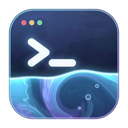
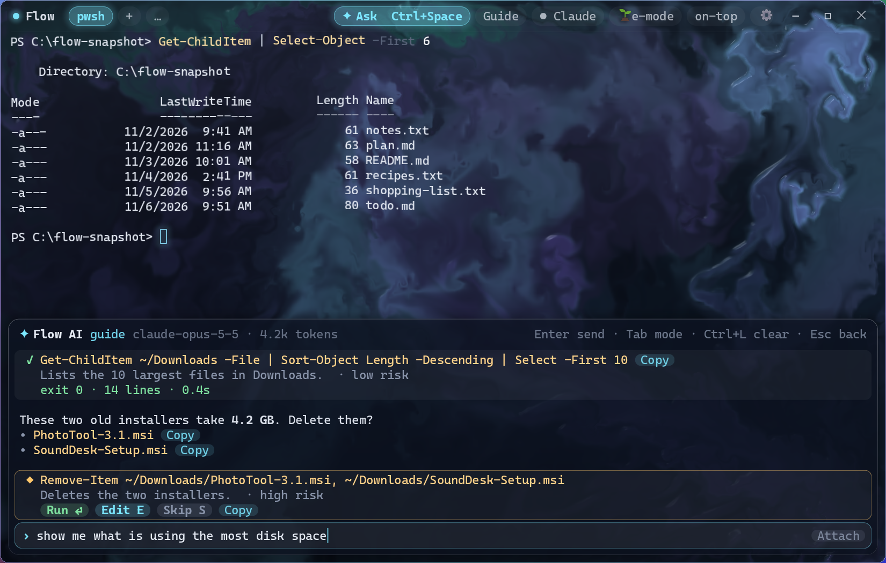
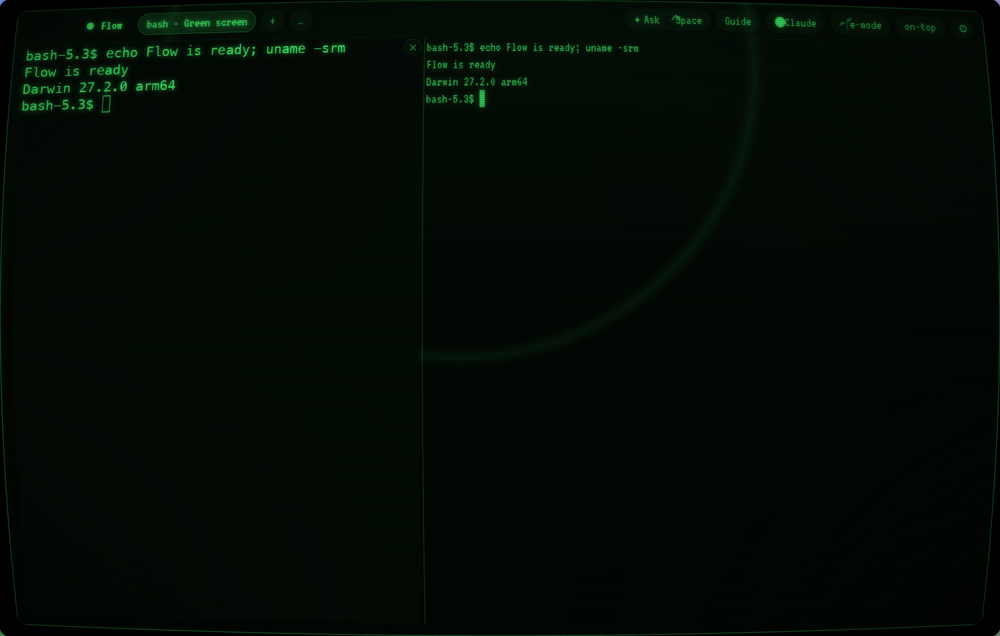
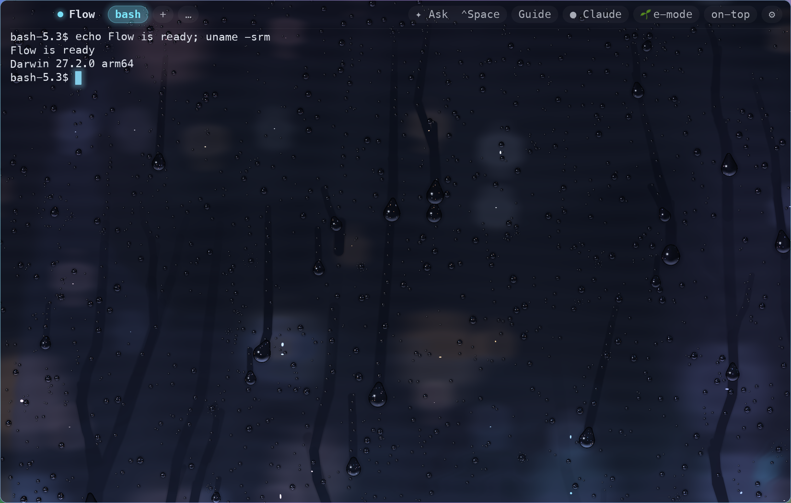
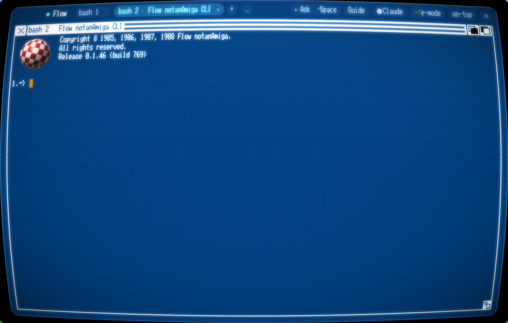
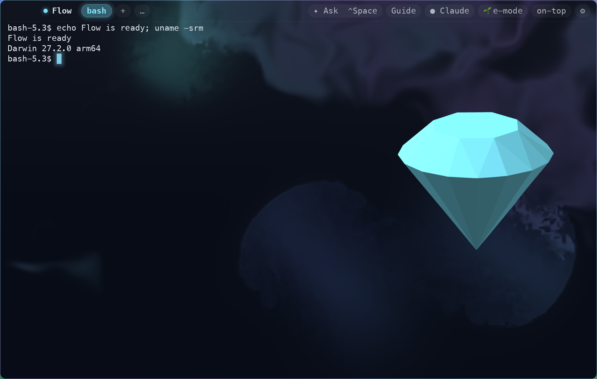
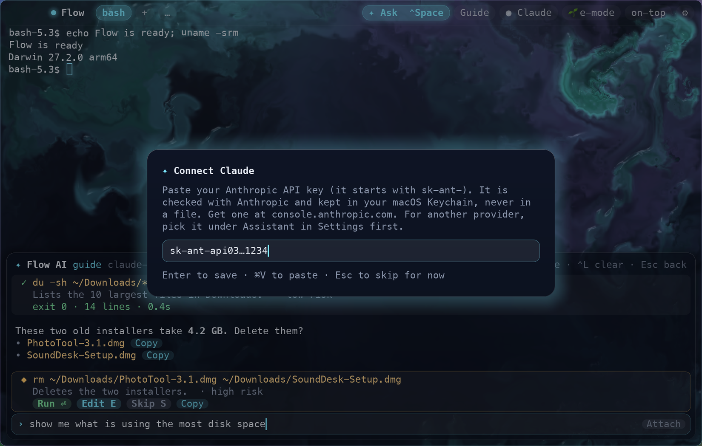

  

<h1 align="center">Flow</h1>

<i>A useful terminal emulator written in Rust with a liquid-glass look and Ai assistant (Claude, GPT or Gemini). One terminal across Linux, MacOS, and Windows (to rule them all).</i>

<table>
  <tr>
    <td align="center" width="180">
       
      <a href="https://github.com/arcanii/Flow-releases/releases/tag/v0.1.48-macos"><b>Download for macOS</b></a> 
      0.1.48
    </td>
    <td align="center" width="180">
       
      <a href="https://github.com/arcanii/Flow-releases/releases/latest"><b>Download for Windows</b></a> 
      0.1.48
    </td>
    <td align="center" width="180">
       
      <a href="https://github.com/arcanii/Flow-releases/releases/tag/v0.1.48-linux"><b>Download for Linux</b></a> 
      0.1.48
    </td>
  </tr>
</table>

  
  
  
  

  <a href="#install"><b>Download Flow</b></a> ·
  <a href="docs/manual/install.md"><b>Install</b></a> ·
  <a href="#documentation"><b>Documentation</b></a> ·
  <a href="CONTRIBUTING.md"><b>Contributing</b></a>

---

You can type commands as usual, or tell the assistant in your language what
you want done. It suggests the steps (guide mode) or runs them for you (auto
mode) in your real shell, where you can watch.

Programs can show pictures in it too: Flow speaks the [kitty graphics
protocol](docs/manual/images.md), so tools like `viu` and `timg` draw images right in the
terminal, and they ride the liquid and glow under the CRT like the text.

## Why Flow

The terminal is where you tell a computer what to do. Flow is built to
make it the best place on your computer to be: a window of live liquid
glass, an assistant that does the work beside you while you watch, and
the same terminal on Windows, macOS and Linux.

**Do you want a taste of [Omarchy](https://omarchy.org) without switching
everything over yet?** Omarchy, DHH's "beautiful, fun & agentic" Linux,
puts the keyboard, the terminal, good looks and AI agents at the heart of
the computer. Flow brings that way of working to the Windows, Mac or
Linux you already have, as one app:
- a theme for the whole window, chosen in one place;
- [split panes](docs/manual/terminal.md#split-panes), tiled and moved between with the keys;
- a [command palette](docs/manual/terminal.md#the-command-palette) that reaches everything;
- a hotkey that drops Flow down over whatever you're doing
  ([Settings](docs/manual/settings.md));
- [every key yours to change](docs/manual/keys.md#changing-flows-keys);
- an assistant in the window;
- [`flowapp`](docs/manual/flowapp.md), which installs terminal tools written again
  for Flow: `ls`, `tree`, `top`, `btop` and `du`, with pictures, bars and
  graphs.

When you're ready for the real thing, your habits come with you.

**Do you want AI to help manage your PC, so you don't have to?** Say what
you want in plain words: *"why is my disk full?"*, *"update everything
Homebrew installed"*, or *"what's listening on port 8080? stop it"*.
Flow's assistant works it out and runs it in your real shell, where you
see every command. It uses Claude, GPT or Gemini, with your own key.
- **[Guide mode](docs/manual/assistant.md#guide-and-auto-mode):** it waits for your yes at each
  step.
- **Auto mode:** it goes ahead by itself, but still asks before what
  it or Flow's rules see as risky: deleting, `sudo`, registry edits, or
  files that look like secrets (rules [by pattern](docs/manual/assistant.md#guide-and-auto-mode),
  not a sandbox).
- **When a command fails,** Flow offers **[✦ Ask why](docs/manual/assistant.md#ask-why)**.
- **It [remembers](docs/manual/assistant.md#memory)** what it learned and where a task got to, and
  carries on after a restart.
- **It can [work on its own](docs/manual/assistant.md#working-on-its-own)** for the time and
  tokens you give it.
- **`/undo`** puts back the files a task changed.
- **[MCP servers](docs/manual/assistant.md#mcp-servers)** let it reach your other tools.

**Do you want the nostalgia of the computers of yesteryear?** Put on one
of ten old machines' [themes](docs/manual/themes.md) and a tab becomes that machine:
- an 8-bit home computer on a television;
- a minicomputer's green or amber screen;
- a teletype typing its start screen at 300 baud;
- a British school's page of teletext;
- an eighties PC counting its memory as it starts;
- a workstation whose PROM probes your own computer's memory banks and
  buses;
- a 16-bit home computer that asks for its disk before its ball spins.

Each comes with its own fonts, start screen and prompt, and a
[CRT](docs/manual/liquid-styles.md#crt): curved glass, scanlines and a phosphor that lingers. Each
makes its own [sounds](docs/manual/sound.md): the tube's hum, the PC's fan, the
teletype's clack and bell, the floppy drive's seek (you can turn these off in Settings, as some of them can get annoying like they were on the old computers). Every tab, and every pane of a split, can wear a different one.

**Do you want to turn your boring terminal into something exciting?**
Flow's glass is a [live fluid](docs/manual/liquid-styles.md) that your cursor and typing
stir. Pick clouds with lightning, water seen from above or below, glossy
oil, or rain on a window that beads, runs and flashes with thunder in a
storm. [The glass reacts](docs/manual/liquid-styles.md#the-glass-reacts):
- a finished command splashes;
- a build's progress fills the glass like a tank;
- the liquid leans toward the assistant while it thinks;
- programs can ask for bolts and bursts of their own.

Programs show [pictures](docs/manual/images.md) (in kitty's, iTerm2's and sixel formats) and moving
[3D models](docs/manual/images.md#3d-models) right in the terminal, and the [games](docs/manual/games.md)
made for Flow install with one command. To share what you did,
[record it](docs/manual/terminal.md#recording-the-terminal) as an animated WebP.

**Do you want a terminal that does the everyday things well, and works
much the same on Windows, macOS and Linux?**
- **[Full-text search](docs/manual/terminal.md#command-history)** of every command you've run,
  in every shell, cmd included. Type any words in any order, or any three
  letters, and see the folder each one ran in and how it ended.
- **[Different shells in tabs](docs/manual/shells.md):**
  - on Windows, cmd, PowerShell and bash (Git Bash, MSYS2, WSL, or the
    BusyBox that comes with Flow);
  - on the Mac and Linux, zsh and bash.

  Any tab splits into [panes](docs/manual/terminal.md#split-panes).
- **One Flow on all three systems,** as far as each one allows: the same
  features, settings and config file, with `Ctrl+Shift` where the Mac
  has `⌘`.
- **[Find in the scrollback](docs/manual/terminal.md#find-in-the-scrollback),** with patterns
  if you like, and jumps from [command to command](docs/manual/terminal.md#scrolling-back).
- **The small things:**
  - links you can click;
  - a click that moves the cursor along the line you're typing;
  - a notification when a long command finishes behind other windows;
  - tabs that come back as you left them.

**And more:**
- **Safe by default.** Flow works as a terminal with no account and no
  key.
  - A key you add stays in the system's own credential store.
  - What looks like a secret is kept out of the command history and
    the assistant's memory.
  - Outside apps get in only when you let them.
  - Updates are signed on every system, and Flow refuses any that
    aren't.
- **Light when it needs to be.** **🌱e-mode** turns the show off in one
  click, and can turn it off by itself on battery ([Settings](docs/manual/settings.md)).
- **Open to everyone.** VoiceOver, Narrator and Orca read Flow's tabs,
  panes, assistant and Settings ([Accessibility](docs/manual/accessibility.md)). Its
  words come in English and Japanese.
- **Yours to build on.**
  - Programs reach Flow with escape codes and
    [its SDK](docs/manual/sdk.md) for C and Python, and change
    its settings with [`flow-settings`](docs/manual/from-the-shell.md#settings-from-the-shell).
  - Themes and [skills](docs/manual/assistant.md#your-instructions-and-skills) come as packages.
  - [Outside apps](docs/manual/outside-apps.md) such as Claude Code, Claude Desktop
    and Cursor can use your tabs through MCP, as far as you allow.
- **Native.** Flow is written in Rust and drawn on the GPU: an app of
  each system's own, not a web page in a window.

## A short tour

| | |
| --- | --- |
|  |  |
| A tab [split in two](docs/manual/terminal.md#split-panes), each pane in a theme of its own | [Rain on the window](docs/manual/liquid-styles.md), one of the liquid styles |
|  |  |
| One of the old machines' [themes](docs/manual/themes.md) | A [3D model](docs/manual/images.md#3d-models) in the terminal |

## Install

<table>
  <tr>
    <td align="center" width="180">
       
      <a href="https://github.com/arcanii/Flow-releases/releases/tag/v0.1.48-macos"><b>Download for macOS</b></a> 
      0.1.48
    </td>
    <td align="center" width="180">
       
      <a href="https://github.com/arcanii/Flow-releases/releases/latest"><b>Download for Windows</b></a> 
      0.1.48
    </td>
    <td align="center" width="180">
       
      <a href="https://github.com/arcanii/Flow-releases/releases/tag/v0.1.48-linux"><b>Download for Linux</b></a> 
      0.1.48
    </td>
  </tr>
</table>

- **Windows 10/11 (x64):** `Flow-<version>-setup.exe` from the [latest
  release](https://github.com/arcanii/Flow-releases/releases/latest), or the
  portable zip beside it.
- **macOS 11 or later:** `Flow-<version>-macos.dmg` from the newest `-macos`
  release on the [releases page](https://github.com/arcanii/Flow-releases/releases);
  drag Flow to Applications.
- **Linux (x86-64, Wayland or X11, glibc 2.31 or newer):** from the newest
  `-linux` release, `sudo apt install ./Flow-<version>-linux-amd64.deb` on
  Debian or Ubuntu, or unpack `Flow-<version>-linux-x86_64.tar.gz` and run its
  `install.sh` on any Linux.

Installed copies update themselves, and Flow refuses any update that isn't
signed with its key. [Install](docs/manual/install.md) has the details for each
system: SmartScreen, Sparkle, the GPU and sound Linux needs, and updating the
.deb through apt. To build Flow from its source, see
[CONTRIBUTING.md](CONTRIBUTING.md#building-and-testing).

## Getting started

Flow works as a terminal without any API key, and never asks for one on its
own. To use the assistant, open Settings (`Ctrl+,`, or `⌘,` on macOS; or click
**Add API key** in the title bar). Under Assistant, pick the **Provider**:
Anthropic's Claude, OpenAI's GPT or Google's Gemini. Then choose
**API key → Add key…** and paste that provider's key. It is checked with the
provider by a free call that lists the models, then stored in the OS credential
store: Windows Credential Manager, the macOS Keychain, or on Linux the Secret
Service (GNOME Keyring or KWallet). Each provider keeps its
own key, so switching back and forth asks only once; **Model**, under it,
picks the model, and so does `/model` in the panel. `ANTHROPIC_API_KEY`,
`OPENAI_API_KEY` and `GEMINI_API_KEY` in the environment take precedence if set.

Press `Ctrl+Space` (`⌃Space` on macOS) and say what you want, for example *"show me what is using
the most disk space"*. The assistant sees your OS, the active shell, the working
directory and the last 40 lines of the terminal. Keep that in mind if the
screen shows secrets.

## Documentation

**Using Flow**

- [Install](docs/manual/install.md): the downloads for Windows, macOS and
  Linux, what each needs, and how each updates.
- [Flow's keys](docs/manual/keys.md): every shortcut on each system, and
  changing them.
- [Working in the terminal](docs/manual/terminal.md): scrolling back, Caps
  Lock, split panes, the command palette, recording the terminal, find in
  the scrollback, the command history and help.
- [Settings](docs/manual/settings.md): every section of Settings, its
  search, preset files, Restart and efficient mode.
- [Themes](docs/manual/themes.md): Flow's look and ten old machines', Theme
  details, your own theme, saved themes and the theme gallery.
- [Liquid styles](docs/manual/liquid-styles.md): the glass's styles, the CRT,
  and how the glass reacts to commands, the assistant and programs.
- [Sound](docs/manual/sound.md): Flow's cues, effects' sounds, the bell and
  the machines' sounds.
- [Shells](docs/manual/shells.md): which shells Flow finds on each system,
  tabs, and the tabs that come back.
- [Accessibility](docs/manual/accessibility.md): VoiceOver, Narrator and
  Orca.
- [Configuration](docs/manual/configuration.md): `config.toml` and every key
  in it.
- [Version and updates](docs/manual/updates.md): About, version numbers and
  the updaters.

**The assistant**

- [The assistant](docs/manual/assistant.md): Ask why, guide and auto mode,
  where it works, files, your instructions and skills, MCP servers, helpers,
  working on its own, memory, and the token cap.
- [Outside apps: MCP](docs/manual/outside-apps.md): Claude Code, Claude
  Desktop or Cursor using Flow's tabs through `flow-mcp`.

**Programs and apps**

- [Images](docs/manual/images.md): kitty's, Sixel and iTerm2's pictures, and
  3D models.
- [From the shell](docs/manual/from-the-shell.md): `flow-settings`, and the
  `flow` command opening a tab from a tab.
- [Apps: flowapp](docs/manual/flowapp.md): installing Flow's apps, games and
  themes, and checking who signed them.
- [Building for Flow: the SDK](docs/manual/sdk.md): Flow-SDK for Rust, C and
  Python.
- [Games](docs/manual/games.md): Flow Rogue and Flow Mines, and installing
  them with `flowapp`.
- [Demos](docs/manual/demos.md): `flow-demo`.

**Developing Flow**

- [CONTRIBUTING.md](CONTRIBUTING.md): building, testing, the house style,
  issues and pull requests.
- [SECURITY.md](SECURITY.md): reporting a security hole, and what Flow
  guards.
- [Code of conduct](CODE_OF_CONDUCT.md): how we treat each other, and
  reporting what breaks it.
- [How it is built](docs/how-it-is-built.md): the workspace, its crates and
  what each holds.
- [Development](docs/development.md): tests, snapshots and recordings,
  adding a language, the Mac's app bundle, the Linux release and the icon.
- [Status](docs/status.md): what has been tested on each system.
- [Designs](docs/design/): the plans agreed for features before they were
  built.
- [BACKLOG.md](BACKLOG.md): what's planned next.
- Releasing: [Windows](windows/RELEASING.md), [macOS](macos/RELEASING.md)
  and [Linux](linux/RELEASING.md).

## License

Flow is licensed under the [MIT License](LICENSE). The fonts, logos and
pictures it carries under `assets/` keep their own licenses and owners:
[`assets/fonts/NOTICES.txt`](assets/fonts/NOTICES.txt),
[`assets/logos/README.md`](assets/logos/README.md) and Trademarks, below.
So do the programs in `windows/third_party/`: BusyBox under the GPL,
version 2 ([its README](windows/third_party/busybox/README.md)), and
WinSparkle under the MIT License
([`COPYING`](windows/third_party/winsparkle/COPYING)).
The crates it's built from are listed with their licenses in each
release's THIRD-PARTY-NOTICES.txt.

Flow's name, its icon and its startup logo aren't covered by the MIT
License: they're arcanii's marks, under
[Flow's brand license](docs/brand/LICENSE-brand.txt). A fork kept pristine
(an unchanged copy, or kept only to propose changes back here) keeps them;
any other fork that's released or handed on takes a name, an icon and an
identity of its own ([Forks](CONTRIBUTING.md#forks)).

## Trademarks

Flow shows other companies' logos for its startup logo and its old machines'
themes, as a historical showcase; they belong to their owners, and
[Trademarks](docs/trademarks.md) names each one. The download links carry
Apple's, Microsoft's and Linux's own logos (Linux's is Tux) only to show which
system each download is for.
