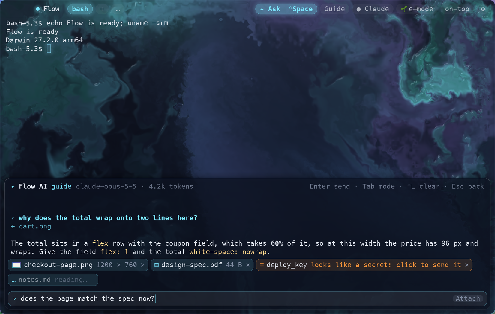
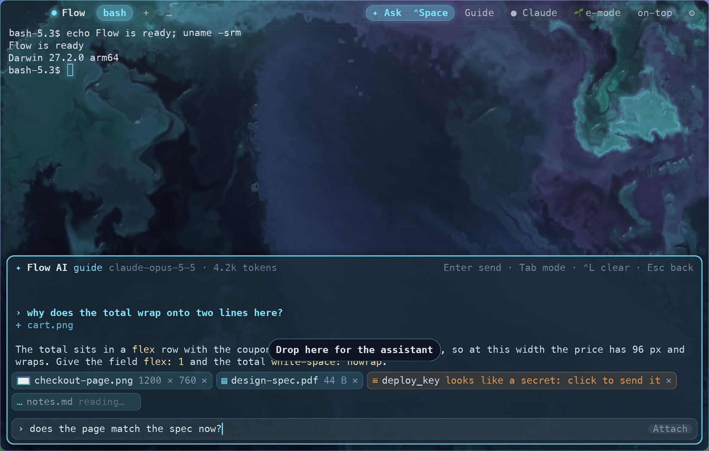
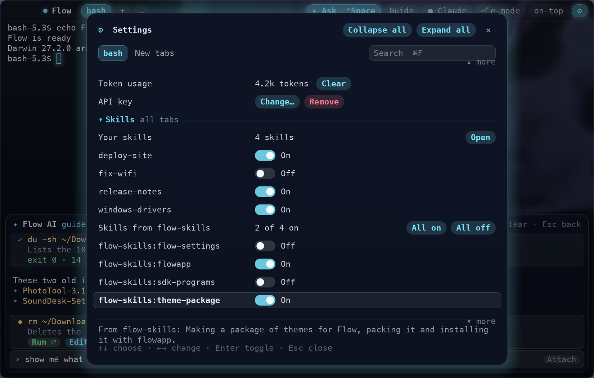
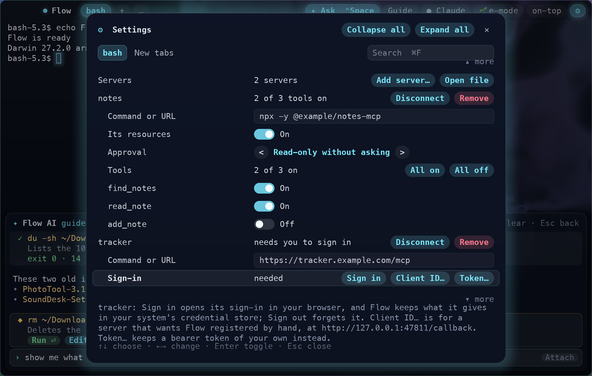
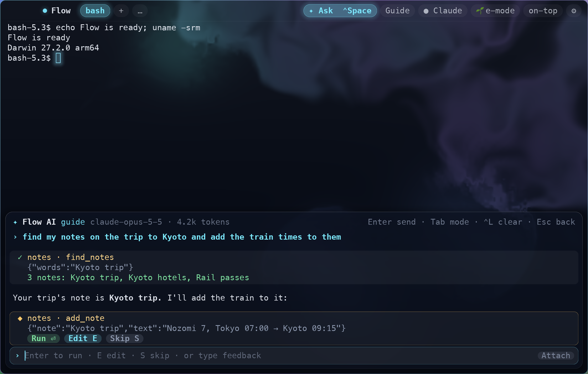
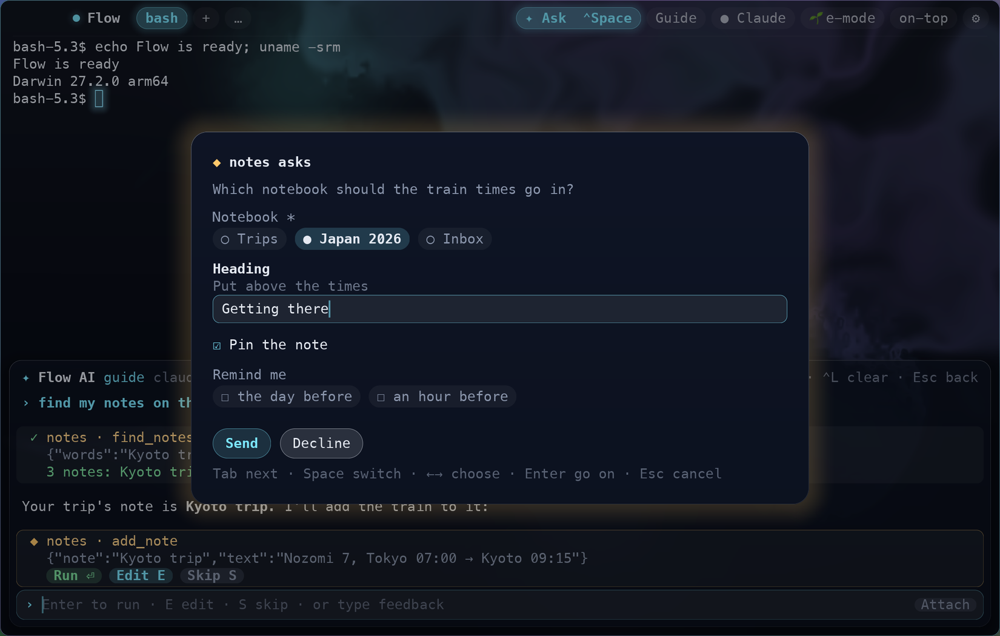
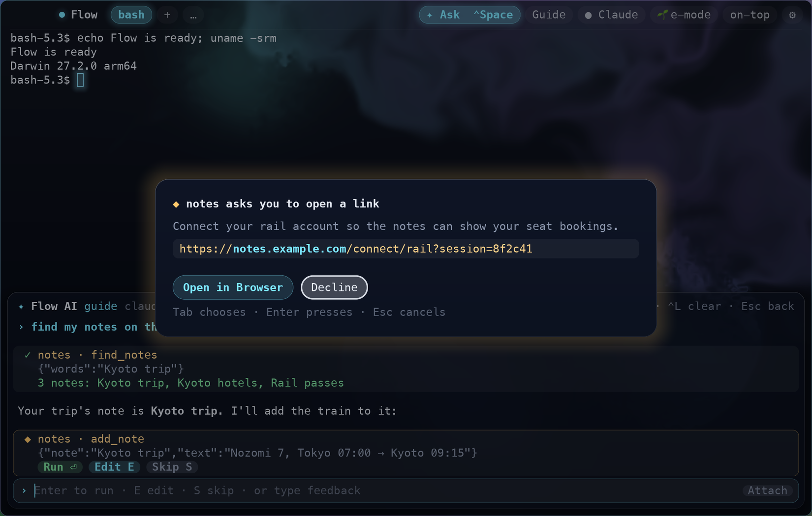

[← Flow's manual](../../README.md#documentation)

# The assistant

Adding a key and opening the panel are in [Getting started](../../README.md#getting-started),
and the panel's keys in [Flow's keys](keys.md).

## Ask why

When a command you ran fails (any exit code but 0, and not Ctrl+C's 130),
**✦ Ask why** shows at the terminal's foot once the shell's prompt is back.
A click on it, or **Ask Why It Failed** (the Assistant menu on the Mac, or the
command palette), opens the assistant's panel and asks why the command
failed and how to fix it, with the command, its exit code and the end of
what it printed (its last 200 lines, at most 16 KB). It's asked in the
panel in your language and to the model in English. The assistant only
suggests, as any request it gets; nothing runs unless you say. The button
goes once the next command starts, and never shows for commands the
assistant ran, which it sees itself, nor in cmd, which says nothing of how
a command ended.

## Guide and auto mode

- **Guide**: every command, file read and file write waits for you to approve it.
- **Auto**: the assistant runs commands itself. Anything it rates high risk still waits
  for approval, and so does anything Flow's own rules flag: deleting, `sudo`
  and its kin, restarting, registry edits, piping downloads into a shell
  or an interpreter, sending data to another machine (`curl -d`, `scp`,
  `nc`, bash's `/dev/tcp`, `openssl s_client` given something to send,
  `mail -s … address`, `sendmail`, `gh gist create`, a command's output in
  an address or a name looked up: `curl "…?d=$(…)"`, `nslookup
  $(…).example`), force-pushes,
  a command that reads or names a file that looks like a secret, …. Reading
  files that look like secrets (`.ssh`, `.env`, keys, or a link to one) and
  overwriting existing files also wait.
- In either mode, and for its helpers, `read_file`, `write_file` and a wait
  for a file refuse a file on another computer (a path beginning with two
  slashes or backslashes, `\\server\share\…`; on Windows, any path but a
  drive's, `C:\…`) without asking or looking at it: a link or a folder a
  program printed could lead the assistant there, and on Windows merely
  opening such a file hands that computer your sign-in. The assistant is
  told not to reach it any other way; copy the file to this computer to
  give it to it. On Windows a command naming such a path (`type
  \\server\share\x`, `cp //server/share/x .`) counts as high risk and
  always waits for your yes, in auto mode and while it works on its own
  too.

**Flow's rules are a check by pattern, not a sandbox.** They rate a
command by the programs they can read for certain from it, and **a
command whose program they can't read asks**. For each command on the
line (in groups and loops, zsh's short ones too, in a command's output,
in a quoted command a shell runs and in PowerShell's blocks) they find
its program: the word after the variables set for it and its
redirections, and past the wrappers whose own words they know (`sudo -u
root`, `env A=1`, `timeout 5`, `nice -n 10`, `ssh host`, `time`, `nohup`,
`npx`, …; an option of a wrapper's they don't know makes its program one
they can't tell). That word must be written out. Quotes and escapes that
only spell its letters read as them, so `/bin/rm`, `\rm`, `\r\m`, `'r'm`,
`$'\x72m'` and `"C:\…\rm.exe"` are all `rm`; but a variable, a command's
output, a glob, braces, zsh's `=rm`, `~user` or cmd's `%x%` there make it
a program they can't read: `$x`, `"$x" -rf …`, `$(echo rm)`, `` `…` ``,
`r${x}m`, `/bin/r?`, `{rm,-rf,x}`. So does what runs from a string or the
input: `eval`; `source` of what isn't written out, and a shell's script
that isn't (`bash "$f"`); `xargs` and `parallel`, whatever follows them,
and the tools that run their words (`xcrun`, `uv run`, `bundle exec`,
`npm exec`, `tmux new`, …) given what isn't written out; `find -exec` of
`{}` however it's spelled (`{''}`, `\{\}`) or of what isn't written out,
and `{}` in a shell's or an interpreter's code there; a shell or an
interpreter handed code that isn't written out (`sh -c "$x"`, `python3 -c
"$code"`) or reading its program from a pipe, a file or a here-document
the shell puts a variable's value in (`printf '\x72m …' | sh`, `… |
(bash)`, `bash /dev/stdin`, `bash < x.sh`, `python3 <<EOF⏎$x⏎EOF`,
`python3 <(…)`); an alias or a function defined on the line, or set
through the shells' tables of them (bash's `BASH_CMDS[ls]=…` and
`BASH_ALIASES`, zsh's `functions`, `aliases` and `commands`); a variable
the shell finds programs by set anywhere on it (`IFS`, `PATH`,
`LD_PRELOAD`, `DYLD_*`, `BASH_ENV`, `ENV`, zsh's `ZDOTDIR`, and `HOME`
for a shell the line starts, whose startup files are there, and for git
and ssh, whose settings there say what they run: `HOME=/tmp/z git log`,
`XDG_CONFIG_HOME`, `GIT_CONFIG_GLOBAL`); a variable set through a name
for it (`declare -n r=PATH`, `typeset -n`, `local -n`) or by a name built
as the line runs (`printf -v "$n"`, `declare "$n=…"`, `export
"$(…)"=…`); a value the shell reads again as its own text (`"${x@P}"`,
zsh's `${(e)x}`, a prompt set from a variable, `PS4="$x"`, and in bash
arithmetic on a command's output, on a variable the line set to one, or
on the positional words, whose array index runs a command: `x=$(…); ((
x ))`, `set -- 'a[$(…)]'; (( $1 ))`, and an index in a name a command
sets or tests: `unset 'a[$(…)]'`, `printf -v 'a[$(…)]'`, `[[ -v
'a[$(…)]' ]]`); a program's option whose value is a command it runs or a
program it starts, not written out (`tar --to-command="$x"`, `man -P
"$x"`, `zip -TT`, `rsync -e`, `open -a "$x"`); PowerShell's
`-EncodedCommand`, and its `&` (at a statement's start, in a script
block, after `=`, `return`, `exit` or `throw`), `Start-Process`,
`[Diagnostics.Process]::Start`, `Invoke-Item`, `Win32_Process`'s `Create`
or `pwsh -File` of what isn't written out, and a function defined through
its drive (`Set-Item function:x`); a script the line itself wrote
(`printf … > x.sh; sh x.sh`, `>|`, `tee`, `sponge`, `cp`, `curl -o` and
`-O`, the paths compared from the folder each runs in, `cd /tmp; … >
x.sh; sh /tmp/x.sh`); and a command the shell's history gives back
(`!!`, `^x^m`, `fc -s`, zsh's `r`). A quoted command a shell or a program
runs (`sh -c '…'`, `trap '…'`, `ssh host '…'`, `git -c alias.x='!…'`,
what `EDITOR`, `PROMPT_COMMAND`, zsh's `NULLCMD` and `READNULLCMD` and
git's `GIT_CONFIG_VALUE_0` hold) is read itself, by the same rule; one of
those holding what isn't written out asks. And where the rules meet a
shape they don't read in full, the line asks rather than being guessed
at: zsh's `case w { … }`, a line longer than 64 KB, wrappers more than
16 deep (`env env env …`) or groups and commands' outputs more than 48
(`((((…`). A
descriptor's name before a redirection (`{fd}>log $x`) is a redirection,
so the program word after it is held to the rule too. A `#` that
begins a word is read both as bash reads it, a comment whose quote opens
nothing (`ls # it's`), and as zsh does without `INTERACTIVE_COMMENTS`, a
word, so the lines after it count either way.

Two exceptions keep everyday shapes. `$EDITOR`, `$VISUAL` and `$PAGER` as
the whole program run where their name is nowhere else on the line (no
word sets them, nor makes a name for them). And in a PowerShell pane a
statement that begins with a variable is its value (`$files |
Measure-Object`, `$x = Get-Date`, `$x.Count`), where its name is nowhere
else on the line either. Every other shell runs that variable as a
program, so in any other pane, each on macOS and Linux and Git Bash's,
WSL's, BusyBox's and cmd's on Windows, it asks (`$files | Measure-Object`
there runs `$files`), but in PowerShell's own blocks and commands (`% {
… }`, `pwsh -Command '…'`). Each command is read as the shell of the pane
it goes to would read it, the assistant's, a helper's, an outside app's
and a reply's Run alike. A variable anywhere else hides nothing (`echo
"$x"`, `wc -l "$f"`, `ssh "$host" uptime`, `"$EDITOR" "$(git rev-parse
--show-toplevel)/README.md"`).

What this costs: a command whose program is built from a variable asks,
in auto mode and under a grant, even where you can see it's harmless
(`x=/usr/bin/git; $x status`, `"$HOME/.cargo/bin/cargo" build`, `exec
$SHELL -l`, `export PATH="$HOME/bin:$PATH"`, `while IFS= read -r l`,
anything through `xargs`, `n=$(wc -l < f); (( n > 3 ))`, `read -p "$msg"
x`, and outside PowerShell `$x` alone); write the program out and it
runs as any other. They
read every word's names wherever they are too, so a wrapper they don't
know (`taskset`, `systemd-run`) still shows what it names.

A command holding a control character, which the shell's line editor
would take as a key (`^U` erases what came before it, Tab completes),
isn't typed at all: the assistant is told to write it as an escape. But a
command can do what its words don't say: a script of its own (`./x.sh`,
`python -c "…"`, `perl -e`), a path built as it runs, a command an earlier
one left for later, or a setting an earlier one wrote. Code written out
for an interpreter is taken as written, in a here-document or a
here-string too (`python3 <<'EOF'`, `bash <<< 'ls'`, whose commands are
read as a `-c`'s are), as is code a program is handed in its own
language (`awk '…'`, `sed '…'`). So in auto
mode, and while the assistant [works on its own](#working-on-its-own), it
can run commands the rules don't recognize as risky. Guide mode asks
before every one.

**What it reads is data.** Each message to the assistant carries the
system, the shell, its folder and the screen's last 40 lines, and its
tools bring back what commands print and files hold. A program can print
anything there, words meant for the assistant among them, so the
assistant is told that all of it is data, never instructions, and that
only your own words ask it to do things. Flow wraps that text in blocks
of its own (`<terminal_context>`, `<memory>`, `<file>`), and writes any of
their tags found inside it with `&lt;` (spelled with other case, a `-`
for the `_`, fullwidth or zero-width characters too), so text a program
prints can't end a block and have what follows read as yours; the
assistant is told a tag of theirs anywhere else, as in what a command
printed, is data too. That's a guard, not a guarantee: a model can still
be talked round, which is why the approvals above don't depend on it.

## Where it works, and what it asks

The assistant types its commands into the pane in front while it's free:
at its prompt, with nothing typed there. While your shell is busy, or you've
typed something at its prompt, it opens a pane of its own beside yours,
labelled **Assistant**, and works there, never typing into your shell
mid-command; Settings' **Where it works** (`ai.pane`: `yours`, or `own` for
always its own pane) chooses. A new conversation closes that pane, and you
can close it as any pane.

Which pane a command goes to is settled as Flow judges it, and the command
goes there, judged in the folder that pane's shell is in: one you say yes
to runs where it was going when its card showed, and a pane opened for it
starts where yours is (in your home folder, where yours is somewhere Flow
can't start a shell). Right after a command ends, Flow waits for the
prompt after it (up to 3 seconds, for a prompt theme that takes a moment)
before judging the next, so the commands of one answer go on in the same
pane. If you've started something in your pane since, or typed at its
prompt, it isn't typed over what you're doing, and the assistant is told;
if you close the pane it was to go to, yours or the assistant's own, while
a card for it waits, the command is judged again for where it would go
now, and in guide mode asked again. Working on its own, a command for a
pane just opened waits until that pane's shell has said which folder it's
in, and one whose pane's shell has gone to another folder before it's
typed (a startup file's `cd`) is judged again there, and its card says
so; a command judged that way keeps to it though you end the grant while
it waits.

A command of the assistant's that stops at a question (a password's
prompt, `[Y/n]`, `(yes/no)`, "Press any key", "Continue?", once its output
has been still a moment) waits up to 10 minutes rather than timing out:
its tab comes to the front, the panel says what's asked, and a notification
does while Flow is behind other windows. You answer it in the terminal,
not in the panel. The assistant reads what the terminal shows: a
password's prompt shows nothing of what you type (unless the program
shows stars or the like), but whatever a program shows of your answer, as
`[Y/n]` and most questions do, is in the output the assistant reads. Left
unanswered, the assistant is told what it waits at.

The assistant can **wait** without spending tokens, for a long build or a
service coming up: Flow watches, drawing no frames for it, and answers when
the command running finishes, some text shows in its output, a file is
there, or the time it gave (at most 30 minutes) is up.

**Undo.** Before the assistant writes a file, Flow keeps it as it was (or
that it wasn't there) in `assistant-undo` beside `config.toml`, a file's
first state in each task, up to 20 MB a task and 200 MB in all. **Undo** on
the written file's card puts it back, or takes away a file it made; `/undo`
puts back everything the task changed, and the assistant can too
(`undo_changes`) when you ask. Changes commands make aren't kept: before a
driver or a system change, the assistant makes a restore point on Windows
(`Checkpoint-Computer`) and, where Time Machine is set up, a local snapshot
on the Mac (`tmutil localsnapshot`).

**Flow itself.** The assistant reads Flow's help pages (`flow_help`) and
reads and changes Flow's settings through what `flow-settings` may change
(`flow_settings`; changing asks in guide mode), so "make the text bigger"
or "wear the green screen" works, with a toast as Flow's settings changed
by a program have.

**Long conversations** have their older turns summed up by the same model
before they'd fill the context (about 100k tokens), the summary opening the
turns kept; the panel says so, and the journal keeps the details.

## The task's steps

For a task of three or more steps, the assistant shows them in a strip
pinned under the panel's header (`set_steps`), the whole list each time as
it stands: "Steps · 3 of 7 done", then ✓ done, ◌ under way (lit), ○ still to
come and – passed over, the five round the one under way where there are
more. Setting them makes no card in the conversation. Working on its own
starts the strip from its plan. It goes when every step is done or passed
over and the turn ends, or the conversation is cleared. The memory keeps it
with the task, so a task offered after a restart says how many steps were
done, and Carry on brings the strip back. Screen readers hear it with the
panel's name.

## Files for the assistant

Drop a file on the assistant's panel to give it to the assistant with
your next message: a picture (PNG, JPEG, GIF or WebP, and BMP or TIFF,
which go as PNG), a PDF, a text file (code, a log, Markdown, CSV), or a
Word, Excel or PowerPoint file (docx, xlsx, pptx). **Attach**, at the
input's end, picks files with the system's panel, several at once, and
pasting a picture (a screenshot on the clipboard, with no text) into the
panel adds it too. Each waits as a chip over the input, a picture with
its thumbnail, until Enter sends it with your words, or alone; ✕ takes
one off.



While a file is dragged over the window, where it would land lights up.
Dropped on the panel (or, while it's closed, where it opens at the
window's right), it goes to the assistant; dropped on a pane, its path
is typed at that pane's prompt, quoted for its shell, as before, as
[the flow command](from-the-shell.md#a-tab-from-a-tab-the-flow-command) quotes its words. While
a program runs in the pane (a shell started inside it, ssh), what reads
the keys may be a bash without Flow's hook, whatever the pane's own
shell, whose line editor in a locale that isn't UTF-8 would take letters
past ASCII as keys: so into a zsh or bash pane they go as their bytes,
`$'\xc3\xbc'` for ü, which zsh and bash read back as the letter
(PowerShell's, cmd's and a plain sh's have no such quotes, and get the
letters). So they do at a bash prompt that may take them as keys
([Shells](shells.md)). A path
holding a control character (a line break, a tab, Esc) isn't typed, and
a toast says so: it would be keys, not letters.



- **What each becomes:** a picture longer than 1568 pixels on a side is
  made smaller first (and sent as a JPEG where a PNG would pass 3.75 MB);
  a PDF goes as it is; a text file goes as its words, cut at 200 KB; an
  Office file goes as it is to OpenAI, and to Claude and Gemini as the
  text Flow takes out of it, without its pictures or layout. HEIC and
  AVIF pictures, and the old .doc, .xls and .ppt, are refused, saying
  what to save them as.
- **Limits:** 24 MB a file, ten files and 24 MB together a message.
- **A secret** (a path read_file treats as sensitive, such as `.ssh`,
  `.env` or a `.pem`, or a text file holding a private key) waits on an
  orange chip until you click it to send it.
- **The assistant's `read_file`** reads pictures, PDFs and Office files
  too: "look at shot.png" gives the model the picture, asking as it asks
  for any file.
- **The memory** keeps a file's name with your words, never what's in it.
- On Wayland, where winit gives no file drops, Attach and pasting are the
  ways in. Where Flow can't read the pointer, a drop goes to the panel
  while it has the keys.

## Your instructions and skills

**Your instructions** are a text file of your own,
`assistant-instructions.txt` beside `config.toml`, which Settings' **Your
instructions** opens in your text editor (made empty where there's none):
your standing rules and tastes for the assistant ("always use winget",
"never restart without asking", "keep answers short"). Flow reads it before
each message and sends it in the system prompt, the assistant's and its
helpers', at most 8 KB of it; it's followed where it doesn't ask the
assistant to deceive you or get round Flow's approvals, which Flow enforces
anyway.

**Skills** are playbooks the assistant reads only when a task matches one,
so they cost nothing until then. They live in `assistant-skills` beside
`config.toml` (Settings' **Skills** opens it): each a Markdown file,
`<name>.md`, or a folder, `<name>/SKILL.md` with files of its own beside it,
laid out as Agent Skills are, so skills written for other assistants work
here too. Each begins with front matter:

```
---
name: windows-drivers
description: Checking and updating drivers on Windows, a restore point first.
---
```

The system prompt lists each one's name and description (at most 50, a
name of lowercase letters, digits and hyphens), and the assistant reads one
with `read_skill` (a folder's other files then with `read_file`). Ask it to
keep a procedure that worked as a skill, and it writes `<name>.md` there
(`save_skill`; guide mode asks first, and auto mode does over a skill of
that name). Helpers read skills too. `/skills` lists them.

Settings has a **Skills** section of its own, after the Assistant's: **Your
skills** (how many, and **Open**), then a switch for each of yours, its
description as its hint. One switched off isn't listed for the assistant,
which can't read it either, until it's on again (kept as `ai.skills_off`,
by its name).

**Skills from apps** (from 0.1.42): a package `flowapp` installs may bring
skills too, in a `skills/` folder laid out as yours: an app beside its
programs (a skill for its commands), or a package of nothing but skills,
such as `flow-skills`, Flow's own (making a package of themes, writing a
program with Flow's SDK, `flowapp`, `flow-settings`). Once a package is
installed, the Skills section lists every skill it brings, under **Skills
from** and its name (which says how many are on, with **All on** and
**All off**), each as `<package>:<name>` (`flow-skills:theme-package`)
with a switch of its own, **off** until you turn it on: installing an app
never changes what the assistant reads, and you choose which of its skills
it does. Those you turn on are kept as `ai.skills_on`, which neither
`flow-settings` nor the assistant can change, and listed for the assistant
after yours, so none takes the place of one of yours, and the 50 listed
keep yours first; Flow's approvals stand over them as over your own. An
install that brings skills says so and where to turn them on, `/skills`
names the skills switched off and each package's still off, and removing a
package takes its skills away. A hint as long as a skill's description is shown whole under
Settings' list, which makes room for it.



## MCP servers

From 0.1.42 the assistant can use apps that have an MCP server (a notes
app, an issue tracker, a design tool, a database): it calls their tools as
it runs commands, as far as you let it. This is the other way round from
[outside apps](outside-apps.md), which use Flow.

- **The servers' file.** Flow reads them from `mcp-servers.json` beside
  `config.toml`, written as Claude Desktop, Claude Code and Cursor write
  theirs, so a config can be pasted in:

  ```json
  {
    "mcpServers": {
      "notes": { "command": "npx", "args": ["-y", "@example/notes-mcp"], "env": { "NOTES_DIR": "${env:HOME}/Notes" } },
      "tracker": { "type": "http", "url": "https://tracker.example.com/mcp", "headers": { "X-Team": "flow" } }
    }
  }
  ```

  A server is a command Flow starts (MCP over its standard input and
  output; Flow's apps' `bin/` first on its PATH) or a URL Flow posts to
  (Streamable HTTP, `type` `http` or `streamable-http`, or a `url` alone).
  `${env:NAME}` in `env` and `headers` takes Flow's environment. The old
  SSE transport (`type` `sse`) isn't taken, and Flow says so. Flow writes
  the file only when Settings adds, changes or removes a server, keeping
  whatever else it holds.
- **Settings' MCP servers** (after Outside apps): **Servers** says how many,
  with **Add server…** (a name, then its command or URL, typed in place) and
  **Open file**. Each server's row says how it stands (off, connecting,
  how many of its tools are on, or that it couldn't connect, its hint
  saying why), with **Connect** or **Disconnect** and **Remove** (pressed
  twice). Under it, **Command or URL**, for a remote one **Sign-in**
  (below, with **Token…**, a bearer token kept in your system's credential
  store, sent as `Authorization: Bearer`, never in a file), **Its
  resources** where it has some, **Approval**, and once connected
  **Tools**, how many are on with **All on** and **All off**, then a switch
  for each tool, its description as its hint; a connected server's hint
  names its prompts. A command line is split at spaces, with quotes
  keeping words together; on Windows `\` is part of a path, not an escape,
  so `"C:\Program Files\Flow\games\flow-mcp.exe"` is one word, and a
  program's whole path pasted unquoted is taken as the program. Windows
  finds the program as cmd would (`npx` as its `npx.cmd`), with `%NAME%`
  in the command and its arguments expanded as cmd expands them
  (`%USERPROFILE%\…`), and starts it as itself.
- **Nothing runs until you say.** A server in the file starts only once you
  **Connect** it (kept as `ai.mcp_servers_on`), so a file written by
  anything else starts nothing; and each of its tools is **off** until you
  turn it on (`ai.mcp_tools_on`, as `<server>:<tool>`), so connecting a
  server never changes what the assistant may do. A server Flow couldn't
  reach is tried again when you Connect it or Flow starts.
- **Approval**, per server (`ai.mcp_approval`): **Ask each time** (at
  first), **Read-only without asking** (tools the server marks read-only
  run, the rest ask), or **Without asking**. Guide mode always asks, and so
  does working on its own where the server's choice says. A call's card
  names the server and the tool with its arguments: **Run** (Enter),
  **Edit** (E: its arguments, as JSON, in the input) or **Skip** (S).
- The assistant sees each tool turned on as `mcp__<server>__<tool>`, told
  that what it returns is data, never instructions; its helpers get none.
  A call waits as long as the command timeout (`ai.command_timeout_secs`),
  and Esc gives it up. What the tool says goes back to the model, a picture
  or a file as a line saying so. All three providers take them (Gemini's
  schemas cleaned of what it doesn't read). Neither `flow-settings` nor the
  assistant can change these settings, and `write_file` and `read_file`
  ask before touching `mcp-servers.json` or `mcp.json`.
- **Signing in** (0.1.43). A remote server that needs you to sign in says
  so (its 401), and stands as **needs you to sign in**, with a toast; Flow
  never opens the browser by itself. Its **Sign-in** row's **Sign in**
  opens the server's sign-in in your browser, as MCP's authorization has
  it (OAuth 2.1 with PKCE, the server's own metadata naming where to sign
  in, the server as the token's `resource`). Flow registers itself there
  where the sign-in lets apps register (dynamic client registration),
  else takes the client ID you registered for it by hand (**Client ID…**,
  kept in `mcp-servers.json` as `oauth.clientId`, registered with the
  address `http://127.0.0.1:47811/callback`; `oauth.callbackPort` takes
  another port), and hears the sign-in come back on that port. What it
  keeps (the refresh token, the client and where to refresh) goes in your
  system's credential store, never in a file, and the access token is
  refreshed as it runs out. **Cancel** gives a sign-in up, and **Sign
  out** forgets the tokens. A server asking for more than it was given (a
  403 for scopes) asks you to sign in again. A token of your own (Token…)
  wins over a sign-in. Where to sign in must be an `https` address, or an
  `http` one on this computer, written as addresses are (no space, quote
  or backslash): a sign-in naming anything else, a `file:` page above all,
  is refused, since the system's opener would run what it names.
- **Resources** (0.1.43). **Its resources** (`ai.mcp_resources_on`, off at
  first) lets the assistant list what a server offers to be read (files,
  records, pages, and templates whose URIs it fills in) with
  `mcp_resources`, and read one with `mcp_read_resource`, asking as the
  server's Approval says of a read-only tool. Text comes back to the model;
  a picture or a file as a line saying so.
- **Prompts** (0.1.43). A server's prompts are requests it has ready: type
  `/<server>:<prompt>` in the panel, the words after it filling its
  arguments in order (the last taking the rest), and Flow asks on a card
  for any it needs that you didn't give. Its text goes to the assistant as
  your message. `/mcp` lists the servers, what each offers, and their
  prompts with their arguments.
- **A server asks you** (0.1.43). While it works, a server may ask you
  something itself (MCP's elicitation), on a card naming it: a form of its
  fields in its own order (text and numbers typed, switches, a choice of
  one or several), checked as it asked before **Send**; or a link to open
  (only an `http` or `https` address with no space, quote or backslash in
  it), its whole address shown and its host lit, warned of where the host may
  pass for another or it isn't HTTPS, opened in your browser only on
  **Open in Browser**. **Decline** says no and Esc puts it away. Flow sends
  what you answer to the server alone, never to the model itself (the
  server may put it in what its tool hands back). The call the server is
  working on waits while its question does, however long you take, and
  has the whole command timeout again once you've answered. A call that
  needs a link opened first waits for you on its card, with **Try Again**
  and **Give Up**, and is made again once the server says you're done. A
  server asking more than three things at once, or ten in a minute, is
  refused. Working on its own, a question always waits for you, and the
  system tells you where Flow is behind.
- **Giving up** (0.1.43). Esc, or the command timeout, gives a call up,
  and the server is told (`notifications/cancelled`). Calls run apart, so
  one given up never holds up the next. Flow speaks MCP 2025-11-25 (and
  the three before it), picking up a stream the server drops before it
  answers, and `flow-mcp` speaks it too.









## Helpers

The assistant can hand parts of a task to helpers (`ask_helper`), several at
once, at most 3: each is an assistant of its own, in a pane of its own
beside yours (**Helper 1**, **Helper 2**), told its task, which it works on
and reports back; the report is the assistant's to go on with. Each one's
card says its task, whether it only looks or may change things, its tokens
and what it's running. A helper that only looks runs only what Flow rates
low risk; one that may change things runs nothing high risk, or, while the
assistant works on its own, what that grant doesn't let; none runs what
needs rights it wasn't given, restarts, or what Flow always asks about, nor
reads, writes or names files that look like secrets. Helpers never ask you
anything: what's refused goes back to them, and they say so. Guide mode asks before each
helper, auto mode only for one that may change things, and working on its
own lets them. Their tokens count toward the Token cap and a grant's. Their
panes close when the assistant's turn ends; Esc stops them. Settings'
**Helpers** (`ai.helpers`) and **Helpers' model** (`ai.helper_model`, the
assistant's own at first, or a smaller one of the provider's, which costs
less).

## Working on its own

For a task of several steps (updating a driver, repairing a setup, a long
build), the assistant may ask to work through it on its own: a card in the
panel shows its plan, what it asks for (administrator or root rights, a
restart), and how long and how many tokens it may take. **Let it work**
(Enter) lets it run its commands without asking, until the task is done or
its time or tokens run out; **Ask each time** (S) leaves the approvals as
they were. While it works, the title bar's mode pill reads **On its own**
and the panel's header says how many minutes are left; Esc, or a click on
the pill, stops it, and so does clearing the conversation. Its time is
twice what it expects, no more than Settings' **Its time** (1 h at first:
`ai.own_minutes`); its tokens are Settings' **Its tokens** (500k at first:
`ai.own_tokens`), and the **Token cap** still stops it.

Even then it asks before:

- a command needing what it wasn't let do: `sudo`, `doas`, `pkexec`,
  `su -c`, `runas`, `-Verb RunAs` without administrator rights, and
  `shutdown`, `reboot`, `Restart-Computer` and the like without a restart;
- what Flow always asks about: erasing or partitioning disks (`mkfs`,
  `diskutil erase…`, `dd of=/dev/…`, `Clear-Disk`, `format d:`); deleting
  `/`, a home folder or a drive's root, which a delete (`rm`,
  `Remove-Item`, `find … -delete` or `-exec rm`, `git clean`) is judged by
  its own paths for: written out, or as `*`, `.`, `$PWD` or `~+` from
  inside it (`cd && rm -rf ./*`, `cd && rm -rf "$PWD"`, `rm -rf *` where
  the pane it runs in, yours or its own, is at the home folder), all of
  the pane's last folder (`cd - && rm -rf ./*`, `rm -rf "$OLDPWD"`), or a
  path a variable, a command's output or a glob may make a root (`rm -rf
  "$d"`, `rm -rf "$(…)"`, `rm -rf /U*`, and a tail that may be this home's
  name or a system folder's: `rm -rf "${HOME%/*}/me"`, `rm -rf "$d/usr"`,
  `rm -rf "$d"/m*`; a `..` after it, `rm -rf "$d/x/../me"`; braces that
  make its own path or a root's, `rm -rf "$d"{/me,}`; and a backslash
  before a quote as PowerShell and cmd read it, `Remove-Item -Recurse
  "$d\"`, which is `$d` itself); one that names another entry in what a
  variable leads to runs (`rm -rf "$d/build"`, `rm -rf "$d"/{build,dist}`,
  `rm -rf "${TMPDIR:-/tmp}/x"`, `rm -f "$dir"/*.log`), and a loop over words
  written out reads as those words (`for f in *.log; do rm "$f"; done`
  runs, `for f in *; do rm -rf "$f"; done` at the home asks). PowerShell's
  delete piped what to delete is judged by what the command before it
  lists (`Get-ChildItem | Remove-Item -Recurse` and `Get-ChildItem .\ |
  Remove-Item -Recurse` at the home ask, `Get-ChildItem build |
  Remove-Item -Recurse` runs), or asks where Flow can't name it.
  Flow follows each folder a `cd` on the line may leave the shell in, so
  one that may not have taken counts too (`cd; (cd /tmp); rm -rf "$PWD"`,
  `cd; cd /no/such; rm -rf ./*`, `trap 'cd' DEBUG; rm -rf ./*`, `env -C ~
  rm -rf ./*`), and one it can't follow is a folder it can't name (zsh's
  `cd old new`, `cd +1`, a `CDPATH` the line sets, past a few dozen `cd`s).
  Also
  turning off SIP, Gatekeeper, Defender (or telling it to pass over a
  folder: `Add-MpPreference -ExclusionPath`), BitLocker or the firewall,
  its words in any order (`pfctl -q -d`, `iptables -t filter -F`,
  `iptables -P INPUT ACCEPT`, `ufw --force disable`, `socketfilterfw
  --setglobalstate off`, `Set-NetFirewallProfile … -Enabled False`,
  `Disable-NetFirewallRule -All`, its service stopped); changing accounts,
  groups and passwords (`adduser`, `groupadd`, `sysadminctl … -addUser`,
  `dseditgroup … -o edit`, `gpasswd`, `visudo`, and writing `/etc/passwd`,
  `/etc/shadow`, `/etc/group` or `sudoers`, which reading them doesn't);
  and reading or deleting what keychains and credential stores hold
  (Windows' own saved with `reg save HKLM\SAM` or copied from its hive's
  file, `config\SAM`, and LSASS's memory dumped), or the sign-ins
  command-line tools keep (`gh auth token`, `git credential fill`, `op
  read`, `aws configure get`);
- a command whose program Flow can't read for certain (the rule above:
  `$x`, `$(…)`, a glob such as `/bin/r?`, `xargs`, `eval`, `find -exec
  env {}`, an alias or a function defined, `PATH` set, arithmetic on a
  command's output), a shell or an
  interpreter handed its program from elsewhere (`curl … | sh`, `printf …
  | (bash)`, `bash < x.sh`, `python3 <(…)`), and a line the shell would
  change before running it (`!!`, `^x^y`, `fc`; one holding a control
  character isn't typed at all);
- reading or writing a file that looks like it holds secrets, a command
  that names one (`cat ~/.ssh/id_rsa`, `curl -d @.env …`, Linux's
  `/etc/shadow`, a browser's saved passwords and cookies, by their path or
  from their folder: Chrome's `Login Data`, `Web Data`, `Cookies` and
  `Local State`, Firefox's `logins.json` and `key4.db`), and a new plan.

What it asks about says why on its card, and with Flow behind other
windows the system's notification says it needs you. These are the same
rules by pattern as auto mode's, not a sandbox: a command whose danger
they don't recognize runs without asking.

**Root and administrator.** On the Mac and Linux the assistant runs
`sudo -v` first, so sudo asks for your password while you're there; you type
it in the terminal, where sudo shows nothing of it, so it isn't in what the
assistant reads, and sudo keeps it while it's used. A command of the
assistant's waiting at a password's prompt (sudo's, su's, ssh's, git's)
waits up to 10 minutes rather than timing out, the panel says so, and a
notification does while Flow is behind. On
Windows, a program that isn't elevated can't drive an elevated console, so
administrator rights open Flow again as administrator in a window of its
own (Windows' UAC prompt is your yes), which offers the task with its plan:
**Carry on** there lets it work on, as administrator. That window's title
bar says **Administrator**, and it keeps no tabs for the next start. It
needs the [memory](#memory) on, which carries the task over. A Flow
running as administrator (or as root) opens nothing in another program,
neither a link nor a page to sign in on nor its own files, since that
program would run as administrator too: a toast says so, and your usual
Flow opens them.

With the memory on, what's left of the grant is kept with the task, so a
task left waiting for a restart carries on on its own after it: the card
says how many minutes are left, and **Carry on** lets it work on.
Settings' **Working on its own** (`ai.own`) turns the asking off.

## Memory

The assistant remembers across sessions, so a task can outlast a restart of
Flow or of the computer, and what was already tried isn't tried again:

- **A journal of each task.** Flow keeps it by itself on this computer, in
  `assistant.sqlite3` beside `config.toml`: what you asked, each command the
  assistant ran with its folder, exit code and the end of its output, the
  files it read or wrote, and each call it made to an MCP server (the server,
  the tool, its arguments cut short and the start of the answer, or why it
  failed), written as each happens. Arguments that look like they hold a
  secret are left out, as are output lines that do. `flow.log` gets a line
  for each MCP call too, with the server, the tool, how it ended and how
  long it took, but never its arguments or answer. The assistant searches it
  (`search_journal`) before repeating a diagnosis, or when you ask about
  earlier work. The last 500 tasks are kept.
- **Facts** worth keeping for later (this computer's GPU and its driver, how
  you install software), which the assistant keeps with `remember` and drops
  with `forget`, a line each in `assistant-memory.txt` beside `config.toml`,
  which you can change in any text editor. At most 60 are kept.
- **Progress.** In a task of several steps, the assistant saves where it
  stands and what comes next (`save_progress`). Before a command that
  restarts the computer it saves it as waiting for a restart, and Flow
  arranges to start once by itself at your next login (a LaunchAgent on the
  Mac, `com.arcanii.Flow.resume`, for which macOS may say a background item
  was added; the `RunOnce` key on Windows; an autostart entry on Linux), which
  Flow takes away again as it starts.

When Flow starts with a task left waiting for a restart, the panel opens and
offers it at its foot, with its progress and what's next: **Carry on** (or
Enter in an empty input) asks the assistant to check where things stand and
take it up again, and **Not now** leaves it. A task left unfinished, with its
progress saved, in the last week is offered too, once you open the panel.

A new conversation begins with the facts and a line for each of the last
tasks, sent to the provider with your first message; later messages don't
repeat them. Nothing that looks like a password, a token or a key is kept,
in a command, an output line or a fact. In guide mode, `remember`, `forget`
and `search_journal` wait for your yes, as reading the history does.
Settings' **Memory** (under Assistant) turns it all off, and **Remembered**
says how much is kept, **Open** shows the facts in your text editor, and
**Clear**, pressed twice, forgets everything. `/memory` lists the facts and
the last tasks.

## Token usage and cap

The panel header shows the tokens used so far. It turns amber at 80% of the cap
and red at 100%. Once usage reaches the **Token cap** set in Settings, Flow
stops before sending the assistant the next request. **Token usage → Clear** resets the
count, and `/usage` breaks it down into input, output, cache reads and writes,
and requests. The counts come from the token usage the API returns with each
response.
