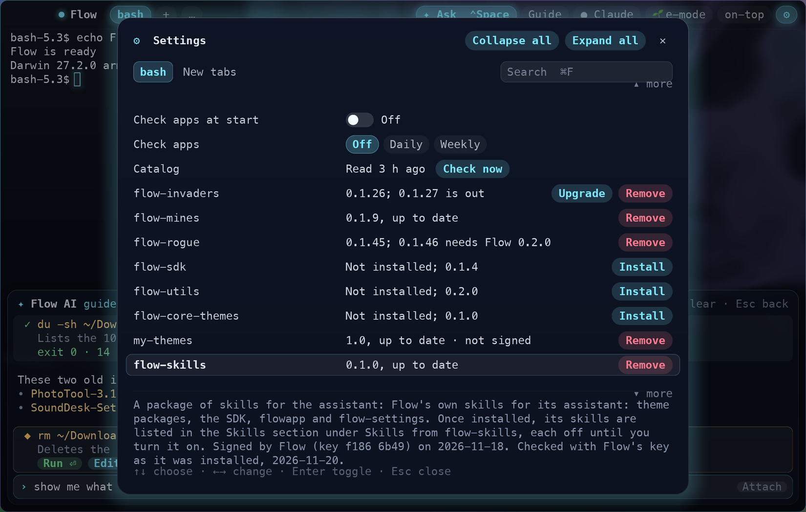

[← Flow's manual](../../README.md#documentation)

# Apps: flowapp

`flowapp`, on every tab's PATH beside `flow-help` and `flow-settings`,
installs Flow's apps and keeps them up to date as Homebrew keeps its
formulae. From 0.1.34 Flow carries none of them itself, so a game comes
with `flowapp install`. The catalog has:

| App | What it is |
| --- | --- |
| `flow-rogue` | **Flow Rogue**, a roguelike with a town, the wilds, lairs and a dungeon to go down, drawn in animated sprites ([Games](games.md)) |
| `flow-mines` | **Flow Mines**, the mine-finding puzzle, drawn over Flow's liquid |
| `flow-invaders` | **Flow Invaders**, ships coming down in waves in 3D, fought from a truck with a shop between the waves |
| `flow-utils` | **Flow-Utils**, `ls`, `tree`, `man`, `top`, `btop`, `du`, `df` and more written again for Flow, with pictures, bars and graphs in Flow's tabs, handing off to the system's own commands outside Flow (`flowapp first flow-utils` puts them first, below) |
| `flow-phonebook` | **Flow Phonebook**, `dial` to call a BBS over SSH, its pictures, models and sounds reaching your tab |
| `flow-sdk` | **Flow's SDK** for C and Python, its library, header and Python package, with `flow-demo` and its [demos](demos.md) |
| `flow-core-themes` | **Flow's machines** as a package of themes, kept up to date, newer ones coming without a release of Flow (below) |
| `flow-skills` | **Flow's own skills** for its assistant, as a package of skills: making a package of themes, writing a program with the SDK, `flowapp` and `flow-settings` ([skills from apps](assistant.md#your-instructions-and-skills); from 0.1.42) |

```bash
flowapp update            # reads the catalog of apps, and says what's newer
flowapp upgrade           # installs what's newer of what you have (or: flowapp upgrade flow-rogue)
flowapp install flow-sdk  # installs an app
flowapp remove flow-sdk   # takes off one flowapp installed
flowapp list              # what you have, and its versions
flowapp outdated          # what has a newer version
flowapp info flow-rogue   # what an app is
flowapp search            # the apps there are (or: flowapp search puzzle)
flowapp verify            # fetches what you have again and checks it's as downloaded (or: flowapp verify flow-say)
flowapp hello flow-say    # has an app introduce itself again, where its download says how
```

Settings' **Apps** lists them too, with what flowapp would do: each app
and package of themes you have or the catalog offers, its version, whether
a newer one is out (or waits for a newer Flow), and **Install**,
**Upgrade** and **Remove** (pressed twice) buttons that do it there, a
package's themes coming in at once. **Catalog** says when the catalog was
last read, and **Check now** reads it again. Flow never upgrades an app by
itself, but **Check apps at start** reads the catalog each time it starts,
and **Check apps** (**Daily** or **Weekly**) whenever its copy is that old,
as Flow comes to the front; both are off at first. When an app you have has
a newer version, a toast says so. The first start of a newer Flow, with
apps installed, reminds you to check them (unless Check apps at start does).
From 0.1.46 the app chosen ends its hint saying who signed it (below), and
an app that introduces itself does so in a tab of its own once Settings has
installed it.



What flowapp installs goes in a folder of your own, `apps/` beside
`config.toml`, whose `bin/` every tab's PATH has, so a tab already open
runs it too, the next time it's started. Flow carried Flow Rogue and Flow
Mines itself until 0.1.33, and an update from such a Flow keeps them: on
its first start Flow installs them with flowapp's own code, says so, and
tries again at the next start if it was offline (it notes it's done in
`apps/carried.json`, so a game you remove afterwards stays removed). One
that a package of yours from an older flowapp is in the way of, named as
it is but for its case (`Flow-Rogue`), is left out and the rest are kept,
and Flow says so, naming the one in its way: `flowapp install` it once
you've removed yours. A copy an older Flow left in its own folder (a
portable zip on Windows unpacked over an older one keeps them; the Mac's,
Linux's and the Windows setup's updates take them away) counts as
installed at its own version, and upgrading it puts the newer one ahead
of it. `flowapp remove` takes off only what it installed, and leaves your
saves. Installing `flow-sdk` puts `flow-demo` on the PATH and says where
its library (`lib/`), C header (`include/`) and Python package
(`python/`, for `PYTHONPATH`, the library inside it) are.
`flow-help apps` prints its help page, which Flow's own help links to.

What flowapp installs comes after the system's commands on the PATH, so an
app's `ls` never takes the place of the system's unasked. `flowapp first
<app>` (from 0.1.34) puts an app's programs, or one by its name, ahead of
the system's commands of their names in Flow's tabs, and `flowapp last
<app>` (or `--all`) puts the system's first again. From 0.1.35 each says
where and how:

```bash
flowapp first flow-utils              # all its programs, in every shell
flowapp first ls --shell zsh,bash     # in zsh and bash alone (--except powershell: in all but PowerShell)
flowapp first tree --prompt           # at the prompt alone: scripts keep the system's tree
flowapp first echo --take builtin     # bash's and zsh's own echo put aside while it's first
flowapp first ls --take alias         # your own alias of ls (ls --color=auto) put aside too
flowapp first ls --take none          # PowerShell's ls alias kept ahead of it
flowapp first which --here            # in this tab alone, until it closes
flowapp first flow-utils/ls           # Flow-Utils' ls, where another app has one too
flowapp first                         # what's first in each shell, and what still comes ahead
flowapp last ls --shell bash          # the system's ls again in bash
```

The shells are named `zsh`, `bash` (every bash: the Mac's, Linux's, Git
Bash and MSYS2), `sh`, `powershell`, `cmd` and `busybox` (the BusyBox that
comes with Flow on Windows). A later choice takes an earlier one's place
in the shells it names and leaves the rest, so `flowapp first ls` and then
`flowapp first ls --shell bash --take alias` has `ls` first everywhere,
and in bash its alias taken away too. flowapp keeps the choices in
`apps/first.json`, and each tab (each pane of a split one) has a folder of
its own under `apps/first/panes/`, made from them for its shell as it
opens, which Flow puts first on its PATH (`FLOW_FIRST`), and again after
the shell's own startup files, and takes away when it closes; a start
takes away those a Flow that quit or crashed left. `first`, `last`,
`remove` and an upgrade write every tab's folder afresh. The tab it's run
in goes by a change at its next prompt, and every other tab open then once
its prompt comes back: bash and zsh forget where they found a command when
what's first changes, with no process started to look. On the PATH, a
program put first is found by scripts run from a tab too; with `--prompt`
it's an alias the shell's hook makes at its prompt, so scripts keep the
system's command (cmd has no such hook, so `--prompt` puts nothing first
there). The choices of a Flow before 0.1.35, the links in `apps/first/`,
come into `apps/first.json` at its first start, first in every shell as
they were.

What stands ahead of the PATH in each shell stays ahead unless asked:

- **Builtins** (`--take builtin`): bash's and zsh's `echo`, `printf`,
  `pwd`, `kill`, `test`, `true` and `false`, bash's `help` and zsh's `which`
  and `log`, put aside with `enable -n` and `disable` while it's first.
  Those that work on the shell itself (`cd`, `export`, `read`) no program
  can do the work of, and flowapp refuses them.
- **Aliases** (`--take alias`): PowerShell's own (`ls`, `cat`, `man`,
  `ps`), which go by default, and in bash, zsh and BusyBox those your
  startup files make (Git Bash's `ls -F --color=auto`, BusyBox's
  `ls --color=auto`), which go only when asked, kept while it's first and
  put back after.
- **Functions** (`--take function`): PowerShell's own (`mkdir`, `more`).
- **Applets** (`--take applet`): BusyBox runs its own (`ls`, `cat`, `du`,
  `df`, `ps` and the rest) ahead of the PATH, so by default Flow names
  what's first in `BB_OVERRIDE_APPLETS` too (after any names of your own
  there), which BusyBox looks for on the PATH. Its shell has no hook before
  each prompt, so a BusyBox tab follows a change once `flowapp` runs in it
  (any `flowapp first`), or in a new tab, and its shell's own builtins
  (`echo`, `cd`) nothing puts aside.
- cmd's own commands (`dir`, `type`, `echo`, `copy`) come ahead of every
  program, and nothing puts them aside; flowapp says so.

`--take none` keeps even PowerShell's alias and BusyBox's applet. In
PowerShell what's taken away gives way to an alias of the name to the
program put first, at global scope, and the name's own alias comes back
after. zsh's `which` is a builtin of its own: while a `which` is first
(Flow-Utils' draws in Flow), a plain `which` of programs goes to it, and
one of an alias, a function or a builtin, or with another of zsh's flags,
stays zsh's, unless its builtin is put aside. `flowapp first` alone lists,
for each shell, each name, the app whose program it runs, how it's first,
what it took away there and what still comes ahead of it by Flow's own
tables of each shell (`--json` too, for scripts); your own aliases and
functions it can't see, and `type <name>` in a tab (`Get-Command <name>
-All` in PowerShell) says what runs there. An install says when an app's programs share
their names with the system's commands, which stay first until asked.
An app's man pages (Flow-Utils' are) come in its `share/man`, which Flow
puts on its tabs' `MANPATH` after the system's own pages, so the system's
`man` finds `man flow-utils` while `man ls` stays the system's. A `MANPATH`
of your own keeps its folders first. Tabs opened after an install see it.

Scripts run from a tab find what's first too, so a program put first
should do as the system's does when it's piped or given flags it doesn't
know, as Flow's own Unix commands do.

Themes come as packages too (from 0.1.34). `flowapp install
flow-core-themes` installs Flow's own machines as a package, so a newer
one of each, or a new machine, can come without a release of Flow; they
stay built in as well, and a packaged theme with a built-in machine's id
takes that one's place. A package's themes join Settings' Theme row and the
new-tab picker once Flow is in front again, after the built-in ones, and
are worn as they are: Theme details' switches, its sounds, its CRT, its
screen for Fit window to, and its own fonts and logo picture where it
brings them. `flowapp install mine.tar.gz` installs a package of your own
from its file (Settings' **Export…**, under Your themes, writes one from a
theme you saved): a `.tar.gz` holding `themes.json` (format 1: the package's
name and version, and each theme's id, names, colors, phosphor, fonts and
font files, cursor, CRT preset, start screen, prompt, sounds, screen, logo
and any more of the look's settings, as `flow-core-themes`' own show) and
the files it names. A theme is only data, never a program: its start screen
only types text, and every shell shows its prompt as text, running nothing
in it ([Themes](themes.md)), so a package of your own needs no signature,
one naming a file outside itself is refused, and one holding a program is
too. A refused file leaves nothing of itself in the apps folder, not even
a folder in it made read-only or, on a Mac, locked against deleting (a
package's folders and files never take such a lock from its file there),
so the next one is installed afresh, and what an older flowapp left of
one is taken away first; should flowapp find something there it can't
take away, it says so and installs nothing over it.

A package of your own can't take the place of one of Flow's, since anyone
can make such a file and send it. Its name can't be `flowapp`, one the
catalog lists (flowapp reads the catalog afresh first, as it does to
install one of the catalog's, so a name added since counts too; offline,
the copy it read last), or one installed from the catalog, in any case;
nor can a theme in it have the id of one of Flow's own machines (`green`,
`amber`…) or of one another package installed brings, which it would
stand in for under that one's name, on the tabs already wearing it.
Should one be there from an older flowapp, which didn't check its themes,
the catalog's packages' themes come first and a package of your own
never stands in for Flow's machines.
Its name is at most 64 lowercase letters, digits, `-` and `_`, starting
with a letter or digit, and not `bin`, `first` or `previews` (flowapp's
own folders) nor a name Windows keeps for a device (`con`, `nul`,
`com1`…); its version is at most 64 letters, digits, `.`, `-`, `_` and
`+`, neither starting nor ending with a dot. Installing it again, at any
version, takes the place of the one before, as it does for one a flowapp
before 0.2.0 (Flow 0.1.45) installed from a file, which marked none as
your own: one the catalog doesn't name is taken for yours (offline, with
no catalog read yet, flowapp can't tell and asks you to remove it first).
The other way round, the catalog's package never installs over one of
your own of its name (one made before the catalog had it): `flowapp
install` and `upgrade` say so, a bare `upgrade`, `outdated`, Settings'
Apps and the theme gallery offer no upgrade of it, and `flowapp remove`
of yours lets the catalog's install, so nothing of yours is deleted
without your word. `flowapp list` shows packages of themes under a
heading of their own, and `--json` gives each entry a `kind`, `app`,
`themes` or `skills`.

Skills for the assistant come as packages too (from 0.1.42): an app may
carry a `skills/` folder in its download, and a package of nothing but
skills holds `skills.json` (format 1: its `package` and `version`) beside
its `skills/`, each skill `<name>.md` or `<name>/SKILL.md` with front matter
naming it and saying what it's for ([Your instructions and
skills](assistant.md#your-instructions-and-skills)). `flowapp install mine.tar.gz`
installs one of your own as it does a package of themes: unsigned, refused
with a program in it or no skill that reads. Its skills are off until
Settings' Skills section turns them on, which the install says. `flowapp
list` shows packages of skills under a heading of their own, and Settings'
Apps lists them after the packages of themes.

In a terminal, `list`, `outdated` and `update`, `search` and `info` print
tables: ruled with box drawing under a bold header, a newer version in
green, a game an older Flow left dimmed, each app's name a link to its
release page (OSC 8, which Flow opens with ⌘-click or Ctrl+click, as
other terminals that take links do),
and long text cut with "…" to the terminal's width (at most 100 columns).
`install` and `upgrade` show each download on one line as it comes, with a
bar, how much has come and how fast, then a green ✓ once its size,
checksum and signature have checked; in Flow the liquid splashes as it
lands. Piped, or with `NO_COLOR`, the same columns are plain text lined up
with spaces, no escapes and a dash for what's empty, and piped nothing is
cut, so scripts can read them (`flowapp list | awk 'NR > 1 { print $1 }'`
names what you have). With `--json`, `update`, `list`, `outdated`, `info`
and `search` print what they list as JSON instead: each app's `name`,
`installed`, `from` (`flowapp`, or `flow` for a copy an older Flow left),
`latest`, `newer`, `size` (bytes), `summary`, `programs`, `page`, `kind`,
`needs_flow`, `held`, `signed_by`, `key` (the whole fingerprint),
`signed`, `checked`, `signature` and `own_file`, `null` where there's
none, in an array but for `info`'s one, which adds `code_signatures`
(`flowapp outdated --json | jq -r '.[].name'`).

**Who signed each download.** `list` and `search` have a **Signed**
column: whose key signed the download, the first digits of the key's
fingerprint, and when, as the catalog says, such as `Flow f186 6b49 ·
2026-11-18`. Every download is signed with Flow's update key, whose
fingerprint is
`f1866b49b0b42871463772bf1c9d77fae2091c32dc01681ae5d752f13008b4d0`: the
SHA-256 of the key's DER, as `openssl pkey -pubin -in flow-update.pem
-outform DER | openssl dgst -sha256` works it out.
- `search` shows the catalog's download for your system.
- `list` shows what's installed, as flowapp noted it at the install: in
  `installed.json`, the download, the key and the day it was checked.
  It's dimmed for an app installed by a flowapp that noted nothing,
  where the catalog's word for that version is all there is.
- A package of your own says **not signed**, and a game an older Flow
  left **comes with Flow**. (The column takes the place of `list`'s
  From, whose `from` stays in the JSON.)
- The name comes from flowapp's own list of keys, never from the
  catalog, which nothing signs. The date is the catalog's word, which
  `examples/app_catalog.rs` writes as it adds a download (`--signed` for
  another day); a download added before it did has none.

`info` gives the same as rows, **Signed by**, **Signed on** and
**Checked**. On the Mac it adds a **Code signed** row for the programs
and libraries in the app, as `codesign` reads them: the Developer ID that
signed them and when, ad hoc, or not code-signed.

**Checking it yourself.** Under its table, `info` prints the lines that
check the download's signature with OpenSSL 3 or later alone, trusting
nothing of flowapp's:
1. fetch `flow-update.pem` from Flow-releases and see that its
   fingerprint is the one above;
2. fetch the download;
3. write its signature, from the catalog, as a file;
4. `openssl pkeyutl -verify -pubin -inkey flow-update.pem -rawin -in
   <file> -sigfile <file>.sig` says "Signature Verified Successfully".

The Mac's own `/usr/bin/openssl`, LibreSSL, can't read an Ed25519 key,
so use Homebrew's (`brew install openssl`); on Windows, Git Bash's.
`app_catalog` also writes each download's signature beside it as
`<file>.sig`, which the `app-release` scripts put on the release with it.

**`flowapp verify`** checks what you have, or `flowapp verify flow-say`
one app:
- It fetches the app's download again and checks it as an install does.
- It unpacks it in the system's temp folder (never in `apps/`) and looks
  at every installed file against it, and at each program's copy on the
  PATH.
- A file changed or missing is named and fails (exit 1). One added
  since, as Python adds `__pycache__`, is named but doesn't count.
- It goes by the download flowapp noted at the install. For an app
  installed before flowapp noted any, it goes by the catalog's download
  of the same version, saying so; with none, there's nothing to check
  against until the app is upgraded.

**Settings' Apps says it too** (from 0.1.46). The app chosen ends its
hint with who signed what you have and when, and when flowapp checked
it with Flow's key as it was installed; for one you don't have, who
signed the catalog's download. A row adds **not signed** for a package
of your own, or **unknown key** for a key Flow doesn't know. A row Flow
signed stays as it was.

**flowapp updates itself.** flowapp is in the catalog too, with a
version of its own (from 0.2.0, `flowapp --version`), so a newer one can
come out between Flow's releases:
- `flowapp outdated` offers it, and `flowapp upgrade` installs it as it
  does any app. Nothing installs it by itself.
- Installed, it's in the apps folder's `bin/`, which comes ahead of the
  copy Flow carries on every tab's PATH, so Flow's tabs run it from then
  on. `flowapp remove flowapp` goes back to Flow's own.
- Whichever copy is newer runs: each hands over to the other where that
  one is newer, so a later Flow that carries a newer flowapp runs its own.
- In a tab opened before the upgrade, bash and zsh may still run the old
  one: open a new tab, or type `hash -r`.
- An app's `flow` (below) is checked against the Flow whose tab it runs
  in, not the one flowapp was built with.
- The flowapps of Flow 0.1.45 and before show the copy Flow carries at
  its build number with a bracket (`737)`) until flowapp is upgraded.
  They offer the upgrade all the same.

**An app can introduce itself** (flowapp 0.2.2). An app's download may
hold a `flowapp.json` naming one of its own programs to run once it's
installed, so what runs is covered by Flow's signature, never by the
catalog, which nothing signs:
- `flowapp install` runs it after a fresh install alone, not an upgrade,
  and only in a terminal, never from a script, a pipe or the assistant.
  It runs the program by its path, not through the PATH.
- `flowapp hello <app>` runs it again whenever you like.
- Installed from Settings' Apps (from Flow 0.1.46), Flow closes Settings
  and opens a tab in its own look that types `flowapp hello <app>`.
- flow-say (from 0.1.2) introduces itself so, greeting you aloud.

An app's download can need a newer Flow than yours (from 0.1.34, the
catalog's `flow`: the oldest Flow it works in). Then `flowapp install`
refuses it, saying which Flow it needs and to update Flow first, and
`upgrade` leaves it as it is and says the same, until Flow is updated;
`outdated` lists it without the green and says why under the table,
`info` has a **Needs** row (red where your Flow is older), and `--json`
gives its `needs_flow` and `held` (true while it waits). The games an
update from 0.1.33 keeps wait the same way, and install at a start after
Flow is updated. A flowapp before 0.1.34 reads past `flow`.

The catalog, `apps.json`, is in the public
[Flow-releases](https://github.com/arcanii/Flow-releases) beside Flow's own
update feeds, and each app's downloads on releases there, one for each
system and chip, each with its own version (`FLOWAPP_CATALOG` names
another catalog, a URL or a file, whose names, versions and programs are
held to the rules a package of your own is, as each becomes a folder or a
file in `apps/`: a program is a plain file's name in `bin/`, never hidden,
a path or a drive). `update` keeps what it read in `apps/`
as `catalog.json`, which `list`, `outdated`, `info` and `search` go by, so
they're quick and work offline: `info` says how long ago it was read, and
in a terminal the others say so too once it's a day old. `install` and
`upgrade` read the catalog again first, since a release takes the place
of the one before it and a catalog read earlier can name a download
that's gone; where it won't read, they go by the one kept and say so. A
download that isn't there (a 404) says the catalog may be out of date, as
it can be for a few minutes after a release, when the copy GitHub serves
hasn't caught up. A server that answers 502, 503 or 504 (a gateway's
trouble, as GitHub's edge has now and then for a few minutes) is asked
again twice, a few seconds apart, and a release's file that github.com
still won't hand over is fetched through GitHub's API instead. Every
download is checked against the catalog's size and SHA-256 and signed
with Flow's own update key, whichever way it came, and one that isn't is
never unpacked. On the Mac flow-sdk is made by
`macos/scripts/app-release.sh flow-sdk`, which builds it, signs it with the
Developer ID, packs it, signs that with Flow's key and writes its entry
into the catalog (`examples/app_catalog.rs`, whose `--flow 0.1.34`,
which each `app-release` script passes on, says the Flow it needs; without
it a download keeps what its system's before it said; `flow-core-themes` is written
and packed by `examples/theme_package.rs`, then signed and entered with
`app_catalog --themes --platform any`, a download for every system); on Windows by
`windows\scripts\app-release.ps1 flow-sdk`, which builds it for x64, packs it
with Windows' own `tar`, tries what it packed, signs it with Flow's key and
writes its entry the same way (`windows/RELEASING.md`); on Linux by
`linux/scripts/app-release.sh flow-sdk`, which builds it for glibc 2.31,
packs it and tries what it packed, and once it's been signed on the Mac
(where Flow's key is) writes its entry the same way (`linux/RELEASING.md`).
The games are made the same way in their own repository, Flow-Games, and
Flow-Utils in its own, each building its programs from its own workspace
with scripts of its own, which take a checkout of Flow-Terminal (named
with `--flow`) for `app_catalog`, the notices and the signing tools.
