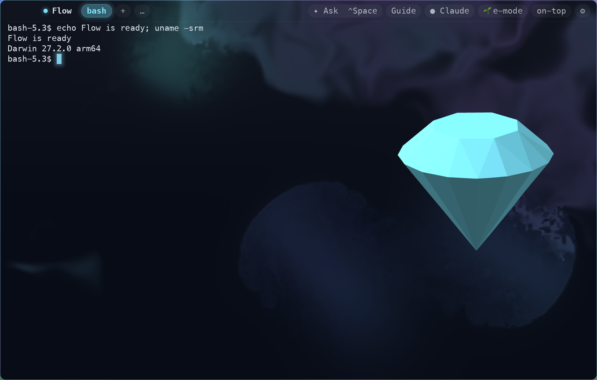

[← Flow's manual](../../README.md#documentation)

# Images

Programs can show pictures in the terminal through the [kitty graphics
protocol](https://sw.kovidgoyal.net/kitty/graphics-protocol/), the one most
image tools speak today: `viu`, `timg -pk`, `kitten icat`, yazi, ranger, mpv's
`--vo=kitty`, fzf previews and Neovim's image plugins. `viu` finds the support
by itself. `timg` picks its protocol from a list of terminal names that doesn't
have Flow yet, so give it `-pk`. An image sits in the
terminal like text: it scrolls with it, goes into the scrollback, and clears
with `clear`. It also rides the liquid as text does, and under the CRT gets
the scanlines, the curve and the phosphor's glow. Copying text leaves images
out, and so does what the assistant reads of the terminal. When a bigger font
or a narrower window makes the text rewrap, an image wider than the terminal
is cut at its edge rather than broken over the lines, and shows whole again
as the terminal widens.

Programs that check for image support find it: Flow answers kitty's query, says
it's `Flow` when asked which terminal it is (XTVERSION), and reports its cell
and window size in pixels. Images come as PNG or raw pixels, compressed or not,
sent in the escape itself or as a file; a GIF or a WebP sent as a PNG would be
(`f=100`) shows too, and plays if it moves. Not yet: images in shared memory
and images under text.

A program can name a file instead of sending it, and a program on another
computer (over ssh, say) can name files on this one, so Flow holds what it
reads to what can't tell such a program anything about them:
- A picture file (a PNG, a GIF or a WebP, `t=f`) is read whole, from its
  start, as `kitten icat` sends a PNG it needn't change. `S` isn't heeded,
  and `O`, raw pixels and compression are refused.
- Raw pixels, compressed data and a part of a file (`O` and `S`) come only
  from a temporary file the program wrote for it (`t=t`), with
  `tty-graphics-protocol` in its path, as `kitten icat` and `viu` write
  theirs, in the system's temporary folder: `TMPDIR`'s or `/tmp` on the Mac
  and Linux, with `/var/folders` on the Mac and `/dev/shm` on Linux, and
  `%TEMP%` on Windows. Flow deletes it once it has opened it, whether it
  holds a picture or not. A `t=t` file anywhere else is read as a picture
  file and kept.
- Flow never reads `/proc`, `/sys` or `/dev` (but for `/dev/shm`), a file
  that isn't a regular one, a path that isn't whole, or, on Windows, a
  share on another computer.
- Whatever goes wrong, a file missing, unreadable, too short or not a
  picture, the answer is the same `EBADF:could not read the file`, and
  Flow's log says why when Flow is started with
  `RUST_LOG=flow_core::graphics=debug`. ranger, which asks with raw pixels
  in a file of its own, then sends its pictures in the escape.
- Finding out takes longer for some files than others, which a program
  asking thousands of times could time, so each failure takes the same
  2 ms (Flow waits it out awake, watching the clock, since a sleep can
  end later than asked: on the Mac later the longer it was asked for, and
  milliseconds later while the system holds Flow back), and after 8
  failures in 10 seconds Flow reads no file the tab names, a picture or
  not, until those 10 seconds are over. Resetting the terminal
  (`flow-settings reset terminal`) doesn't start them over. A program
  that sends files fails once at most, asking whether it may, and
  pictures read don't count. A PNG whose header says it's larger than
  Flow shows (10,000 pixels a side) is refused before the rest of it is
  read.

So the answers tell such a program only whether a path holds a picture
Flow reads, and from where its cursor goes, how big that picture is. What
the time taken could still tell it, it learns a few times in 10 seconds at
most: where finding out takes longer than the 2 ms (a disk slow to find a
file the first time, or a long file that begins as a picture but won't
decode, which Flow reads whole first, so the time says roughly how long it
is), or where the computer holds Flow back meanwhile.

Programs can also make a picture move with kitty's own animation commands,
as `kitten icat` does with a GIF:
- `a=f` sends a frame, as a picture is sent (PNG or raw pixels, in chunks
  if need be), laid at `x`, `y` over a frame before it (`c`), a color
  (`Y`, transparent at first) or, with `r`, the frame it edits, in place
  of what's there with `X=1`; `z` is how long it shows (40 ms at first,
  below zero never: a frame that's only a base for others). The answer
  names the frame (`r=`).
- `a=a` plays it round (`s=3`), plays it holding its last frame while more
  are coming (`s=2`) or stops it (`s=1`), shows a frame (`c`), sets how
  many times it plays (`v`) and a frame's time (`r` and `z`; the picture's
  own, its first frame, has none until given one, so it's passed over).
  Like kitty, it answers only what goes wrong.
- `a=c` lays a rectangle of one frame (`r`, at `X`, `Y`) over another (`c`,
  at `x`, `y`), `w` × `h` pixels, in place of what's there with `C=1`.
- `a=d,d=f` deletes a frame (`r`; none, the first; past the last, the
  last), as kitty does: the frames after it move down, and the frame shown
  stays shown where it's still there. A picture's last frame stays, unless
  `d=F` asks, which deletes the picture whole.

A picture made to move this way starts stopped on its first frame, as in
kitty, and each change goes on from the frame it's at. It shows wherever
its cells are, placed by Flow or written by the program (`U=1`), from the
terminal and, on Windows, down Flow's pipe for images. Its frames count as
a GIF's do (see below), and go when it's deleted or sent again.

Flow also shows Sixel pictures, as `img2sixel`, `lsix`, gnuplot's `sixel`
terminal and `chafa -f sixels` send them, and iTerm2's inline images (OSC 1337
`File=`), as `imgcat`, `chafa -f iterm` and `timg -pi` do. Both sit in the
terminal as kitty's pictures do, and shrink to the room right of the cursor
as they do.
- A sixel shows at its own size in pixels, its pixels' shape as its raster
  (or else its first parameter) gives it, its 1024 color registers set in
  RGB or HLS and starting from the VT340's sixteen colors; with its second
  parameter 1, the glass shows through what it leaves unpainted. The cursor
  goes to the start of the line below it, as in xterm, or, with xterm's
  sixelScrollsRight set (`CSI ? 8452 h`), after its last row, right of it.
  In sixel display mode (DECSDM, `CSI ? 80 h`) it goes at the screen's top
  left instead, as wide as the screen and cut at its foot, the cursor
  staying where it was and nothing scrolling. DECRQM (`CSI ? 80 $ p`) says
  whether each mode is set, and a full reset (`ESC c`) resets both.
- An iTerm2 image is a PNG, a JPEG, a BMP, a TIFF (its first page), a GIF
  or a WebP, at its own size or as its `width` and `height` say (cells,
  `px`, `%` of the terminal, or `auto`), fitted in them, or stretched to
  fill them with `preserveAspectRatio=0`. The cursor goes after its last row, right of it,
  as in iTerm2, or stays with `doNotMoveCursor=1`. A big file may come in
  parts, as iTerm2 3.5's `imgcat` sends it (`MultipartFile=`, then
  `FilePart=` as many times as it takes, then `FileEnd`), up to 128 MB of
  base64, and shows once its end is in. Other files (a PDF, say) aren't
  shown, and Flow's log says what they were.
- An animated GIF or WebP plays where it is, on screen or scrolled back to,
  as many times as its file says (forever, for most), then keeps its last
  frame. A frame that gives no time of its own shows for a tenth of a
  second, as in browsers. Flow keeps up to 1,000 frames of one and 128 MB
  of its pixels, and plays those of a longer one. The window draws only as
  a frame gives way to the next, and the GPU holds one frame of it, written
  afresh as the next shows, so the card under a tab and About's Resources
  count an animation's frames in its pictures and one frame's worth on the
  GPU.
- Programs that ask find sixels: DA1's answer says so (`ESC [ ? 62 ; 4 ; 22
  c`), and XTSMGRAPHICS answers 1024 color registers and, as the largest
  sixel shown whole, the text area in pixels.
- Inside tmux, a program that wraps its picture for tmux to pass on (`DCS
  tmux;` with its escapes doubled, as iTerm2's `imgcat` does there) shows
  it in Flow as it would unwrapped, at the cursor where tmux last left it.
  tmux needs `set -g allow-passthrough on` to pass it on.

On Windows, programs show images only if they know Flow: the console layer
Windows puts between Flow and the shell (ConPTY) drops kitty's escapes, so
`viu`, `timg` and the rest show none there. Instead, each tab has a named pipe
for images, which programs find in `FLOW_IMAGE_PIPE` and only programs
running as you can open, elevated or not, but not as another account
(Windows' default would let any user read it). A program a standard user
runs with an administrator's name and password (`runas`, or Windows' `sudo`
asking for them) runs as that account, and finds the pipe shut. In a Flow
run as administrator, only its tabs' elevated programs may write to it.
What a program writes
to it is read as kitty's graphics commands and the questions that go before
them (XTVERSION, `CSI 16 t` and `CSI 14 t`, the colors OSC 4, 10, 11 and 12
ask for, and DA1, whose answer comes last), and the answers come back up the
pipe, the colors as the terminal gives them elsewhere. The cells that show an
image still go through the terminal, as virtual placements (`U=1`), and ConPTY
spoils kitty's usual ones: it gives each combining mark a column of its own and
doesn't know the underline color. So write them bare, U+10EEEE in the image's
color (`38;2;r;g;b`) and nothing else. Flow takes a bare cell's column from the
cell to its left, one more when that shows the same image, and its row as
the first, so each row of a taller image has to be an image of its own, and
an image right of its double needs another id. The pipe also takes Flow's
effect escape (OSC 7731, under [The glass reacts](liquid-styles.md#the-glass-reacts)), for
the same cells. Through ConPTY, iTerm2's images show from every shell, cmd
too. ConPTY never learns an image's room, and keeps its cursor on the row
the image began on, where it draws what comes next; so on the main screen
Flow has the image rise from that row over the lines above (its top in the
scrollback where there are fewer), and the text after it goes right of its
last row and the next line below it, as in iTerm2.

Windows' ConPTY drops a sixel whole, so on Windows send sixels down the pipe
instead. A sixel program's output can go there as it is: from cmd or
BusyBox, `img2sixel a.png > %FLOW_IMAGE_PIPE%` (`> "$FLOW_IMAGE_PIPE"` in
BusyBox); from PowerShell, `[IO.File]::WriteAllBytes($env:FLOW_IMAGE_PIPE,
[IO.File]::ReadAllBytes('a.six'))`. Git Bash can't open a Windows pipe
itself, so go through cmd there: `cmd //c 'type a.six > %FLOW_IMAGE_PIPE%'`.
Since ConPTY never learns the picture is there, Flow fits it in where
ConPTY's cursor is, once ConPTY has drawn what the program wrote before
it: in lines of its own above the cursor's line (the lines above scroll up,
its top in the scrollback where there are fewer), so the line the cursor is
on, and the shell's prompt, come below it, as a terminal leaves its cursor
after a sixel. Where the cursor is partway along a line, or with
sixelScrollsRight, it rises from the cursor as an iTerm2 image does, and
in DECSDM's display mode it goes at the screen's top left; on the
alternate screen it goes at the cursor, which stays. A program that writes
more text after a sixel sends DA1 (`CSI c`) after it down the pipe and
waits for the answer first, so its text comes after the picture. The pipe
takes DECSDM and sixelScrollsRight too, and answers DECRQM for them, though
ConPTY passes both on to the terminal. iTerm2's images go through the
terminal, so the pipe passes them over.

Flow keeps up to 320 MB of images per tab, letting go of the oldest, those no
longer on screen first, and takes images up to 10,000 pixels a side (a sixel
up to 32 million pixels in all, cut short past that); an animation's every
frame counts. Sixels and iTerm2's pictures, which nothing names again, go
sooner, once none of their cells can show: on the alternate screen (a
program's full screen, as yazi's previews or a video in sixels draw there)
as soon as another covers it, the screen is erased or the program leaves
it, and on the main screen once `clear` or a full reset takes it from the
screen and the scrollback, or, past half the 320 MB, once it has scrolled
out of the scrollback.

Now and then `viu` leaves Flow's answer to its question on screen
(`^[_Gi=31;OK^[\`) just before the picture. It turns the terminal's echo back
on between reading each key of the answer, so when the answer arrives in such a
gap the terminal shows it; the picture still comes out.

## 3D models

Programs can show 3D models too, through the [Ratty graphics
protocol](https://docs.rs/crate/ratty/0.4.1/source/protocols/graphics.md),
which the [Ratty](https://blog.orhun.dev/introducing-ratty/) terminal began;
Flow speaks it as Ratty does, so a program written for one works in both. A
program asks whether it's spoken (`ESC _ ratty;g;s ESC \`), registers a model
by an id (`r`: Wavefront `.obj` or binary glTF `.glb`, sent in base64 chunks
or named by a path), places it centered on a cell over so many cells (`p`),
changes how it looks without placing it again (`u`), and deletes it (`d`).
Placing it again moves it. A placed model sits in the terminal like an image:
it scrolls with the text, goes into the scrollback, clears with `clear`, rides
the liquid and goes under the CRT, and when the text rewraps it's cut at the
terminal's edge rather than broken over the lines.

How it looks, as `p` and `u` set it: `animate=1` spins and tumbles it and lets
it bob; `rx`, `ry` and `rz` turn it (degrees); `scale` and `sx`, `sy`, `sz`
size it; `px` and `py` move it (pixels, y up); `color` tints an OBJ (a glTF
has its own colors and textures); `brightness` lightens or darkens it; and
`depth` gives flat artwork thickness and an oblique view (it still turns with
`animate=1`, and a glTF's own animation still plays). Flow fits a model to
its cells, by its box while it's still and unturned, else so that it stays
inside them however it turns. It's lit from above left, and drawn again only
when the program changes it, or each frame while it's animated. A program can
also register a new model under a placed one's id each frame, to move a whole
scene as [the demos](demos.md) do: Flow draws it in the last one's place and
lets the last one go at once.

A glTF plays its own animation, looped: its nodes' moves, turns and scaling
(step, linear or cubic), skinned meshes following their joints, and morph
targets blending. `clip=<n>` on `p` or `u` picks which of its animations
(counting from 0; `clip=-1` holds it at rest), and Flow fits the model to its
cells over the whole animation, so it never leaves them. Its materials show
too: metal and roughness (factors and texture), normal maps (with tangents
worked out where the file has none), occlusion maps (with their strength) and
emission (made stronger by `KHR_materials_emissive_strength`). A mesh the
file gives no normals is drawn flat, each triangle lit as the way it faces,
as glTF has a viewer draw it, however the file shares its vertices
(gltfpack's welded ones and Draco's too). Its vertex
colors (`COLOR_0`: RGB or RGBA, floats or normalized bytes or shorts,
however the file is packed) tint the base color and its texture, blended
across each triangle, their alpha with the material's; further sets
(`COLOR_1` and on), and instances' own attributes such as `_ID`, have no
meaning glTF gives them, so they're passed over, as other viewers pass
them over. Its alpha is
taken as the material says: ignored for a solid part, cut out below the
cutoff for `MASK`, and blended for `BLEND`. A texture can read the second
set of texture coordinates (`TEXCOORD_1`), and be offset, turned and scaled
by `KHR_texture_transform`. After a font size change, each model is drawn
again at the new size rather than scaled. A file may require
(`extensionsRequired`) any of the extensions Flow reads, which are all those
named here; one that requires something Flow doesn't do, such as diffuse
transmission (`KHR_materials_diffuse_transmission`), isn't shown, and the
error names what it requires (in a notice for a file
named by a path, in Flow's log for one sent in the command).

A node with GPU instancing (`EXT_mesh_gpu_instancing`) draws its mesh once
for each of its instances, each moved, turned and sized as its
`TRANSLATION`, `ROTATION` and `SCALE` say (any of them, floats or the bytes
and shorts `KHR_mesh_quantization` allows) in the node's own space, before
the node places it: so the instances go with the node as the file's
animation moves it, Flow fits the model to its cells with all of them in,
and a click on any of them names the node. A solid or cut-out part is
drawn once for each instance on the GPU, so its triangles count once
toward the 2 million a model may have, however many instances draw it, up
to 32 million triangles drawn in all: a forest of a hundred trees of
30,000 triangles each shows. A see-through part, or one moved by a skin,
is copied for each instance instead, and those copies count toward the 2
million (and make 6 million vertices at most). A file past any of these
isn't shown, and the error says so. Flat artwork drawn in instances isn't
made thick for `depth`.

A file packed small, as gltfpack or gltf-transform packs one, reads as it
would unpacked (Flow's tests read and draw files both tools wrote, Khronos's
Fox among them, skinned and animated):

| Extension | What's read |
|-----------|-------------|
| `EXT_meshopt_compression` (and `KHR_meshopt_compression`) | buffer views compressed with meshoptimizer's codecs (vertex data, by either version of its vertex codec, triangles, other indices) and its octahedral, quaternion, exponential and color filters, unpacked into the fallback buffer as the file loads |
| `KHR_draco_mesh_compression` | meshes compressed with Google's Draco (positions, normals, texture coordinates, colors, joints and weights; its triangles kept either of Draco's ways), decoded as the file loads |
| `KHR_mesh_quantization` | positions, normals, tangents and texture coordinates (morph targets' too, and instances' moves, turns and sizes) kept as bytes and shorts, normalized or not, which the nodes above them usually scale back |
| `EXT_texture_webp` | WebP textures, lossy or lossless; where a texture offers a PNG or JPEG as well, the WebP is shown, and the other where the WebP won't decode |
| `KHR_texture_basisu` | Basis Universal textures in KTX2 (ETC1S or UASTC, Zstandard-compressed or not), transcoded to plain pixels as the file loads; where a texture offers a PNG, JPEG or WebP as well, the KTX2 is shown, and the other where it won't decode |

A texture Flow can't decode (an HDR KTX2's, say) is left out rather than the
model, so a texture that offers a PNG or JPEG as well shows that.

The material extensions show as well, each with its textures:

| Extension | How it shows |
|-----------|--------------|
| `KHR_materials_unlit` | the base color alone, without light |
| `KHR_materials_specular`, `KHR_materials_ior` | how strongly, and in what color, a non-metal's glaze reflects (a metal's is its own color) |
| `KHR_materials_clearcoat` | a clear glaze over the rest, with its own roughness and normal map |
| `KHR_materials_sheen` | a fabric's soft rim of light in the sheen's color, wider the rougher it is |
| `KHR_materials_transmission`, `KHR_materials_volume` | see-through, under a film of the color light takes through it, its reflections kept |
| `KHR_materials_anisotropy` | a surface brushed or spun one way: its highlights stretched along that way (its strength, its turn from the tangent, and its texture's way and strength) |
| `KHR_materials_iridescence` | a thin film over the glaze, as on a soap bubble or an oil slick: what it reflects colored by the film's interference, changing as it's seen more aslant or the film is thicker (its strength, the film's ior and thickness, and their textures) |
| `KHR_materials_dispersion` | read, and drawn as nothing: it parts light through glass into colors, and Flow doesn't bend light through glass (below) |
| `KHR_materials_pbrSpecularGlossiness` | the older specular-glossiness material, read as glTF-Transform turns it into metal and roughness: its diffuse the base color, no metal, its specular color what its glaze reflects head on, its glossiness (its texture's alpha too) how smooth it is |

Anisotropy and iridescence are drawn Flow's way rather than glTF's
reference way, as its glaze always was: anisotropy stretches Flow's own
highlights along the surface's way, which needs the mesh's tangents
(worked out from the first set of texture coordinates where the file has
none; a part with no texture coordinates shows no anisotropy), and
iridescence colors what the glaze and a metal reflect by a thin film's
color for red, green and blue light, a film of no thickness leaving it as
it was. Iridescence's strength and thickness textures are read as one
(through the strength texture's coordinates, where they differ).

Light through a part is the one Flow can only approach: a model's picture is
drawn on its own and laid over the terminal, so what's behind the part
can't be bent or tinted, only seen through it. So a part that lets light
through is see-through, as much as the light passes; the film over it is as
deep as its color absorbs (and, with a volume, as its attenuation color
deepens over its thickness), a rough one is frosted, and its highlights and
reflections stay whole, so a glass ball looks clear with glints on both its
near and far sides.

See-through parts, blended or letting light through, are drawn after the
solid ones, triangle by triangle, farthest first, so what's behind each
shows through it, a closed one's far side included. Two see-through
triangles that cross can't be ordered as they are, so Flow cuts them where
they cross when it reads the model. In one that plays an animation, where
they cross moves: with up to 2,048 see-through triangles Flow cuts them
again as each frame poses them; a bigger one keeps the cuts made at rest,
moved with the triangles they were cut from, which is right wherever the
parts that cross move together (glass on a turning machine), and can be
half wrong where they slide through each other.

A glTF's own lights (`KHR_lights_punctual`: directional, point and spot)
take the place of Flow's light from above left, the room's soft light (the
ambient light, the rim, the reflections) staying. A file's intensities are
physical units that say nothing of how bright the picture should be, so
the strongest four together light the model's middle as Flow's own light
does, each with its share: at rest, or, where the file's animation carries
them nearer, at the brightest moment of it, so it never washes the model
out (and at rest it's lit the less). Their colors, places, ranges and cones
are the file's. They stay with the view the model is first seen in, so a model
turned with `rx` or spinning with `animate=1` turns under them, as under
Flow's own. A glTF's camera (the scene's first) picks that view: the model
is turned to face you as it faces the camera. An orthographic camera stops
there, and the model is fitted to its cells and drawn straight on, as a
model without a camera is. A perspective camera is looked through: the
model is drawn as the camera sees it from where it stands, nearer things
larger, the camera's vertical field of view (`yfov`) spanning the cells'
height and the cells' own shape setting how wide it sees (the file's
`aspectRatio` is the file's picture's, not the cells'), so it can be cut
off at the cells' edges where the camera frames it so. What's nearer than
its `znear` isn't drawn. `rx`, `ry`, `rz`, `scale` and `animate=1` turn and
size the model about its middle in front of the camera, `px` and `py` move
it in pixels, and `pz` brings it nearer, so larger. A model turned so that
it would reach past the cells' edges (further than the camera has it reach)
is drawn smaller, just enough to stay inside: as its box turns for `rx`,
`ry` and `rz`, as the ball round it for `animate=1`, which turns it every
way. A click on such a model
answers where it met the mesh in its unit box as the camera sees it, along
the line from the camera's eye through the pointer.

Where the file's animation moves its lights or its camera, they move as it
plays. A light goes where the animation carries it and shines the way it's
turned, and one brought nearer than it was at rest brightens, as its
intensity says it would, up to the light Flow's own gives. A moving camera turns the model as the camera
turns and slides it as the camera slides, so a camera going round a model
shows it turning in place. Through a perspective camera, the model is
drawn as the camera sees it at each moment, so one coming nearer shows it
larger; through an orthographic one, Flow fits the model to its cells over
all of the move.

A program can ask to hear about clicks on a model it placed, with `clicks=1`
on `p` or `u` (`clicks=0` stops): a click on the model itself (not with Shift,
not under a dialog, not with **Mouse reporting** off) answers
`ESC _ ratty;g;click;id=<id>;button=<left|middle|right>;x=<x>;y=<y>;z=<z>[;node=<n>] ESC \`,
where it met the mesh in its unit box and which glTF node it was. A click
that misses gets no answer. These two keys are Flow's own: other terminals
ignore them, and Flow's answer to `s` names them (`;clip=1;clicks=1`).

A model named by a path makes Flow read a file the program chose, so Flow asks
first, naming the tab and the file; **Allow** (Enter) reads it, **Don't Allow**
(Esc) doesn't. A relative path is from the shell's folder. A file on another
computer (a path beginning with two slashes or backslashes, `\\server\share\…`;
on Windows, any path but a drive's, `C:\…`, or `\\?\C:\…` written exactly so,
in backslashes and with no `.` or `..`) isn't asked about or read: on
Windows, opening it would hand that computer your sign-in. Once allowed,
only a regular file is read: a folder, a device such as `/dev/zero`, a
pipe, `/proc`, `/sys` or `/dev` isn't, and Flow says so. Models come up to
64 MB and 2 million triangles; a tab keeps up to 256 and shows up to 64 at
once, each up to 200 cells a side and about 8 million pixels all told.

To try one, run `cargo run --release --example show_model -- model.glb` in a
Flow tab (`--animate`, `--cols 40`, `--rows 12`, `--color 7ce7ff`, `--depth 2`,
`--rx`, `--ry`, `--rz`, `--clip 1`, `--clicks`, which prints the answers to
clicks until a key is pressed): it checks the terminal speaks the protocol,
sends the file and places it below the prompt. It needs a Unix tty.

On Windows, ConPTY drops the protocol's escapes as it drops kitty's, so a
program sends them down the tab's pipe for images (`FLOW_IMAGE_PIPE`), which
takes them too and answers `s` there; `show_model` doesn't do that yet. Flow
writes a model's cells itself, which ConPTY doesn't know about: so a
placement down the pipe waits until ConPTY has painted what the program
wrote before it (send a model after the screen it sits on), and a repaint of
those rows (after a resize, say) can still take a model away.
