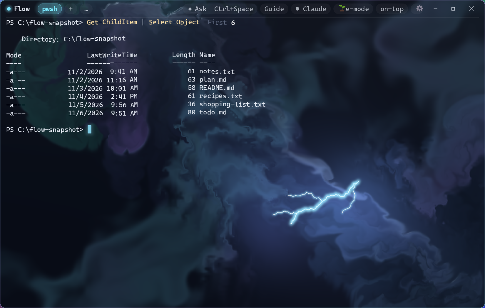
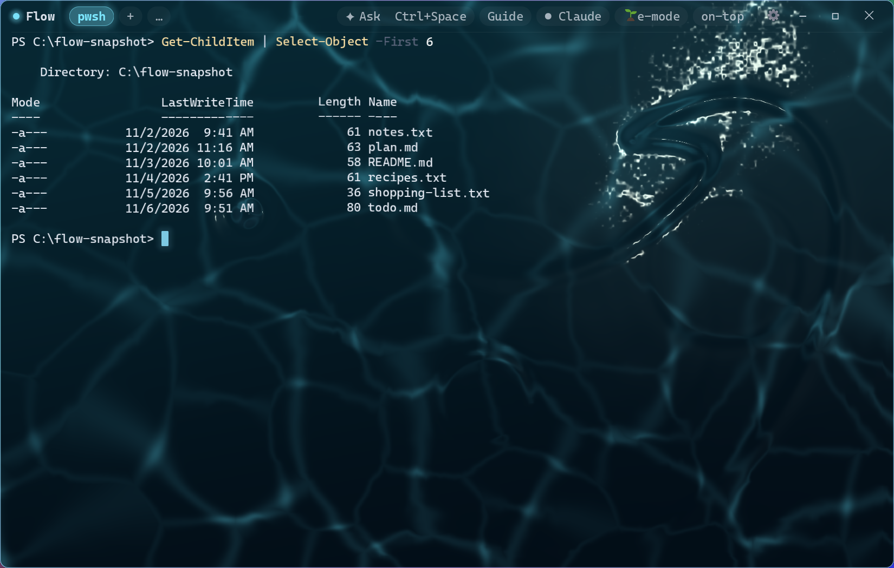
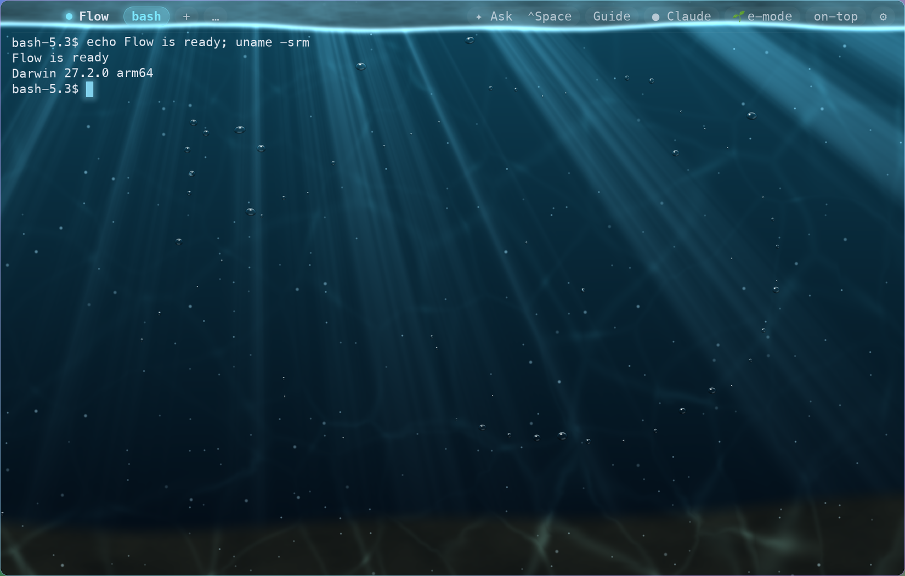
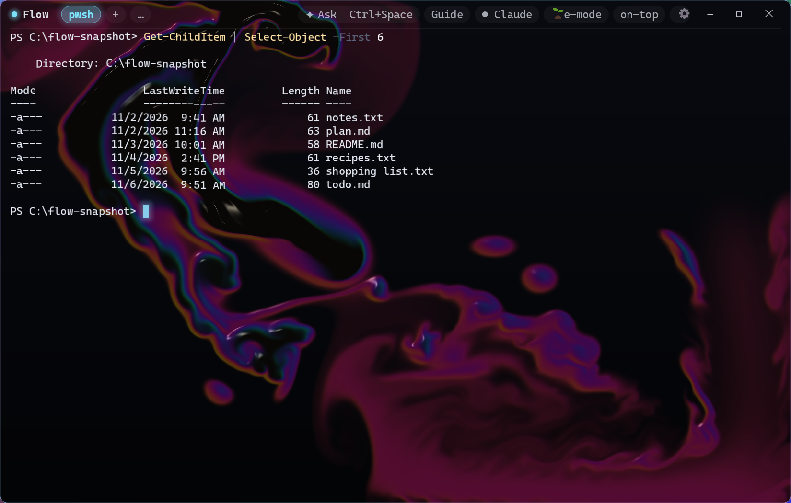
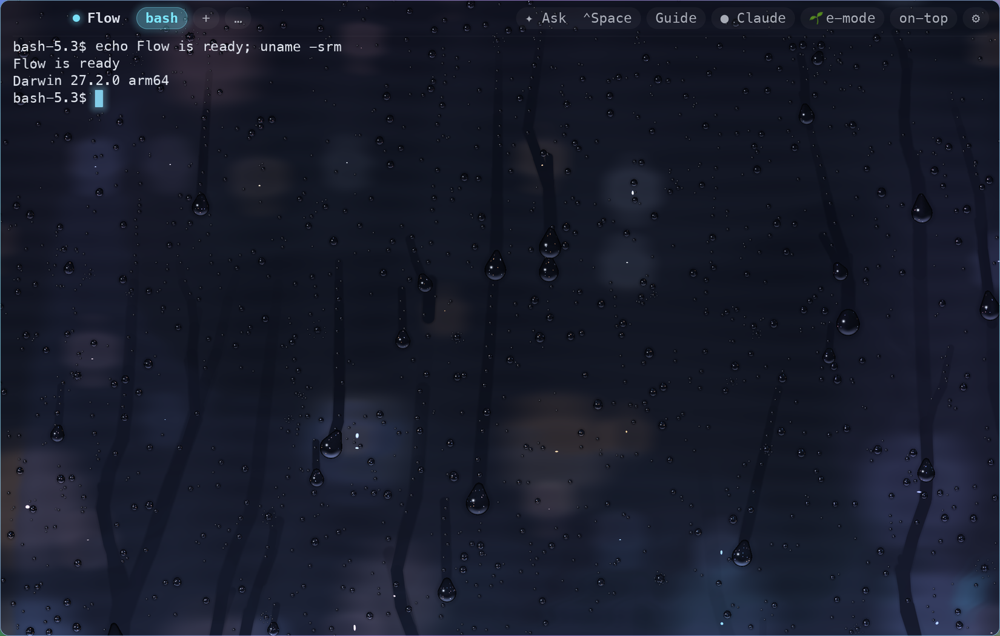
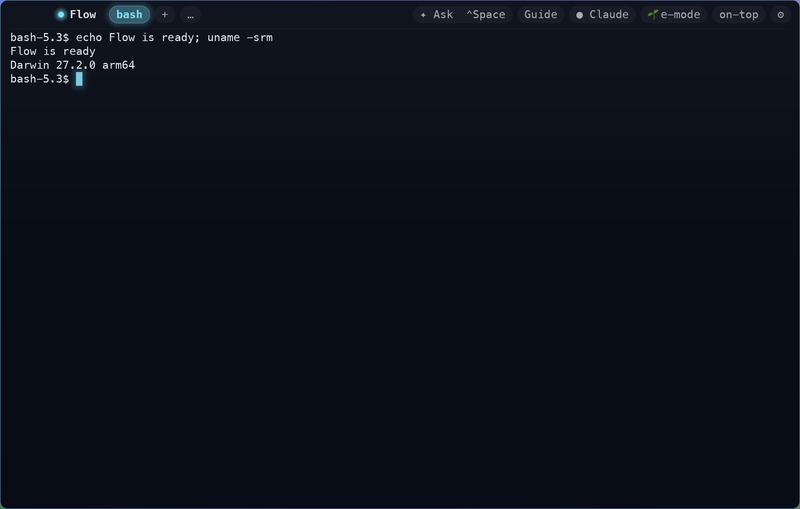
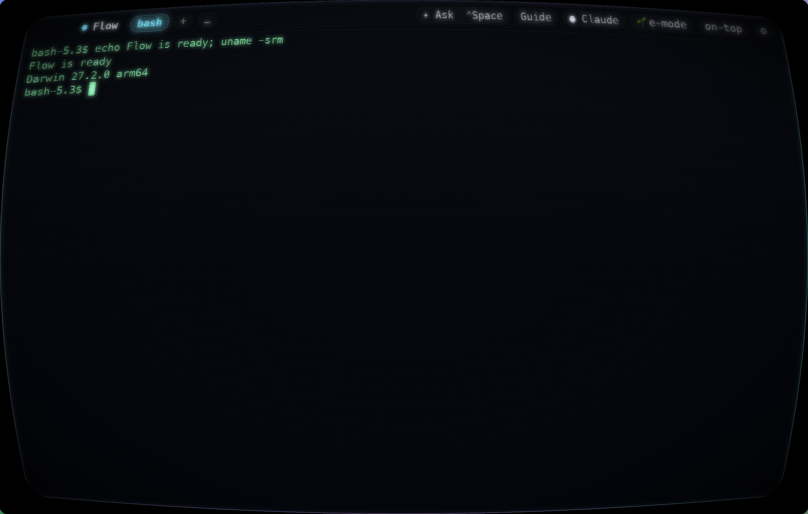

[← Flow's manual](../../README.md#documentation)

# Liquid styles

The glass is a live fluid simulation that your cursor and typing stir up. Pick a
style in Settings:

| | |
| --- | --- |
|  |  |
| **Clouds**: swirling ink, with optional lightning (*Electricity*) | **Water, from above**: ripples, sunlight glints and caustics on the floor |
|  |  |
| **Water, from below**: light shafts, bubbles and the surface overhead | **Oil**: a dark, glossy body with a thin-film sheen |
|  |  |
| **Rain**: drops strike fogged glass in a splat and a ring of spray, bead and merge; heavy ones run down, growing as they gather the water in their way, and leave beaded trails; water follows water, so runners are drawn onto the wet trails of those before them (and down a path the mouse wiped), a well-run trail becoming a stream that others join, and a path wiped across the glass holds them back a moment before they break through. Each drop is a tiny lens showing the lights outside small and upside down; the cursor wipes a clear path and typing lands new drops. In a downpour (pictured) runners hold their course in rivulets and the water runs down the glass in sheets; with Electricity up, heavy rain brings a thunderstorm | **None**: plain tinted glass, with nothing moving behind it |

**Flow speed** slows any of them down, from 0.1× to 2×. With rain, **Rain**
takes the place of **Flow amount** and sets how hard it rains: from a
drizzle (a few drops a second, as the rain always fell) through rain and
heavy rain to a downpour of some fifty times as many, where the glass is
wet all over, runners keep to their rivulets, a path wiped clear closes
over again quickly, and the taps on the glass become a steady hiss.
**Electricity**, for the clouds their lightning, brings the rain a
thunderstorm from heavy rain on: lightning far off lights up the night,
and every drop showing it, for a flicker, and its thunder follows, later
and fainter the farther off it struck (off at first).

**None** has no liquid at all: plain tinted glass, with nothing moving and
nothing to simulate, which uses the least power. **Liquid effect** in Settings
instead freezes the current style where it is.

## CRT



The **CRT** section of Settings shows everything, over any style, as an old
tube monitor would. **Preset** picks a ready-made look (Subtle, Classic,
Arcade, Phosphor, Television, Monitor), **Strength** sets how strongly it shows (Off
turns it off), and while it's on each part has a row of its own:

- **Scanlines:** how dark every other line is (50% is half brightness)
- **Interlace:** the lit and dim lines swap each frame
- **Phosphor glow:** the light bright text spreads over the lines
- **Phosphor decay:** how long the phosphor keeps glowing after the picture
  changes, leaving a fading trace (0 to 300 ms)
- **Grille:** the fine stripes of red, green and blue phosphor (none under
  a **Phosphor**: a monochrome tube's one phosphor coats its glass whole)
- **Vignette:** darker toward the corners
- **Curvature:** the picture bulges like a tube's glass, inside a black bezel.
  Clicks, selections and the pointer follow the curve.

**Your presets → Save as…** keeps the look under a name you type, to pick from
**Preset** later; saving under a name used before replaces it, and **Delete**
removes the saved preset in use. The CRT pairs with **None** and Green or Amber
text. With Interlace or Phosphor decay on, it draws every frame while the
window is in front, which uses more power; behind other windows the lines hold
still.

## The glass reacts

- **Commands.** When a command finishes, yours or the assistant's, a ring
  spreads from the prompt: calm teal when it worked, ember when it failed,
  violet and wider when it ran 30 seconds or more. The liquid splashes too, each
  style its own way: a burst in the clouds (lightning, after a long run) and
  the oil, ripples in the water seen from above, bubbles from below, drops on
  the rain. A failure's drops land close together and merge into one fat
  runner. A command you stop with Ctrl+C passes quietly.
- **Progress.** While a program reports its progress (OSC 9;4, which Windows
  Terminal also reads; Flow tells Cargo to send it), or keeps redrawing a
  percentage on its line as curl and wget do, the glass fills from the bottom
  like a tank: teal, red on an error, amber while paused, sloshing when there's
  no figure. It drains when the program is done.
- **The assistant.** While it thinks, the liquid leans in toward its panel, and
  ripples, bubbles or drops turn up along the panel's top edge. Each tool it
  reaches for splashes, and a task of several steps blooms from the panel when
  it's done.

- **Tabs.** When a command that ran 30 seconds or more finishes in a tab
  that isn't in front, that tab glows green (or red if it failed) until you
  look at it.
- **Notifications.** When a command that ran 30 seconds or more (Settings'
  **Notify when done**, under Terminal) finishes while Flow isn't in front,
  the system tells you: on the Mac a notification under the tab's name,
  saying the command (unless it looks as if it holds a secret, as the
  [command history](terminal.md#command-history) leaves out), whether it finished or
  failed (with its exit code) and how long it took, whose click brings
  Flow forward with that tab and pane in front (macOS asks
  once whether Flow may notify you); on Windows the same as a toast
  under Flow's name and icon, which Windows' Settings → System →
  Notifications lists as Flow (where they're off for Flow, its taskbar
  button flashes until you come back instead); on Linux a desktop notification, and the
  window marked as wanting you. Flow plays no chime or low tone for it
  besides. A command stopped with Ctrl+C says nothing.
- **Programs.** A program can set off an effect at a cell of its own:
  lightning from one cell to another, a splash, a ring or a push of the
  liquid. Flow Rogue's spells and blows do.

The rings and the tank show over every style, None included. **Reactions** in
Settings turns all of it off, and **Programs' effects** the programs' alone.

A program asks for an effect with

```
ESC ] 7731 ; fx=<kind> ; at=<col>,<row> [; to=<col>,<row>] [; color=<rrggbb>]
    [; size=<columns>] [; dir=<dx>,<dy>] [; strength=<0..1>] BEL
```

(or ST in place of BEL), counting cells from the screen's top-left from 0. The
kinds are `bolt` (lightning from `at` to `to`, which it needs), `burst` (a
splash, in `color` where the liquid takes color), `ripple` (a ring) and `stir`
(the liquid pushed along `dir`, which it needs). `size` is how far it reaches
and `strength` how hard, 0.5 unless given. Each style takes them its own way:
the clouds with colored splashes, the oil with pushes of oil, the water and
the rain with the ripples, bubbles and drops that typing makes. Since a
program's own pictures cover the liquid, and so do the backgrounds it gives
its cells (a game's own ground), bolts, bursts and ripples also glow over
them, under the text: the lightning itself, sparks flying out, a ring
spreading. The liquid itself stays under the cells' backgrounds.
None has nothing to move and shows none of it. Only the tab in front
sets them off, about six a second at most after a burst of eight, and only
those on the screen shown. Unknown keys are ignored, and so is a
request of an unknown kind, so programs can send it to any terminal: one that
doesn't know OSC 7731 ignores it. With [Sound](sound.md) on, each also sounds,
`sound=` picks the sound, and `volume=<0..1>` turns its sound down without
weakening the effect, for a program's own volume for its effects.

A program can also wash the glass in a color while it runs, as a game's night
falls:

```
ESC ] 7731 ; fx=tint ; color=<rrggbb> ; strength=<0..1> BEL
```

The glass shifts toward the color and the liquid dims, as far as `strength`
says, easing in over a second; `strength=0` washes it off, and so does the
program leaving the alternate screen (its full-screen mode). Flow Rogue sends
it at dusk and at night in the wilds.
