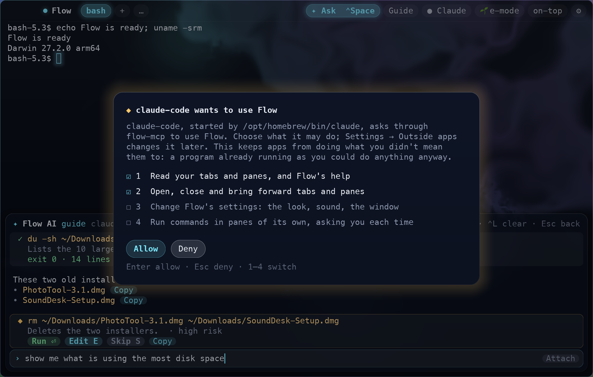
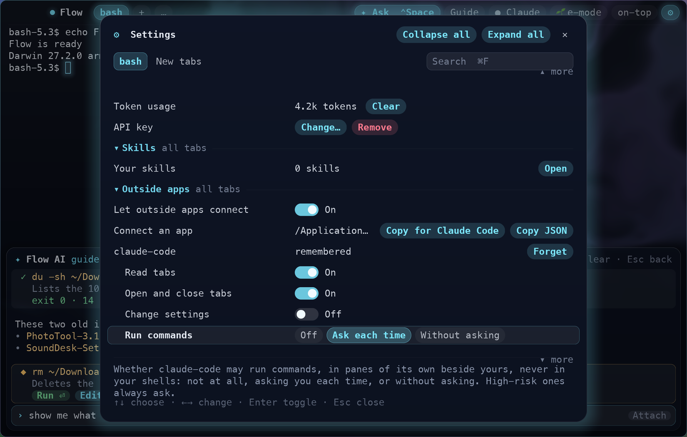

[← Flow's manual](../../README.md#documentation)

# Outside apps: MCP

From 0.1.42, outside apps (Claude Desktop, Claude Code, Cursor) can use
Flow through **`flow-mcp`**, an MCP server Flow carries beside `flowapp`, as
far as you allow each one: read your tabs and panes, run commands in panes
of their own, open and close tabs, and change Flow's settings.

- **Off until you turn it on.** Settings' **Outside apps** section starts
  with **Let outside apps connect** (`mcp.enabled`, off at first). Off, Flow
  doesn't listen for them at all; on, it listens on a socket in its config
  folder only you can open (on Windows a named pipe, `\\.\pipe\flow-mcp-<you>`,
  whose access list names you alone). Nothing listens on the network.
- **Only you, at both ends.** Each end asks the system who's at the other
  before a word goes: Flow closes a connection another user makes, unread,
  and `flow-mcp` sends nothing to a socket another user listens at, or to a
  pipe that isn't yours or is served by anything but a `flow.exe` running
  as you (pipes' names are shared by every user, so another could take
  Flow's first). It opens Flow's pipe letting whatever serves it know who's
  asking but never act as you, since what serves it isn't known to be
  Flow until it's open, so a program that took the name first can't
  borrow your account before `flow-mcp` turns it away. The app's model
  hears that what answers isn't your own
  Flow, to tell you, rather than that nothing does; where the system
  itself won't let `flow-mcp` open Flow's socket or pipe (another user's,
  or an app that runs `flow-mcp` in a sandbox), it hears that instead.
  Either way `flow-mcp` starts no Flow, which couldn't help. Flow listens
  in no folder that isn't yours (a link left in its folder's place is
  refused).
- **Connecting.** **Connect an app**, under it, gives `flow-mcp`'s path
  (in Flow.app's `Contents/Helpers`, Windows' `games` folder, Linux's
  `lib/flow-terminal/games`), with **Copy for Claude Code**, the command to
  paste in a terminal:

  ```bash
  claude mcp add flow -- /Applications/Flow.app/Contents/Helpers/flow-mcp
  ```

  (on Windows, `claude mcp add flow -- "C:\Program Files\Flow\games\flow-mcp.exe"`,
  in double quotes that PowerShell, cmd and Git Bash all read)
  and **Copy JSON**, an `mcpServers` entry for Claude Desktop, Cursor and
  others:

  ```json
  { "mcpServers": { "flow": { "command": "/Applications/Flow.app/Contents/Helpers/flow-mcp" } } }
  ```

  The app runs `flow-mcp` itself, which speaks MCP over its standard input
  and output and hands each call to the running Flow. Where Flow isn't
  running, `flow-mcp` starts it. `flow-mcp --help` says the same in a
  terminal.
- **Asked once.** The first time an app calls, a card in Flow names it and
  the program that started `flow-mcp`, and asks what it may do: read your
  tabs and panes (and Flow's help), open, close and bring forward tabs and
  panes, change Flow's settings, and run commands, each with a switch (a
  click, or 1 to 4). Enter allows, Esc denies. Flow remembers the answer in
  `mcp.json` beside `config.toml`, by the app's name and that program, so
  another program giving the same name is asked anew; the Outside apps
  section lists each app with a switch for each kind and **Forget**. This
  keeps apps from doing what you didn't mean them to; a program already
  running as you could do anything anyway.
- **Commands run in the app's own panes:** one Flow opens beside yours,
  labeled with the app's name, or the tabs and panes it opened. It may read
  your panes but never types into your shells nor closes your tabs. **Run
  commands** is Off, **Ask each time** (a card shows the command, Enter
  runs it, Esc skips it) or **Without asking**; a command Flow's rules
  rate high risk (deleting, sudo, erasing a disk, turning off the system's
  protections, sending data to another machine, naming a file that looks
  like a secret) always asks. The rules go
  [by pattern](assistant.md#guide-and-auto-mode), not a sandbox, so
  Without asking runs what they don't recognize. A command holding a
  control character is refused, since the shell's line editor would take
  it as a key and run another line. Its output, exit code and folder go
  back to the app, or its output so far once its time is up (the app's, at
  most 600 s, else the assistant's command timeout).
- **Settings** an app may change are what [`flow-settings`](from-the-shell.md#settings-from-the-shell)
  may: the look, in the tab in front, and sound and the window, for every
  tab; the assistant's settings and your themes stay closed.
- With Flow behind, a card asks through the system's notification too.
  Flow run as administrator on Windows never listens.

The tools: `list_tabs`, `read_pane`, `run_command`, `open_tab`,
`split_pane`, `close_pane`, `focus_pane`, `flow_settings` and `flow_help`.




