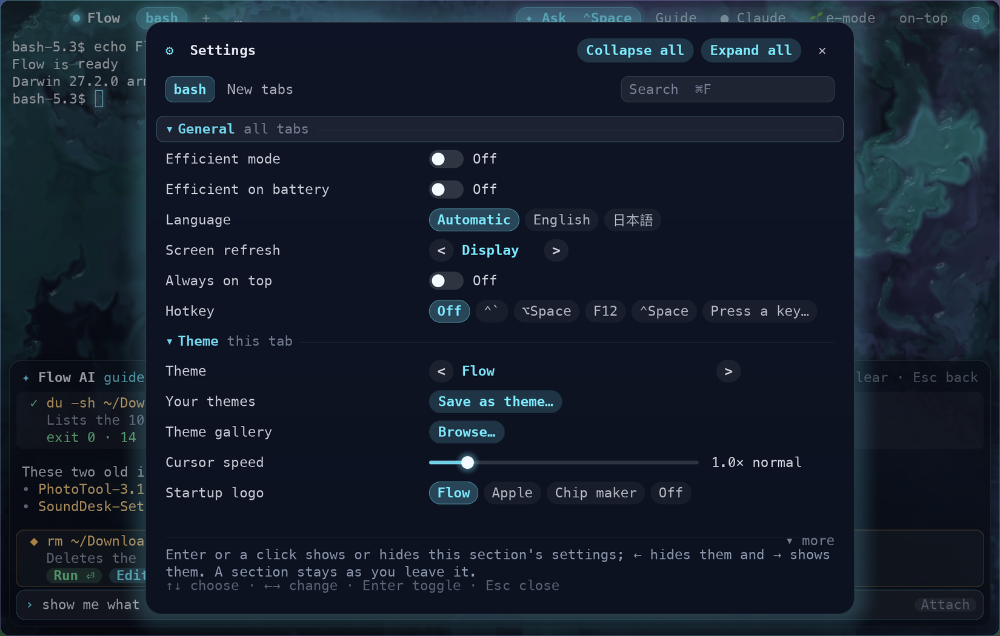
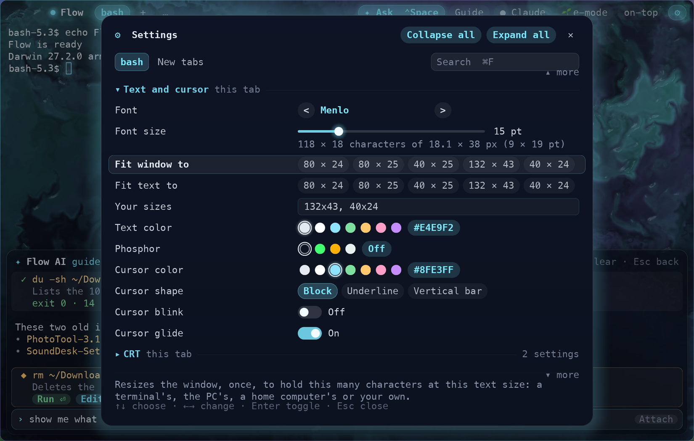

[← Flow's manual](../../README.md#documentation)

# Settings



Changes apply immediately and are saved when the menu closes. Use ↑↓ to choose
a setting and ←→ to change it (Shift moves sliders faster), or the mouse. The
wheel or trackpad scrolls the list, which otherwise moves only as far as it
takes to show the setting the keys choose.

The field at the end of the row of tabs searches Settings: `⌘F`
(`Ctrl+Shift+F`), a click on it, or a letter typed where no setting takes
one gives it the keys. It finds a setting by any words about it, each the
start of a word (Japanese by any run of its letters): its name, its hint,
its choices (**amber** finds **Phosphor**) or its key in `config.toml`
(`fx.crt`), in English as well as in the language Flow is in, every
section searched, closed ones too. The list shows what it finds, a name
before a hint, each with its section beside it and the words typed lit:
↑↓ choose, ←→ change the one chosen there and then, and Enter, or a click
on its name, goes to it in its place. Esc empties the field, then closes
Settings. Screen readers read the field as a search box.

Settings opens on the tab in front. Under its title, a row names each open
tab and then **New tabs**: a click, or the tab shortcuts (`⌘1` to `⌘9`,
`⇧⌘]` and `⇧⌘[`, or `Ctrl+Tab`; `Ctrl+Shift+1` to `9` off the Mac), moves
it to another, which comes to the front behind it. The look's sections
(**Theme**, **Theme details**, **Liquid**, **Glass**, **Text and cursor**
and **CRT**, the font's size among them) say **this tab** and change that
tab alone, which keeps its look as its own, across quitting and Restart
too; on **New tabs** they say **new tabs** and change the look the **+**
and `⌘T` open with, which the tabs whose look you haven't changed follow.
The others (**General**, **Assistant**, **Terminal**, **Recording**,
**Apps**, **Sound** and **About**) say **all tabs** and are Flow's, wherever Settings is. `⌘+` and
`⌘-` size the tab in front's text alone, likewise. A CRT preset or a theme
saved under a name is kept for every tab, and the machines' muted sounds
are per theme.

The settings come in sections: **General**, **Theme**, **Liquid**, **Glass**,
**Text and cursor**, **CRT**, **Assistant**, **Terminal**, **Recording**,
**Apps**, **Sound** and **About**. Each header is a row the keys reach too: Enter or a click closes
the section, leaving its header with a count of the settings it hides, and
opens it again; ← closes it and → opens it. A section stays as you leave it
(`ui.closed_sections`), so the ones you don't change can stay out of the way;
the CRT's, Apps' and Sound's start closed. **Collapse all** and **Expand
all**, beside Settings' ✕, close every section to its header or open them
all, so you can open just the one you want. Settings opened at one setting
(the title bar's **Add API key**, say) opens its section.

**Language**, at the top, picks the language of Flow's menus, settings and
messages: English or Japanese (日本語). **Automatic** follows the Windows
display language, the system's preferred languages on macOS, and on Linux
`LANGUAGE`, then the locale (`LC_ALL`, `LC_MESSAGES` or `LANG`). The assistant is told the
language too, so it answers and describes its commands in it unless you write
in another. On the Mac, Sparkle's update windows and the permission prompts
for programs run in Flow follow the system's language.

**Screen refresh**, under it, sets how often Flow draws while something moves
or output comes. **Display**, the default, keeps to the screen's own rate while
the window is in front: 60 Hz on most screens, 120 Hz on a ProMotion Mac.
30 to 240 Hz cap it instead, and a lower rate saves power (a rate above the
screen's draws at the screen's). **Unlimited** doesn't wait for the screen: each
frame shows as soon as it's drawn, so text shows a little sooner, but while
anything moves Flow draws as often as the GPU manages, which uses the most
power. Behind other windows Flow draws at most 20 frames a second, whatever it's
set to. With the CRT on and nothing moving, Flow draws at most 30 frames a second
once its afterglow has faded, unless its lines interlace.

**Always on top**, under it (off at first), keeps Flow's window in front of
every other window, as the title bar's **on-top** pill does (lit while it's
on; also **Window → Float on Top** on the Mac, and the palette, where Keys
can give it a key). The pill sits beside the gear and never gives way when
the title bar runs short: the tabs give up the room instead. It keeps a
window the hotkey dropped down on top too, and off, the hotkey still
brings the window forward, but other windows can come in front of it.
Wayland lets no program keep its own window on top, so there the row
says your desktop's window menu does it (a right click on Flow's title
bar), and the title bar has no pill.

**Hotkey**, under it, takes a key for the whole system that brings Flow
forward from any app and puts it away again while it's in front: `` ⌃` ``,
`⌥Space`, `F12` or `⌃Space` (`` Ctrl+` ``, `Alt+Space`, `F12` or `Ctrl+Space`
off the Mac, but not `F12` on Windows, which keeps it for debuggers and
refuses it, with Shift or Alt too), Off at first; while it's `⌃Space`, that key no longer opens
the assistant's panel. **Press a key…**, last, takes the next key you press
instead: a letter, a digit, `` ` ``, Space or an F key, held with ⌃, ⌥ or ⌘
(Ctrl, Alt, or the Windows key or Super), or an F key alone. The hotkey
set is let go meanwhile, so it can be pressed too; Esc keeps the one
before, and a key Flow can't take says so under the row, as the system's
do (`⌘Q`, `⌘Tab`, `Alt+F4`), which the hotkey would take from every app.
A key one of Flow's commands has (the Mac's menus give theirs up while
Settings waits) is taken from it, since the system takes the hotkey
first, and a note says which command gave it up; where the hotkey can't
be had (Wayland), the command keeps it. With one set, **Drop
down** (on) has it drop Flow's window over the top of the screen, in
front, as a Quake-style console does: on the Mac the screen the pointer is
on, below its menu bar, the window on every Space until the hotkey puts it
away (which hides Flow, giving the keys back to the app before it); on
Windows and Linux the window's screen. Off, Flow comes forward where it
was. Either way it stays in front of other windows only while **Always on
top** is on, as the title bar's **on-top** shows. While it drops:
- **Drop-down height**: a third, half (at first), two thirds or all of the
  screen.
- **Slide** (on): the window slides down from above the screen, slowing
  as it lands, and back up as it's put away, in about a fifth of a
  second. Off, in efficient mode, on Wayland (which lets no program move
  its window), and where another screen is above the one it drops on
  (which it would be seen crossing), it shows and goes at once. GNOME
  keeps a window below its top bar, so there it shows and goes in place.
- **Put away when unfocused** (off): the window dropped down is put away
  once another app has the keys, as the hotkey would. It waits a moment
  first (X11 takes the keys for one as the hotkey is pressed), and Flow's
  own panels for files don't count.
- **Over full-screen apps** (the Mac, off): the window drops over an app
  in full screen too, without leaving its Space. For that Flow runs as an
  accessory app while it's down, so its Dock icon and menu bar go, and
  ⌘Tab passes it by; they come back as it's put away.

Where the key can't be taken (another app has it), Settings and a toast
say so. On Linux it works in an X11 session only: Wayland lets no program
take a key for the whole desktop, and Flow on X11 under a Wayland desktop
(XWayland, as About's X11 there says) hears it only while an X11 window has
the keys, so the key that put the window away would never bring it back.
There the Hotkey's row says **Not available on Wayland** and why, with
nothing to choose, and a hotkey set in an X11 session is kept but not tried.

Put away, Flow's window is hidden: it has no taskbar button and Alt+Tab
passes it by, though Flow and its tabs go on running. On Windows, Flow's
icon shows in the notification area meanwhile (Windows 11 may keep it
under the ^ until you pin it), saying how it comes back. A click on it
brings Flow back as the hotkey does. Its menu has **Show Flow** and **Quit
Flow**, which keeps your tabs as any quit does. Starting Flow again while
it runs (from Start, the taskbar or Explorer) brings the Flow running
forward, put away or not, rather than opening a second one. A second one
couldn't let outside apps connect or take the hotkey, and the two would
save their settings over each other. Another copy of Flow, in another
folder or with another config folder, still starts on its own. On the Mac
the Dock does both already, and on Linux a second start still opens a
second Flow.

Without a GPU, Flow draws on the CPU and each frame takes tens of milliseconds.
That's the case in Windows on a Mac in Parallels, whose graphics driver offers
no Direct3D 12. So that typing stays quick, the liquid then pauses while you
type and flows again a moment after, the CRT holds still (no interlacing or
afterglow), the cursor steps along as you type instead of gliding, and a key
sent to the shell is drawn together with the shell's echo. Flow says so when it
starts.

**Font** steps through the monospaced fonts installed on your computer, and
the eight Flow brings for its themes, and redraws the terminal and the
assistant panel in the one you pick. Characters a
font lacks, such as emoji or powerline symbols, come from other
installed fonts (Flow draws box drawing and block graphics itself), and in a font without a bold of its own (Monaco, Andale Mono)
bold text is drawn thicker.



**Font size** says under its slider what the window holds at that size and
each character's size: "80 × 24 characters of 9 × 18 pixels", and on a
Retina or other scaled display the cell in points too ("of 16.8 × 34 px
(8.4 × 17 pt)"), since a cell is as wide as the font's letters, often a
fraction of a pixel. `⌘+` and `⌘-` (`Ctrl+=` and `Ctrl+-`) say the same in a
toast. **Fit window to**, under it, resizes the window to hold a screen of
an old machine's at the text size in use: 80 × 24 (a terminal), 80 × 25 (the
PC) or 40 × 25 (a home computer, teletext). While an old machine's theme is
worn its own screen comes first: 80 × 34 for the Flow notaSun Workstation's console,
80 × 40 for the Graphics workstation's terminal, 72 × 24 for the Teletype's
line of paper, 32 × 24 for the Flow Instruments Home Computer's screen, 80 × 32
for the Flow notanAmiga CLI's (a PAL screen of its letters). The
size counts the margins, a theme's border, the title bar
and the assistant's panel if it's open, and the choice that matches the
window's grid is lit. It resizes the window just this once: nothing is
saved, and Flow still opens at `window.width` × `window.height`. A maximized
window is put back to its own size first (on the Mac a zoomed one is simply
resized), and a toast says so if it stays maximized. Where the screen (less the menu
bar and the Dock on macOS, the taskbar on Windows; on Linux less room for a
taskbar) can't hold it,
the window takes the largest size it can and a toast says what it holds
then. The window can't be smaller than 520 × 320 points, which at the
default 15 pt holds 54 columns, so 40 × 25 needs larger text: the toast
says from what size (about 20 pt in Menlo). In full screen it says to leave
it first, and where the desktop keeps the window's size (a tiled window on
Wayland) it says so and what the window holds.

**Fit text to**, under it, is the other way round: it leaves the window as
it is and sets the text size, as Font size does, to the largest whole size
at which the window holds the screen chosen, from the same list; a toast
says what it holds then (a window of another shape holds more one way), or
that the window is too small for it even at 8 pt.

**Your sizes**, under them, adds screens of your own to both lists: type
as many as you like, each as columns × rows (`132x43, 40x24`; `×`, `X` or
`*` work too, and spaces round the sign), press Enter or click the row to
type, and Enter again to keep them, or Esc to put back what was there.
Each comes after the others in Fit window to and Fit text to, and is kept
in `window.sizes`. A size needs at least 10 columns and 3 rows and at most
500 × 300; what isn't one is dropped as you keep them, a note saying
what was left out and why (`Left out 5x5: a size runs from 10x3 to
500x300`), and the rest is written alike (`132x43, 40x24`).

**Text color**, **Cursor color** and **Background** each offer a row of
swatches and show the color in use as `#RRGGBB`. Click that value, or press
Enter on the row, for a color picker: drag in the field for saturation (across)
and brightness (up), pick the hue on the bar below it, or type or paste a hex
value. ←→ turn the hue and ↑↓ change the brightness (Shift for bigger steps).
The color changes as you go; **Done** or Enter keeps it, **Cancel** or Esc goes
back. The text color is for text that programs leave uncolored, so `ls` colors
and syntax highlighting keep theirs, and the background tints the glass under
any liquid style. Programs that ask for the terminal's colors are told the
ones picked. **Phosphor** shows everything in one color, as a monochrome monitor
did: programs' colors (the 256 and truecolor too), pictures, 3D models, the
liquid and Flow's own title bar, panels and dialogs, each as bright as its
luma, the brightness such a monitor took from the video signal (weighed as
composite video and mono VGA weighed it). So black is black, white is the
phosphor at full and never paler, as one phosphor can't be, and every color
keeps its place between them: the green and amber screens' own text, sent
in their phosphor's color, shows a little below full, and their bright
text above it. A glow over bright text tops out at the phosphor too,
with the CRT on or off, and the tube has no grille, as a monochrome tube
had none. Unlike a real monitor, a saturated color shows at least a third
as bright as its brightest part, so a program's blue or red text on black
still reads; by its brightness alone, pure blue would be about a ninth of
white's, and all but vanish. Its row
offers **Off** (full color), green, amber and white, and the picker any
other; the picker's own field keeps its colors. The green and amber screens
wear theirs, and your own theme or one saved keeps the one picked. The
desktop behind the glass isn't Flow's to color. **Glow** sets how strongly the cursor, tabs, buttons and dialogs glow,
from Off to 200%. A tab whose long command finished behind it glows whatever
it's set to.

**Cursor shape** picks a block, an underline or a vertical bar, and **Cursor
blink** makes the cursor blink while Flow is in front; it stays lit as you type.
They're what the terminal starts with: programs can still change both while
they run, as Vim does in insert mode, and go back to them when they're done.

**Cursor glide** lets the cursor glide to each new place, also as you type.
Turned off, it steps to each character you type at once and glides only on
longer moves, such as to the next prompt. Without a GPU it always steps.

**Startup logo** greets you as old workstations did: each tab Flow opens
shows a logo beside Flow's version, the computer (system, chip and memory)
and the shell with the graphics API Flow draws with, shown by its logo
(Vulkan's, OpenGL's or Metal's, and for Direct3D 12 DirectX's wordmark in
the text's color), and the prompt follows below; it's drawn in the tab's own
colors, and an old machine's tab shows its maker's where its theme has one. **Flow** shows Flow's
icon; **Apple** or **Windows** shows the system's logo instead, Apple's drawn
from macOS's own font; on Linux **Distribution** shows your distribution's
(the logo `/etc/os-release` names, or the icon theme's `distributor-logo`,
where there's one as a PNG; else Flow's); **Chip maker** shows Intel's (the
one with its e dropped, as it was until 2005) or AMD's with its arrow, by
the computer's chip, and the system's for another's; **Off** shows nothing.
With the **Flow notaSun Workstation** theme on, its boot shows Sun Microsystems' emblem
in its purple of 1983 to 1996, and with the **Graphics workstation** SGI's
cube of tubes turns beside its boot's words (see [Trademarks](../trademarks.md)). A click on
the cube turns it back to stand as SGI's logo does, where it rests five
seconds before it turns on again (in efficient mode, which holds it still,
it stands so until efficient mode goes off). It takes
effect the next time Flow starts, or after **Restart** (at the end of
Settings). The logo scrolls away with the output and goes with a clear
(`cls`, `clear`), while full-screen programs leave it where it was.

**Theme**, at the top of the look, with **Theme details**, your own theme,
**Save as theme…**, **Export…** and the **Theme gallery**, is in [Themes](themes.md).

**Preset file** saves the look to a JSON file (**Save…**) and takes one on
(**Load…**): the liquid style and its settings, the glass, glow, the CRT, the
colors, the cursor, the font and your own theme, under the same names as in `config.toml` (see
[Configuration](configuration.md)). The assistant, the shells, the language, the
window and your named CRT presets aren't in it. Loading changes only what the
file sets, so one edited by hand can hold just a few settings:

```json
{
  "fx": { "style": "rain", "opacity": 0.7 },
  "colors": { "text": "#7EE09F" },
  "cursor": { "shape": "bar", "blink": true }
}
```

If a setting in it doesn't fit, such as a word where a number goes, nothing
changes and Flow says what's wrong.

**Restart**, at the end of Settings (also **Restart Flow** on the About
card, which a click on the Flow logo opens, and **Flow → Restart Flow** in
the Mac's menu bar), starts Flow afresh without quitting it: every tab closes, ending what runs in them, `config.toml` is read again, and each tab opens again with its shell, its theme and its folder, the one in front in front, greeting you as at
launch, with the startup logo and a theme's start screen. The window, the
assistant's conversation and the command history stay. So a startup logo just
picked, or a `config.toml` edited by hand, shows at once; a `config.toml` that
doesn't read leaves the settings as they are, and Flow says why. `⇧⌘B`
or `Ctrl+Shift+B` (**Shell → Restart Tab** on the Mac) restarts only the
tab in front: a new shell of its kind starts in its place in the tab bar,
in its theme and its folder, greeting with the startup logo and its
theme's start screen as Flow does when it starts, and the old one ends
with what runs in it; while a program runs there, it asks first. On Linux,
once an update has put a new Flow in place of the one running (About's
**Install Update**, or `sudo apt install` for the .deb), **Restart** starts
the new one and this one quits, with a new window and the same tabs.
**Flow → Restart Flow** (and the palette's Restart Flow, or a key you bind
to it) restarts at once while every tab waits at its prompt; while a
program runs in one, it asks first, and choosing it again within five
seconds restarts. A program's `flow-settings restart` never counts as
that second choice ([From the shell](from-the-shell.md#settings-from-the-shell)).

**Efficient mode**, first in Settings and **🌱e-mode** in the title bar (lit
while it's on; also `⇧⌘E` or `Ctrl+Shift+E`, and **View → Efficient Mode**
on the Mac), puts Flow at its leanest for real work: the liquid stops and the
glass is plain, as with the None style, the CRT is off, the rings and
splashes and the effects programs ask for (with their sounds) are left out,
and the theme's machine is quiet. The cursor goes straight to where it goes,
and a theme's start screen shows at once, one being typed too. Your settings stay as they are, so turning it
off brings everything back; only the switch is saved, and Flow starts as you
left it. Programs' own pictures and 3D models still draw and move as they
ask, programs' own notes and named sounds still play, and the bell and
Flow's cues still sound. Flow's own turning startup logo (the Graphics
workstation's cube) stands still where it is, and turns on from there when
efficient mode goes off.

**Efficient on battery**, under it (off at first), turns efficient mode on
by itself while the computer runs on battery, or saves power while plugged
in (Low Power Mode on the Mac, energy saver on Windows), and off again when
that ends, unless you had turned it on yourself. Meanwhile the title bar's
pill reads **🌱e-mode · battery** (or **🌱e-mode · low power**, just
**🌱e-mode** where a narrow window leaves the tabs no room for it, and
narrower still the **✦ Ask** pill leaves out its shortcut), and
Settings' **Efficient mode** shows on and says why, and a toast says when
it comes on and what ended when it goes off (plugged in, Low Power Mode or
energy saver off). Switch efficient mode off then and it stays off until
that ends or Flow quits: that isn't saved, so Flow opened again on battery
turns it on again. Switch it on and it's your own, staying on after;
switched off on battery (or in Low Power Mode, or with energy saver on),
it stays on for that, as the title bar and a toast say, and off again it
stays off until that ends. The power never changes the saved switch.
Flow asks how the computer is powered at the start, when its window comes
to the front, and
at most every 2 seconds while it's in use (the Mac's power sources and Low
Power Mode, Windows' power status, Linux's `/sys/class/power_supply`); a
computer that doesn't say counts as plugged in, and snapshots and
recordings never ask.
