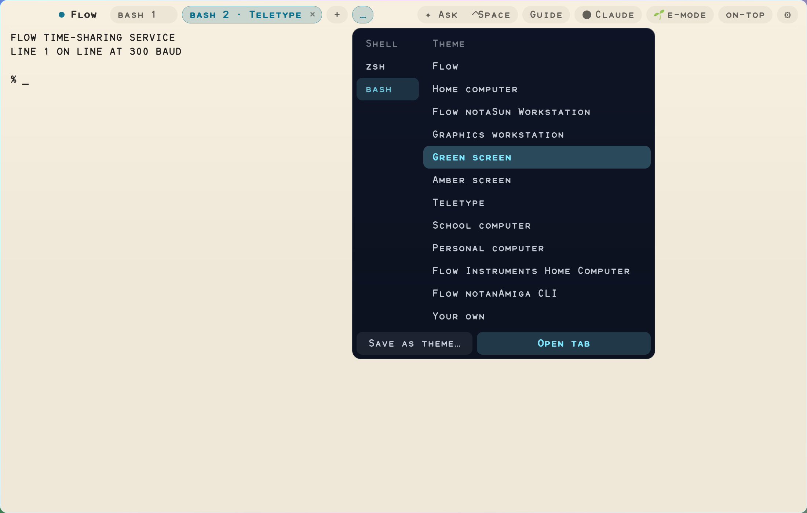
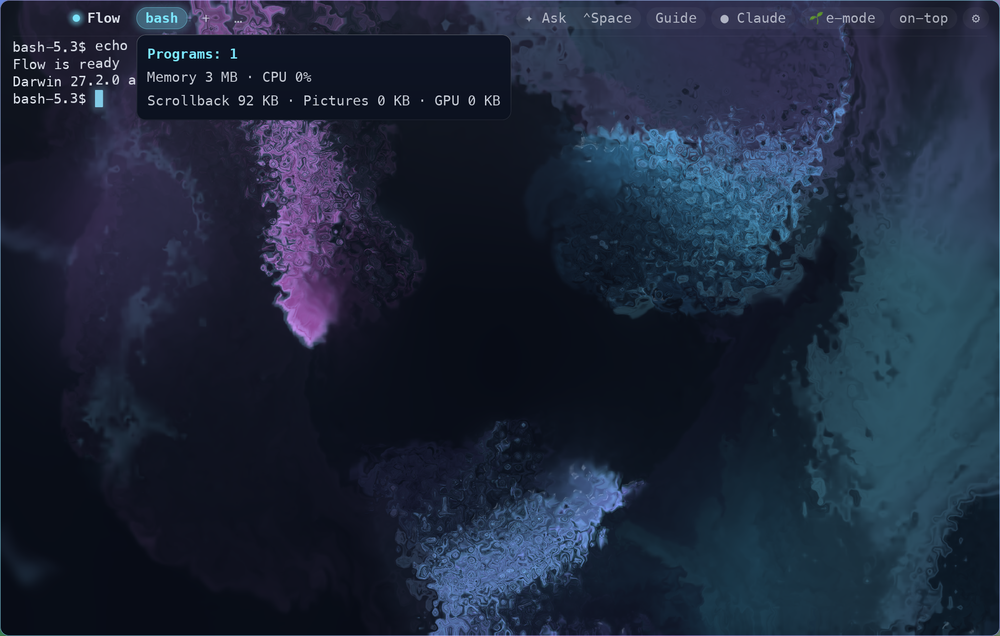
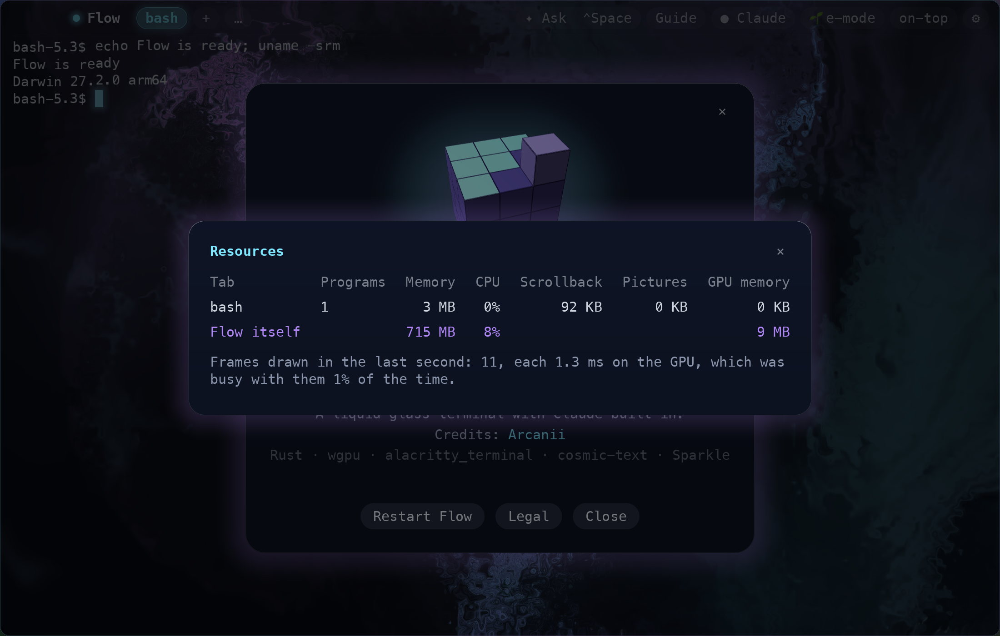

[← Flow's manual](../../README.md#documentation)

# Shells

| Platform | Shells |
| --- | --- |
| Windows | cmd, PowerShell (pwsh 7 when installed, else Windows PowerShell), bash (Git Bash, then MSYS2, then WSL, else the BusyBox that ships with Flow) |
| macOS | zsh (default), bash (Homebrew bash if installed, else `/bin/bash`) |
| Linux | zsh and bash, whichever is your login shell first (zsh when it's neither); `/bin/sh` if there's neither |

Each tab runs one shell, and you can open as many tabs as you like, the same
shell more than once included (they're numbered: `bash 1`, `bash 2`). A new tab
starts in the folder of the one in front, where that's a folder on this
computer: any program can say what folder its shell is in, so a folder on
another computer (`\\server\share` on Windows, where merely looking at it
hands that computer your sign-in) is never looked at, and the new tab
starts in your home folder. The **+** after the tabs, like
`⌘T` / `Ctrl+Shift+T`, opens the **Default shell** from Settings at once; the
**…** beside it lists every shell beside every theme, the ones you saved
last, to open a tab with any shell in any theme (↑↓ or the wheel choose in
a list, ←→ go between them, Enter or **Open tab** opens; a list longer
than the window has room for shows what fits around its choice); its **Save as theme…** keeps
what the window wears now under a name (see [Themes](themes.md)). A tab in a theme of its own says so in its name (`zsh ·
Teletype`), and the window wears that theme while the tab is in front: its
colors, fonts, glass and CRT, its start screen and prompt, and its machine's
sounds. Settings opens on the tab in front, and its look's sections change
that tab alone (see [Settings](settings.md)). When a tab's shell exits,
the tab closes. Quit Flow with tabs open and the next start opens them
again, each with its shell, its theme and its folder, the one in front in
front (Settings' **Reopen tabs at start**, under Terminal, on by default;
`FLOW_SHELL` opens its one shell instead), and Settings' **Restart** always
does; once the last tab closes, the next start opens one. The assistant runs its commands in the tab
in front when it starts them, and keeps to that tab if you switch.

Rest the pointer on a tab, or bring it to the front with the keys (`⌘1`
to `⌘9`, `⇧⌘]` and `⇧⌘[`, or `Ctrl+Tab`; `Ctrl+Shift+1` to `9` off the Mac),
and a card under it says what the tab uses for a moment (until the next
key, from the keys): its
programs (its shell and everything started under it), the busiest named,
their memory and their share of a CPU core, and what Flow holds for it, its
scrollback, its pictures and what they take on the GPU (a 3D model's mesh,
its textures and its drawing among it). **Resources**,
beside **Release notes** on the About card, shows the same for every tab
at once, with Flow's own memory and CPU, what the window itself takes on
the GPU (its glyphs, the liquid, the CRT), the frames drawn each
second, and where the GPU can say (it asks for its timestamps), how long
each took on the GPU and so how busy it was with them.
They're read about once a second while one of them shows, and not
at all otherwise. Programs in WSL
run in its own Linux, out of Windows' sight.

Each shell starts with a small integration hook (prompt markers, OSC 133/633)
so Flow knows when a command finishes, its exit code, and the current folder;
zsh's, bash's and PowerShell's also say each command line. Those three send
a secret of the tab's own with the line and with each command's end
(`FLOW_NONCE`, which they keep from the programs they start), so what a
program running in the foreground prints that only looks like the hook's
marks (a command line, a prompt, a command done) is passed over: it can't
name a line in the [command history](terminal.md#command-history), end a
command early, or have Flow take the program for the shell's prompt.
cmd's and BusyBox's hooks send no secret, and there Flow takes the marks
as they come.

A program left running in the background (`tail -f log &`, `ssh -f`)
prints while the shell waits at its prompt, and a prompt carries no
secret, so what it draws there is taken as the shell's: a prompt with
words after it, which your Enter then reads off the screen with what you
typed. zsh and PowerShell say each line they run themselves, and bash each
line it reads at the prompt, which takes the place of those words. For a
line bash's history leaves out (`HISTCONTROL`'s `ignorespace`,
`HISTIGNORE`), its hook can say only the newest line the history holds,
so Flow keeps what the screen showed only where it's that line (a command
typed again, which `ignoredups` leaves out). A line the hook says nothing
of at all ran nothing the hook saw: Enter alone, blanks, a comment, a line
the shell couldn't read (a syntax error), a line of 4,000 characters or
more, and in bash before 4.4 a line that begins in a subshell (`( … )`,
`{ …; } &`) or runs no command at all (a function's definition,
`f() { …; }`). For those, and for a line bash left out that isn't the
newest, Flow keeps nothing: no line in the history, and no command named
in the notification or for Ask why, which a syntax error then isn't
offered for either. What's still open:

- In bash before 4.4 (macOS's own 3.2, RHEL 7's 4.2) with a `DEBUG` trap
  of your own (starship's prompt sets one where bash-preexec isn't
  loaded), Flow's hook leaves the trap alone and says no line, so the
  words a background job drew stand for every line; so they do for a
  pane's first line, before its hook has said any, and in a bash whose
  `PROMPT_COMMAND` is read-only, whose hook says no command's end.
- With bash's history off (`set +o history`, or `HISTSIZE=0`), its hook
  can say no line it reads, so Flow keeps no line of that bash's, and the
  notification and Ask why name no command for it.
- PowerShell says no command's start: a line typed ahead while another
  runs is taken to start at the shell's prompt, so a prompt a program
  draws while it runs is taken as the shell's; and a prompt that draws
  itself again as you press Enter (oh-my-posh's transient prompt) says its
  command done before the command runs, so the same holds for that
  command.
- cmd's and BusyBox's hooks send no secret at all.

bash's line editor in a locale that isn't UTF-8 (`LC_ALL=C`, which scripts
often set, or none at all) would take each byte of a letter past ASCII as
Meta and a key, so a command Flow types (the assistant's, a reply's, the
flow command's) could be keys that throw away what's typed so far, quotes
and all, as macOS's bash 3.2 does with Ē. Flow's bash hook has it take
every byte as a letter before each prompt (readline's `convert-meta` off,
`input-meta` and `output-meta` on), whatever your `.inputrc` says. But
readline 8.1 and later (bash 5.1 on) look at the locale again as each line
is read, and where it has changed since the line before, put back that
locale's settings over the hook's for that one line. A bash built with a
readline apart from it (Homebrew's, and some Linux distributions') has
readline read the locale from the environment bash hands the programs it
starts, which bash brings up to date only as it starts one or runs a
command substitution, so a locale changed at one prompt would reach
readline only at a later one, or one set for a program and taken back on
the same line would stay; so from bash 5.1, Flow's hook runs a
substitution before each prompt (`: "$(:)"`, about half a millisecond on
a Mac, more where starting a process costs more, as in Git Bash), and
readline sees each prompt's locale at that prompt. So
at the first prompt after a change into a locale that isn't UTF-8 (`export
LC_ALL=C` typed at the prompt, or in a file you `source`; a locale
variable exported counts as a change), the hook tells Flow, and Flow types
no letter past ASCII into bash there: a command of the assistant's or an
outside app's holding one isn't run (it's told why: any command without
them first brings a prompt that takes them), a reply's block isn't run or
put at the prompt, nor a command from the history (a toast says so), and
the flow command's words and a dropped file's name go as their bytes,
`$'\xc3\xbc'` for ü. So it is wherever Flow's hook can't tell readline
what to do: in a bash or zsh pane whose hook never ran (one that its
startup files `exec`ed in its place, whatever a program there prints to
look like Flow's prompt: the hook says each command done with the pane's
secret before every prompt, which no program can), and in a bash whose
`PROMPT_COMMAND` is read-only, which runs nothing of Flow's before its
prompts. Which locale counts is the one readline goes by: `LC_ALL`, else
`LC_CTYPE`, else `LANG`, both as bash's own readline reads them and among
those exported, as one of its own does (so `LANG=C` beside a UTF-8
`LC_CTYPE` takes letters as letters).

cmd can't report exit codes, so Claude sees "unknown" there. Prompt themes
that set the prompt afresh before each one (zsh's `prompt` themes, a bash
`PROMPT_COMMAND` that sets `PS1`, as a string or bash 5.1's array) keep
working: zsh and bash mark the prompt after them.

On Windows the bash tab works even without Git Bash, MSYS2 or WSL: Flow ships
[BusyBox](https://frippery.org/busybox/) (`windows/third_party/busybox`) and falls back
to it. That is BusyBox's ash, a POSIX shell with some bash features but not
GNU bash (no arrays), plus 100+ Unix tools in one 0.7 MB exe: `ls`, `grep`,
`sed`, `awk`, `find`, `vi` and more. Claude is told which one it's talking to.
A real bash always takes precedence when one is installed.

`FLOW_SHELL` in the environment picks the first tab for one launch: `cmd`,
`powershell` or `bash` (on macOS and Linux, `zsh` or `bash`). `FLOW_SHELL=busybox` opens
the built-in bash even where Git Bash is installed, which is handy for trying it.

Every shell Flow starts gets `CARGO_TERM_PROGRESS_TERM_INTEGRATION=true`, so
Cargo reports its build progress for the tank.

On macOS the shells start as login shells, as in Terminal, so `/etc/zprofile`
and your `~/.zprofile` set up `PATH`. An app opened from the Finder gets no
locale, so Flow sets `LANG` to your UTF-8 locale (for example `en_US.UTF-8`)
unless one is already set. On Linux the desktop sets the locale; if Flow was
started without one, its shells get `LANG=C.UTF-8`.
