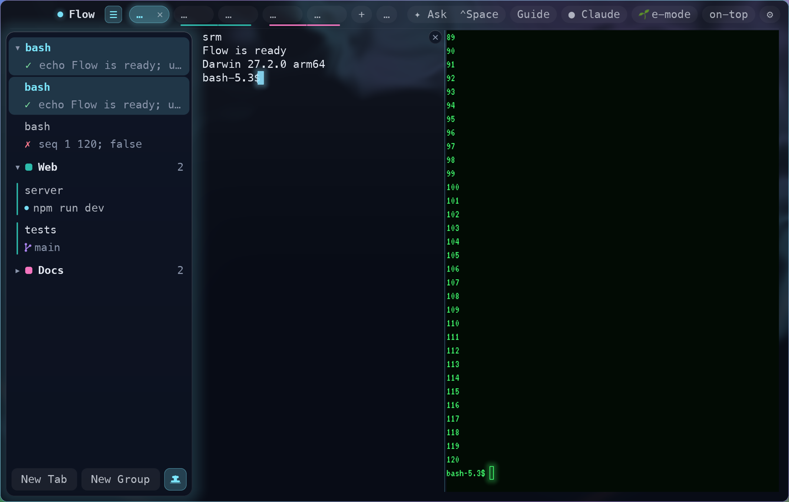
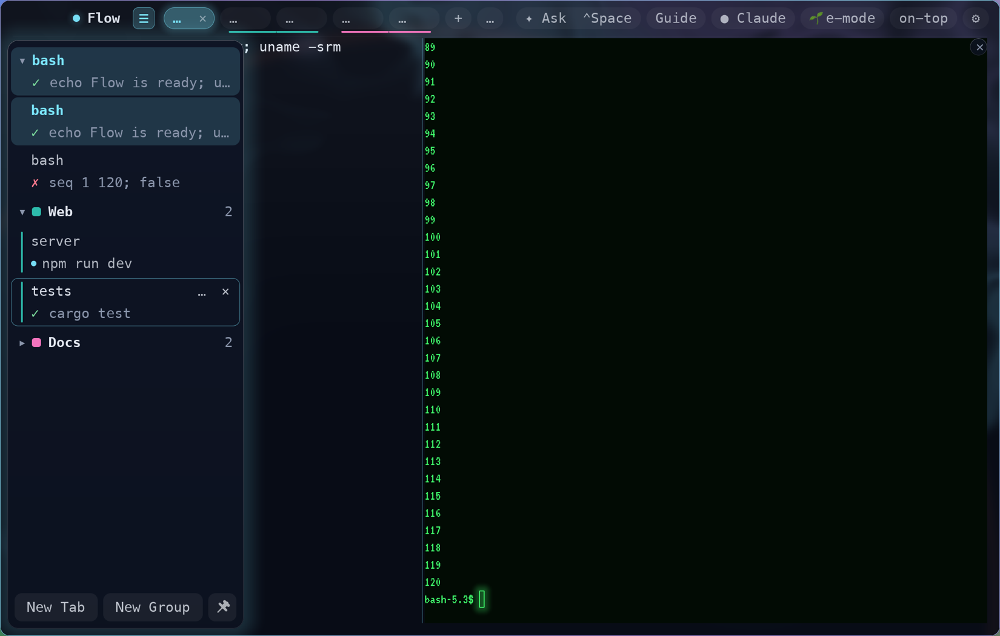
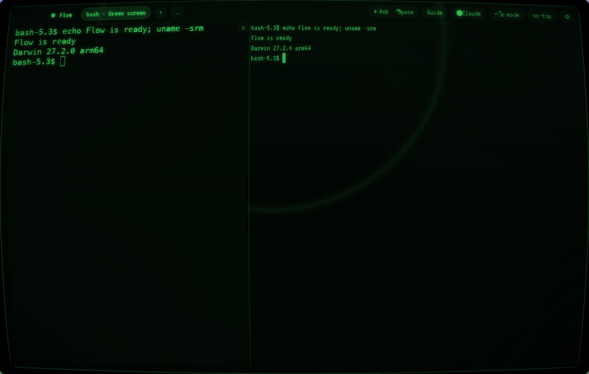
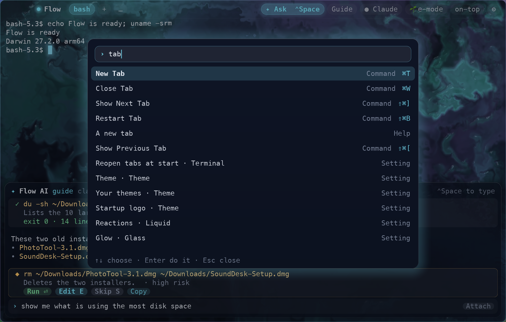
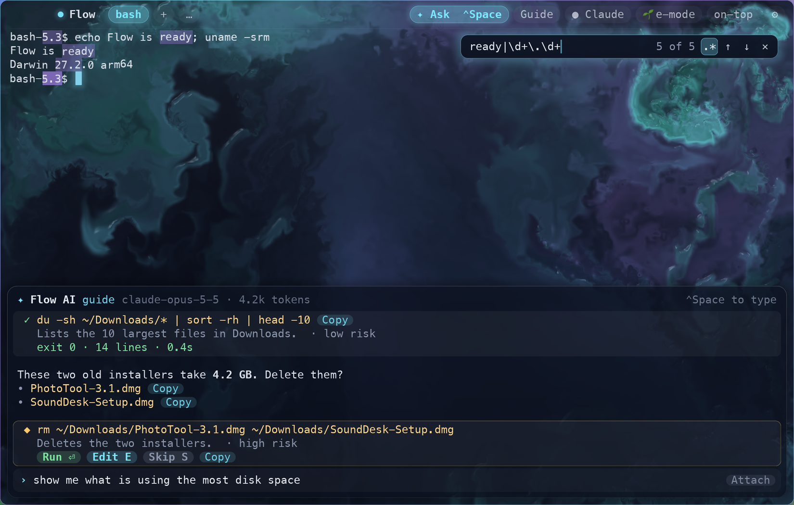
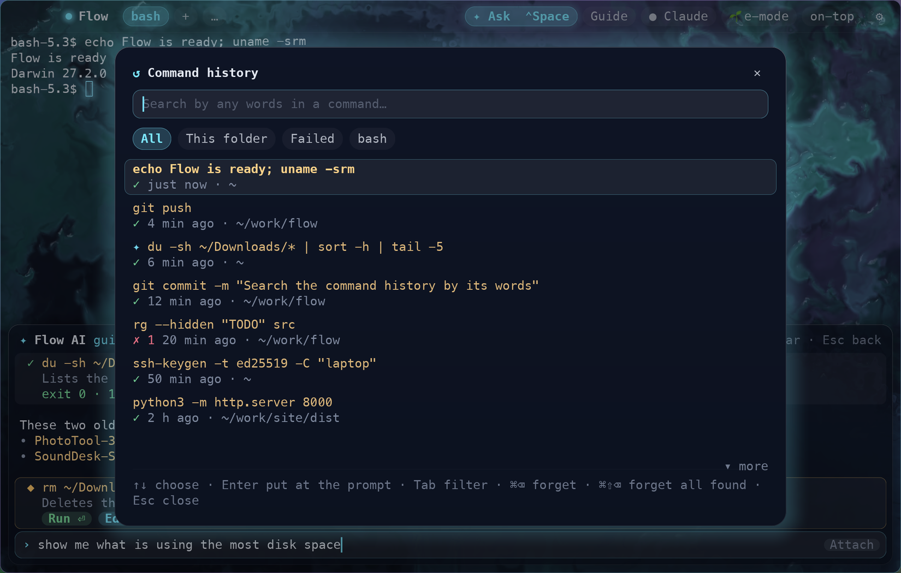
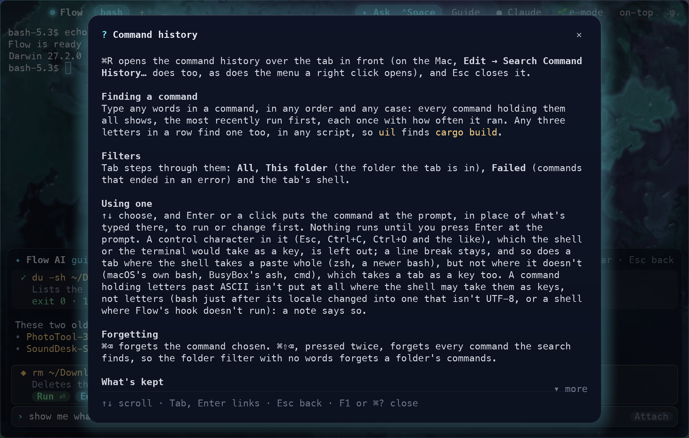

[← Flow's manual](../../README.md#documentation)

# Working in the terminal

Scrolling back, Caps Lock, naming tabs, groups of tabs, the tab sidebar, split panes, the command palette,
recording the terminal, finding in the scrollback, the command history and
Flow's help.

## Scrolling back

Scrolled back, a pill at the terminal's top right says how many lines are
below (**↓ 21 lines below**); click it to go back to the bottom, as typing
does, or press `Ctrl+Shift+End` (`⌘End` on the Mac); `Ctrl+Shift+Home`
(`⌘Home`) goes to the top. A scrollbar along each pane's right edge goes anywhere in the
scrollback: drag its thumb, or click the track to jump the thumb's middle
there. It's thin, and widens under the pointer. Settings' **Scrollbar**,
under Terminal (`shell.scrollbar`), shows it **While scrolling** (scrolled
back, the wheel turning, or the pointer at the pane's edge, then fading;
the default), **Always**, or **Never**. A full-screen program, which has no
scrollback, shows none, and the keys for the bottom and the top go to it.

Each command run at a prompt is marked on the scrollbar where its prompt
was: in the accent color once it's done, red where it failed (an exit
code other than 0), dim while it runs. A click on a mark goes there.
`Ctrl+Shift+↑` and `Ctrl+Shift+↓` (`⌘↑` and `⌘↓` on the Mac, also **View
→ Previous Command** and **Next Command**) go from command to command, as
Terminal.app's do: the one before or after is put at the top of the
screen, its line lit a moment, and past the last you're back at the
bottom. A full-screen program gets those keys. A mark lives in its
prompt's line, so it scrolls with it and goes when the line leaves the
scrollback; a program that writes over that line takes it away, as
Windows' console does on the screen after the window is resized.

## Caps Lock

Typing into the terminal with Caps Lock on brings up a notice at the foot
of the terminal, in the middle: **⇪ Caps Lock is on**, glowing orange
however low Settings' Glow is set, so a password or a command isn't typed
in capitals by mistake. Each key typed brings it back, and it goes a couple
of seconds after the last one, or at once when Caps Lock goes off. Over the
cursor's row it sits just above it, so what's typed stays in view. Screen
readers say it as it comes. On the Mac, Windows and Linux under X11, Flow
asks the system whether Caps Lock is on, so the notice comes with any key
typed, a digit too; on Wayland, which doesn't tell a program, it tells from
the letters typed (a capital without Shift, or a small one with it), so
there it comes with the first letter typed with Caps Lock on.

## Naming a tab

A tab is called after its shell (**zsh**, or **zsh 1** and **zsh 2** where
two run it), with the theme it wears where that isn't Settings' (**zsh ·
Green screen**). A tab keeps the number it opened with as others close,
so **zsh 2** is still **zsh 2** once **zsh 1** has gone, and a new tab
takes the lowest number free. Double-click a tab to give it a name of its own, or
choose **Rename Tab** in the [command palette](#the-command-palette) (on
the Mac, also **Shell → Rename Tab**; Settings' Keys can give it a key).
The name is typed in the tab's own pill in the title bar, where every key
goes meanwhile: the arrows, Home and End move the caret, Backspace and
Delete delete, and `Ctrl+Shift+V` (`⌘V`) pastes. Enter keeps the name, and
so does a click anywhere else; Esc puts back the one before. A name left
empty, or typed as the shell's own, gives the tab its shell's name again.
A tab's name is shown as typed, with no theme after it, in the title bar,
Settings on that tab, the system's notice when a long command ends there,
and to screen readers, and it goes with the tab when Flow opens its tabs again at the next start (Restart
Tab keeps it too). Names keep to one line of at most 60 letters.

## Groups of tabs

Tabs can be kept together in groups, each with a name and a color. Choose
**New Group** in the [command palette](#the-command-palette) (on the Mac,
also **Shell → New Group**; Settings' Keys can give it a key) and the tab
in front goes into a group of its own, named **Group 1**, **Group 2** and
so on, in the next of eight colors. Each tab in a group has a bar in its
group's color along the foot of its pill in the title bar, running on
under the gap to the next tab of the same group, so a group's tabs read as
one. Screen readers say each tab's group after its name.

A group's tabs always stand together in the title bar, and tabs in no
group may stand before, between or after the groups.

- **Move Tab to Group: *name*** in the palette, one for each other group,
  moves the tab in front into that group, after its tabs.
- **Remove Tab from Group** takes it out, just after the rest of its group.
- **Go to Tab: *name***, one for each tab, brings any tab forward by its
  name, its group's name beside it.
- A right click on a tab in the title bar (a Control-click on the Mac)
  opens its menu, drawn under it: **Rename**, **Move to New Group** and to
  each other group, **Remove from Group**, **Restart Tab** and **Close**.
  ↑ and ↓ choose, Enter does it, and Esc or a click elsewhere shuts it.
- A tab opened from a tab in a group (**New Tab**, the **+**, the new-tab
  picker, and `flow` in a tab) joins that group, after its tabs; one opened
  from a tab in no group goes at the end. Restart Tab keeps its tab's
  group.
- A group goes once no tab is in it: its last tab closed or moved out.
- Flow keeps the groups with the tabs it opens again at the next start, as
  it keeps their names, in `tabs.json`. An older Flow opens them in no
  group.

The [tab sidebar](#the-tab-sidebar) shows the groups too, and names,
folds, colors, moves and closes them.

## The tab sidebar

`⇧⌘S` on the Mac (also **View → Tab Sidebar**) or `Ctrl+Shift+S`
elsewhere brings a card out from the window's left edge over the
terminal, as do the three lines left of the tabs in the title bar and
**Tab Sidebar** in the [command palette](#the-command-palette); Settings'
Keys can change its key. It lists every tab in the title bar's order, each
group's under its header (its color, its name and how many tabs it holds),
and under each tab's name a line saying what it's doing, the first of:

1. a program's progress, as a thin bar and its share;
2. the command running, after a dot;
3. how the last command ended, ✓ or ✗ with the command, until the next
   one starts;
4. its folder, `~` for your home folder, cut from its start where it's
   long.

The tab in front is lit, a tab whose long command ended while it was
behind glows as its pill does, and a split tab folds open (its ▸) to show
its panes, a row each with its own line, the assistant's pane and an
outside app's named so. Resting the pointer on a tab's row shows what its
programs use beside it, as in the title bar.

The sidebar lies over the terminal and leaves its size alone, so no
program sees a resize. While it's out it takes the keys and the pointer:
choosing a tab (a click, or Enter) brings it to the front and leaves the
sidebar out, so you can look at one tab after another, and a pane's row
brings that pane to the front. Esc, its key again or a click outside it
puts it away. Every other key of Flow's still works.

| Key | Does |
|---|---|
| `↑` `↓` | Move through the rows (`Page Up`, `Page Down` by eight, `Home`, `End`) |
| `Enter` | Bring the tab or pane forward, or fold a group open or shut |
| `→` `←` | Fold a group or a split tab open or shut, or go from a group's tab to its header |
| `F2` | Name the row's tab or group, typed in its row |
| `⌥↑` `⌥↓` (`Alt+↑`, `Alt+↓`) | Move the tab a step, into the next group or out of its own at a group's edge, or a whole group past what's beside it |
| `⌘⌫` (`Ctrl+Delete`) | Close the row's tab, or its group |
| `⇧↑` `⇧↓` | Pick every tab from where the pick began to the row the keys go to |
| a letter | Go to the next row whose name starts with it |
| `Esc` | Close a row's menu, or let go of the tabs picked, or put the sidebar away (pinned, give the keys back to the pane) |
| `F1` | Its help page |

A click on a group's header folds it shut or open. Under the pointer,
and on the row the keys are on, a row shows its **…**, which opens its
menu (a right click does too), and its **×**, which closes its tab or its
group. A tab's menu holds **Rename**, **Move to** each other group and to
a new one, **Remove from Group**, **Restart Tab** and **Close**; a group's
**Rename**, its eight colors, **Ungroup** (its tabs stay where they are)
and **Close Group**. A double click on a tab's or a group's name names it
too, and **New Tab** and **New Group** wait at the sidebar's foot, New
Group's name ready to be typed.

Several tabs can be picked at once: `⌘`-click (`Ctrl`+click elsewhere) a
tab's row to pick it, with the row the keys were on, or let it go again,
and Shift-click or `⇧↑` `⇧↓` to pick every tab from where the pick began;
a plain click or arrow lets them go. Picked rows are lit with a bar at
their left. With tabs picked, **New Group** (its count beside it) puts
them all into one new group, gathered at the first one's place, and a
picked row's **…** says how many it acts on: a new group of them, **Move
*n* Tabs to** each group, **Remove *n* Tabs from Their Groups** and
**Close *n* Tabs**, which asks once where any is busy, and where they're
every tab. Where the rows don't all fit, the list
scrolls, keeping the row the keys are on in view, and the wheel scrolls
it.

Drag a tab's row to move it, a line showing where it will land. Dropped
on a group's header, it goes into that group, after its tabs; between
rows, it goes there, into the group where the line is set in and in the
group's color, loose where it isn't (so the gap after a group's last tab
takes it out of the group). Drag a group's header to move the group with
all its tabs, between other groups and loose tabs. A tab's pill in the
title bar drags too, the sidebar out or not: dropped among a group's
pills it joins that group, and over a loose pill, past the last, or in
the outer quarter of a group's first or last pill it lands loose, a line
between the pills (in the group's color where it would join one)
showing where. A pill can be dropped in a pinned sidebar, and a row from
the sidebar in the title bar. Esc while dragging, or letting go away
from both, leaves it where it was; `⌥↑` and `⌥↓` move the row with the
keys.

A tab's **×**, here or in the title bar, `⌘W` (`Ctrl+Shift+W`) and a
pane's **✕** close it at once while it waits at its prompt. Where something
runs in it, a toast says what, and the same again within a few seconds
closes it. Closing the last tab from its row here quits Flow, so it says
so first, and the same again quits.

**Pinned**, it stays out beside the terminal, which narrows to make room
for it: click the pin at its foot, or choose **Pinned** for **Tab
sidebar** in [Settings](settings.md) (on the Mac, **View → Tab Sidebar**
still brings it out and in). The keys then stay with the pane in front,
and the sidebar's key moves them into it and back out; choosing a tab
brings it to the front and gives it the keys, and Esc or a click on the
terminal gives them back. Drag its right edge to make it wider or
narrower, up to a third of the window. The pin leans over while the
sidebar isn't pinned, and stands pressed in while it is. The pin again
unpins it, leaving it out over the terminal with the keys until Esc or a
click outside it puts it away. In a window too narrow to leave the
terminal 20 columns beside it, it pops out over the terminal instead,
until the window is wider again.

**Close Group** closes every tab in the group at once while each waits at
its prompt. Where one is running something, it says which in a toast and
turns the group's name red, and pressing it again within a few seconds
closes them; where the group holds every tab, closing it quits Flow, so it
always asks twice.

## Split panes

`⌘D` on the Mac (also **Shell → Split Right**) or `Ctrl+Shift+D` elsewhere
splits the pane in front in two side by side, and `⇧⌘D` (**Split Down**) or
`Ctrl+Alt+Shift+D` one above the other: a new shell of its kind, in its
folder, takes the second half and the keys, and a pane splits again as
often as there's room (each half at least 20 columns and 5 rows). `⌥⌘` and
the arrows (`Ctrl+Alt` and the arrows elsewhere) move between panes, and a
click in one gives it the keys; its cursor glides and blinks, the others'
stand hollow, and a thin line parts them. Drag the line to give one side
more room (each keeps at least 20 columns and 5 rows), and double-click it
to put it back in the middle; the tab keeps it. The pane under the pointer
shows a ✕ at its top right (left of its scrollbar), which closes it; a
theme's window frame has its close box instead. `⌘W` closes the pane in front
first, its room going back to the pane it was split from, and the tab with
its last pane; a shell that exits closes its pane. Each pane wears a theme
of its own: a new one starts in the theme of the pane it was split from,
and Settings on a split tab (its look's sections say **this pane**), or
the Theme row, changes the pane in front alone. Each draws in its theme's
colors and font, its background laid under it; the liquid, the glass,
the tube and a phosphor are the window's, and follow the pane in front, as
they follow the tab in front. Restart Tab (`⇧⌘B`) restarts the pane in front. A split tab
opens again as it was at the next start, each pane's shell in its folder.
The find bar searches the pane in front, Ask why is its, and effects and
the machines' sounds come from it. Fit window to and Fit text to fit the
pane in front: the window grows until it holds 80 × 24 (say), or the text
until it fills it, and Font size's line says what it holds.

## The command palette

`⇧⌘P` on the Mac (also **View → Command Palette…**) or `Ctrl+Shift+P`
elsewhere opens a palette of everything Flow can do: its commands, in the
words of the Mac's menus with their keys; every setting, which opens
Settings at its row; every theme, which the tab in front puts on as
Settings' Theme row does; every page of help; a new tab in each shell; and
each tab to go to by its name, with the [groups](#groups-of-tabs) the tab
in front can move into. Type a few letters of what you want, in order and in any case: what's found
as typed comes first (at a word's start before inside one), then letters
that start words (`nt` finds New Tab), and a setting is found by its
section too (`glass opa`), and by any words about it, as
[Settings' search](settings.md) finds it: what the line at the foot of
Settings says of it, its choices (`amber` finds Phosphor) and its key in
`config.toml` (`fx.crt`), in English as well as Japanese, after what's
found by name. What was chosen lately comes first before
anything's typed, and ahead of others as good (a tab or a group, which
may be gone by then, isn't kept); Flow keeps the last eight in
`palette.json` beside `config.toml`, so they come first after a restart too,
whatever the language. ↑ and ↓ choose (Page Up and
Page Down by eight, or the wheel), Enter or a click does it, Esc closes.

## Recording the terminal

`⇧⌘R` on the Mac (also **View → Record the Terminal**),
`Ctrl+Alt+Shift+R` on Windows or `Ctrl+Alt+Shift+V` on Linux (GNOME keeps
`Ctrl+Alt+Shift+R` for its own screen recorder), or the palette's
**Record the Terminal**, records the terminal as Flow draws it, the
liquid, the glass, a theme's tube and border and the notanAmiga's frames in it. It records the window
below its title bar and left of the assistant's panel, so not the tabs,
the panel or the clock. A note counts down three seconds first ("Recording
the terminal in 3…") and is gone before the first frame, so it isn't in
the file; the same keys during the countdown call it off. The clock comes
up red in the title bar while it runs; the same keys, or a click on the clock, stop it, and the
system's save panel asks where to keep it, starting in your Movies or
Videos folder and named by when it ended (`Flow-2026-11-11 15.30.12.webp`).
Cancel it and the recording isn't kept.

The file is a looping animated WebP, which browsers, GitHub's pages and
most chat apps play inline, up to 24 frames a second. Settings'
**Recording** section says how it's kept, from the next recording on:

- **Quality**: **Smaller file**, **Balanced** (the default), **Sharp** or
  **Lossless**. The moving liquid is the hard part: between whole frames
  a frame keeps only what changed, and a lossy encoder takes a small
  change as none, so a liquid that moves slowly everywhere can drift into
  a patchwork. A whole frame comes every two seconds at Smaller file,
  every second at Balanced and twice a second at Sharp, and the higher
  qualities take smaller changes as changes, so they stay cleaner, in a
  larger file: four seconds of the oil style at 1100 × 700 came to 0.4,
  0.7 and 1.6 MB, its worst patch 25, 11 and 6 levels off. Lossless keeps
  every pixel as drawn, but a moving liquid makes it very large (16 MB for
  those four seconds); it suits a still or plain-glass terminal.
- **Countdown**: **Off**, **3 s** (the default), **5 s** or **10 s**
  before it starts. Off starts at once, and the note saying so is then
  in the file.
- **Size**: **Points**, the window's size in points (so a Retina screen's
  is half its pixels), at most 1600 pixels wide; or **Every pixel**, up to
  3840 wide, with sharper letters in a file about two and a half times
  larger, as the encoder takes about that much longer over each frame.

Flow draws only when something changes, and a frame that didn't change
isn't stored, so a pause costs nothing. Frames are taken from
what's shown and encoded as they come, on a thread of their own, so a
long recording holds no frames in memory. Where everything moves at once
(a theme's tube, a large window, Every pixel) and the encoder can't keep
up with 24 a second, it hurries, encoding faster into a file about a
third larger that looks the same, and frames are taken as it's ready for
them, evenly spaced, rather than dropped; it tries its usual pace again
every two seconds; a recording stops by itself
after 10 minutes. See-through glass stays see-through in the file (the
glass is opaque unless you lower Glass opacity).

As it counts down, the note says so if a prompt in the tab shows your
user name or the computer's name, which the recording would show too;
nothing is hidden for you. A dialog or Settings opened over the terminal while
recording is in the file too. Where the computer's graphics can't hand a
frame back (an OpenGL surface that can't be copied from, which is rare),
Flow says recording isn't available there.

## Find in the scrollback

`⌘F` on the Mac (also **Edit → Find…**) or `Ctrl+Shift+F` elsewhere opens a
find bar at the terminal's top right, searching the tab's text: its screen and
everything scrolled off it, up to its scrollback's length. What's typed is
found as written, letters and signs alike, in any case unless it holds a
capital letter (alacritty_terminal's own search, across wrapped rows). The
bar's `.*`, or `⌥⌘R` on the Mac and `Alt+R` elsewhere while the bar has the
keys, looks for what's typed as a pattern (a regular expression) instead:
`build \d+` finds every build and its number, `took|failed` either word, and
"Bad pattern" takes the count's place while what's typed isn't one. Every
match is lit, the one chosen brighter, and the bar says which of how many it
is (up to 10,000, then "10,000+"). ↑ or Enter goes to the match before, further
up, and ↓ or Shift+Enter to the one after, as `⌘G` and `⇧⌘G` do on the Mac
(**Edit → Find Next** and **Find Previous**) and `F3` and `Shift+F3`
elsewhere, going round past either end, and the terminal scrolls to each.
The matches are marked down the pane's [scrollbar](#scrolling-back) as
well, below the bar, the one chosen taller, which shows while the bar has
found something; a click on a mark scrolls there.
Words selected when it opens are looked for at once. The matches follow what's
printed while it's open; a click in the terminal gives the keys back to it,
leaving the bar and its matches showing, and a click on the bar, or `⌘F`
again, gives them back to the bar. Esc closes it.

## Command history

Flow keeps every command run in its tabs, whatever the shell (cmd included),
with the folder it ran in, how it ended and when, and finds it again by any
words in it. `⌘R` on the Mac (also in the Edit menu) or `Ctrl+Shift+R`
elsewhere opens the search; the shells keep their own `Ctrl+R`. Type any words,
in any order and any case, and every command holding them all shows, the most
recently run first, each once with how often it ran. Any three letters in a
row find a command, in any script, so `uil` finds `cargo build`, and Japanese
finds Japanese. Tab steps through the filters: all, the folder the tab is in,
the ones that failed, and the tab's shell. Enter (or a click) puts the command
chosen at the prompt, in place of anything typed there, to run or change
first; nothing runs until you press Enter. A control character in it (Esc,
Ctrl+C, Ctrl+O and the like), which the shell or the terminal would take as
a key, is left out; a line break stays, and so does a tab where the shell
takes a paste whole (zsh, a newer bash), but not where it doesn't (macOS's
own bash, BusyBox's ash, cmd), which takes a tab as a key too. A command
holding letters past ASCII isn't put at all where the shell may take them
as keys, not letters (bash just after its locale changed into one that
isn't UTF-8, or a shell where Flow's hook doesn't run): a note says so.
Commands the assistant ran wear its ✦.

What's kept is the line as the shell ran it: zsh, PowerShell and bash say so
themselves (a command continued over several lines comes whole; macOS's own
bash 3.2 through a `DEBUG` trap, or bash-preexec's `preexec` where you have
it, unless you set a `DEBUG` trap of your own), and for cmd and BusyBox Flow
reads it off the screen as you press Enter. Anything printed in a tab could
say a line the same way, a file being `cat`ed or a remote host's output over
ssh among it, or draw what looks like a prompt with words after it for your
next Enter to be read as a command. So in zsh, bash and PowerShell each
tab's shell gets a secret of its own, `FLOW_NONCE`, which its hook sends
with each line and each command's end and keeps from the programs the
shell starts: it's gone from their environment (in PowerShell, from once
your profile has run), so none of them, ssh among them, has it. A line said
without it is passed over, and so is a prompt drawn while a command runs
and a command's end said without it: Flow keeps what was on the screen at
the prompt, and the command runs until the shell itself says it's done.
Ask why and the notification of a long command done name it the same way.
For a line bash's own history leaves out (`HISTCONTROL`'s `ignorespace`,
`HISTIGNORE`), bash's hook can say only the newest line it kept, so Flow
keeps what the screen showed only where it's that line, as a command
typed again is (`ignoredups`): a job left running in the background could
have drawn a prompt with words of its own there. Otherwise Flow keeps
nothing of the line, and the notification and Ask why name no command
for it; nor for a line the hook says nothing of though it says each line
it runs (Enter alone, a comment, a syntax error), nor for any of bash's
while its history is off (`set +o history`, `HISTSIZE=0`). A command
typed again by `!!` or found with Ctrl+R that `ignoredups` leaves out
isn't named either, since the screen shows `!!` or the search, not the
line; and a paste of several lines in bash 5 is kept as its first, which
bash reads before the rest, but not at all where its first line is only
a comment, which bash's history keeps. In bash before 4.4 a line that
runs no command (a function's definition, `f() { …; }`) isn't kept either
([Shells](shells.md) says what's still open).
Flow keeps nothing typed in a shell started inside another (`zsh` typed in
a tab, or one on a host you reach with ssh), which runs none of Flow's
hooks. The history stays in `history.sqlite3` beside `config.toml`. The
assistant sees it only when you ask about a command you ran before ("the
command I deployed with last week"): it searches for a few commands by words
in them, asking you first in guide mode, and never reads the history whole.
Lines that start with a space
are left out, as bash's `ignorespace` does, and so are lines that look like
they set a secret: a name with KEY, TOKEN, SECRET, PASS or AUTH in it set to
something, a flag such as `--password` or `-Token` with a value, a key in its
service's own form (`sk-…`, `ghp_…`, `AKIA…`), an `Authorization` header, or a
URL with a password in it. `⌘⌫` (`Shift+Delete` elsewhere) forgets the command
chosen; `⌘⇧⌫` (`Ctrl+Shift+Delete`), pressed twice, forgets everything the
search finds, so the folder filter with no words forgets a folder's commands.
Settings' **Command history** turns it off, and **Kept commands** shows how
many there are, with **Clear**, pressed twice, to forget them all. It keeps the
last 100,000 runs.

## Help

Each of Flow's own screens has a page of help: press `F1` while it's open
(the command history, Settings, a color picker, the assistant's panel, the
key dialog, the question before a model file is read, About, the question
about update checks, the new-tab picker), and Esc or `F1` again goes back to
it. `⌘?` on the Mac (or Help's key as you've bound it) (**Flow Help** in the Help menu, which lists every page
below it) or `Ctrl+Shift+?` elsewhere opens it anywhere, and over the
terminal a page of Flow's own keys; there `F1` stays the program's, as many use it for help of
their own. The arrows, Page Up and Page Down, Space and the wheel scroll a
long page. Each page is in the language Flow is in, with the keys of your OS.
One more, **Legal**, says whose the logos Flow shows are and why it shows
them (see [Trademarks](../trademarks.md)); About's **Legal** button opens it, and so does the
Mac's Help menu. And **Flow's keys** lists every key as it's bound, with a
changed one's default beside it; About's **Keys** link opens it, as do
Flow's own page and `flow-help keys`.

Pages link to each other where they mention one another (Settings' to the
color picker's, About's to the question about update checks, the Flow page
to the history's, the assistant's, Settings' and About's), drawn in the
accent color and underlined under the pointer. A click follows a link, or
Tab and Shift+Tab choose one (scrolling to it) and Enter follows it. Esc or
Backspace goes back to the page before, as does the ← beside the title, and
Esc on the first page closes help; `F1`, `⌘?` or `Ctrl+Shift+?` close it at
once from any page. Flow's own page ends with **Pages**, a link to every
other page, so on Windows and Linux, which have no Help menu, `Ctrl+Shift+?`
over the terminal leads to them all too.

The same pages print in the terminal itself: in a Flow tab, `flow-help`
prints every page, one after another, to scroll back through or search
(`flow-help | less -R` pages it). `flow-help settings` prints one page
(`flow-help picker key` two), and `flow-help --list` names them all. They
come laid out to the tab's width (at most 100 columns), with headings in
bold, keys and commands in color and links underlined; the list of pages at
the end of Flow's own says the command that prints each. Piped or
redirected, or with `NO_COLOR` set, they're plain text. They're in the
language Flow is in, which Flow gives its tabs as `FLOW_LANGUAGE` (outside
Flow, `flow-help` follows `LANG`), with the keys of your OS. `flow-help` is
in the folder at the end of the tabs' PATH, with the games (see [Games](games.md)), so
only Flow's tabs have it; under `cargo run` there's no such folder, and
`cargo run --bin flow-help` prints them instead.
