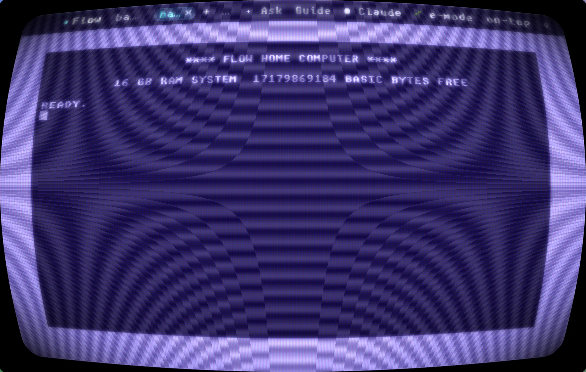
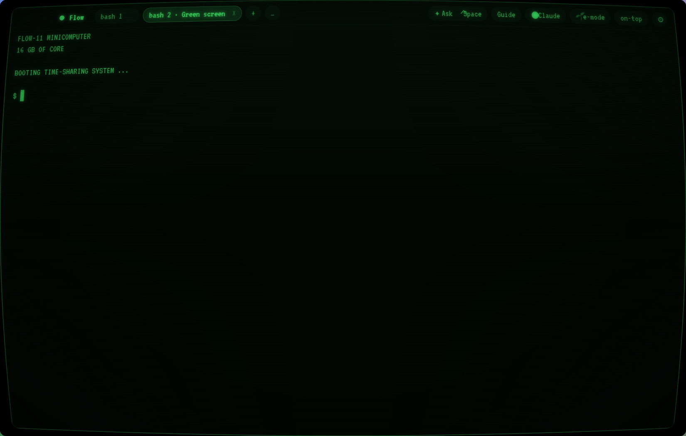
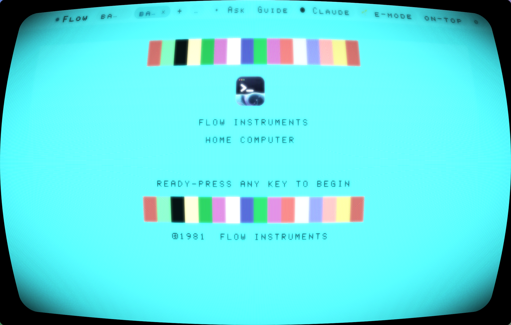
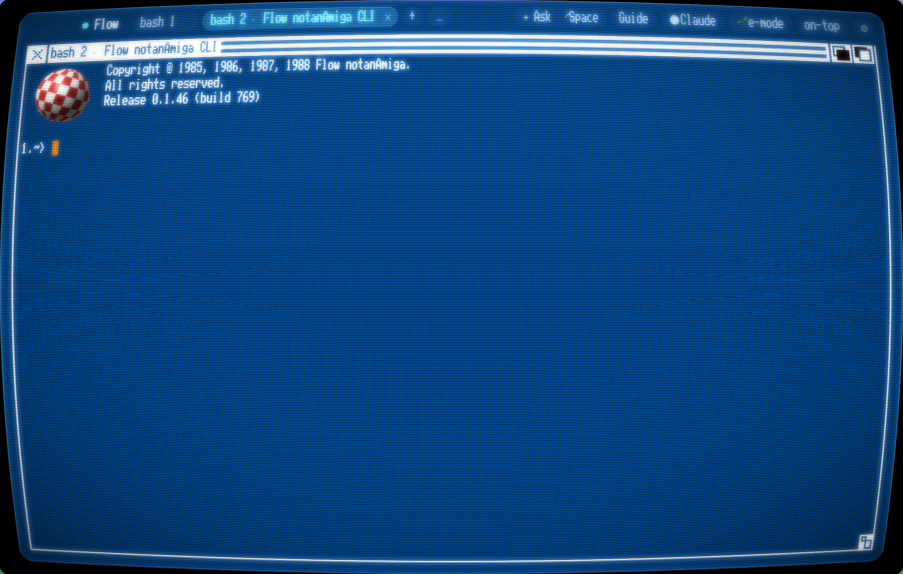
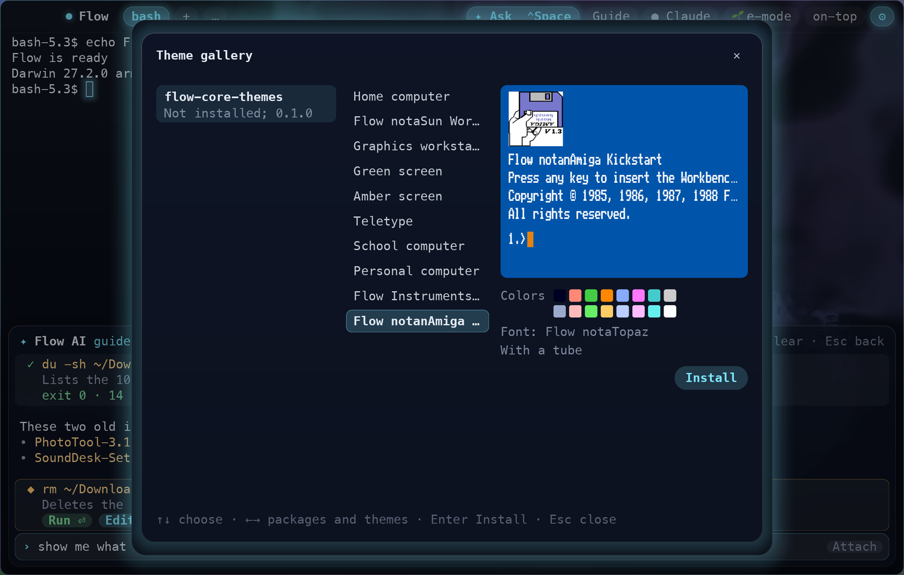

[← Flow's manual](../../README.md#documentation)

# Themes

A theme is chosen at the top of the look's sections in [Settings](settings.md),
for a tab or for new tabs, or for a new tab in the picker beside the **+**.

**Theme**, at the top of the look, is Flow's own look, one after an old
machine, or your own:

| Theme | After | Its prompt |
| --- | --- | --- |
| **Home computer** | an 8-bit home computer on a television: light blue on blue inside a light blue border | `READY.` |
| **Flow notaSun Workstation** | a workstation's console: black on white, booting as a SPARCstation's PROM did (this computer's own memory banks and buses probed, where the system says what they are; the maker's emblem beside the banner with a made-up serial number and Ethernet address; then `ok boot`) | `%` |
| **Graphics workstation** | a graphics workstation's terminal: dark text on warm grey, starting up as an SGI's PROM did (the maker's cube turning beside "Starting up the system...", then IRIX's banner, here Flow's, with a made-up Ethernet address) | the command's number, then `%` |
| **Green screen** | a minicomputer's terminal, green phosphor | `$` |
| **Amber screen** | the same at an amber terminal | `$` |
| **Teletype** | dark ink on a teletype's paper, in the type a Teletype Model 33 printed | `%` |
| **School computer** | a British school's micro in its teletext mode: white on black, starting with a page of colored teletext | `>` |
| **Personal computer** | an eighties personal computer: grey on black, with its BIOS's memory test as it starts | `C:\>` |
| **Flow Instruments Home Computer** | an early-eighties home computer on a television: black on cyan inside a cyan border, in its letters of 8 × 8 dots, its title screen between two bands of its video chip's colors with the startup logo in the middle, waiting for a key, then its BASIC, ready | `>` |
| **Flow notanAmiga CLI** | a 16-bit home computer's shell window, on its desktop of 1988: white on its blue with an orange block for the cursor, in its letters of 8 × 8 tall dots, on its monitor, framed as its window was (a title bar with the tab's name, three lines and the depth gadgets that bring the window in front of the others and send it behind them, a sizing gadget in the corner, and an outline round it);  it asks for its Workbench disk with Kickstart 1.3's own white first screen, a hand holding the disk out, which a key puts in (its empty drive clicking until then), then gives its shell's copyright beside the Boing ball, spinning | `1.`, the folder, then `>` |
| **Your own** | your colors, fonts and CRT, with a start screen, prompt and sounds you type in Settings | yours |
| a theme you saved | what was worn when you saved it under its name (**Save as theme…**, below) | its own |

A theme sets the colors, the cursor, the glass (plain and opaque for an old
machine, which Glass opacity dials back) and the CRT, and tries fonts of its
time first. Ten come with
Flow, built in: VT323 for the green and amber terminals, Bedstead for the
school computer's teletext, Gallant (the Sun console's own) for the
workstation, SGI's Screen for the graphics workstation, Flow Teletype for the
teletype, Flow Instruments for the Flow Instruments Home Computer (Flow's
own, its capitals five dots by seven in cells of eight, lowercase as small
capitals), Flow notaTopaz for the Flow notanAmiga CLI (Flow's own too, drawn
in the manner of the machine's Topaz, which isn't free to ship: cells of
8 × 8 dots twice as tall as they're wide, so its uprights are two dots
wide, and its tails in the cell's last row), and unscii's 8×8 and 8×16 letters for the home computer and the
personal computer; Special Elite, a typewriter's letters, each set in the
middle of its cell, is there to pick in **Font**. No free font has the
Model 33's type, so Flow Teletype is Flow's own, drawn from its printouts: a
heavy, round-ended gothic of capitals, with lowercase as small capitals so
text keeps its case, `^` and `_` a caret and an underscore (the Model 33's ↑
and ← are at their own characters), and Latin-1's accented letters and signs
in the same hand. The home computer and the personal computer take their
makers' fonts first where you have them installed (C64 Pro Mono or Pet Me
64, the Px437 IBM VGA fonts). The font's size and your
saved CRT presets stay. A tab can wear a theme of its own, picked when it's
opened (the **…** after the tabs, under [Shells](shells.md)). Under an old machine's theme, **Start screen** starts
each new tab with the machine's start screen, typed out at the speed of its
line (a teletype's 300 baud, a terminal's 1200 or 2400, at once on the 8-bit
home computers), below the startup logo, which keeps to its own setting. The School computer's begins with a page of colored teletext:
its name in double height on a band of blue, over a boat at sea drawn in
teletext's mosaics; the Flow Instruments Home Computer's is its title screen
row for row, between bands of its colors, which waits for a key as it says
(the key goes to it, not to the shell, and it beeps again), then clears for
its BASIC's first words at the screen's foot. The Flow notanAmiga CLI's is
Kickstart 1.3's first screen, white, with its picture of a hand holding out
the Workbench disk pixel for pixel; it waits for a key to put the disk in,
its empty drive clicking meanwhile; then its drive seeks, and the screen
clears for its shell's copyright beside the Boing ball, spinning on its
tilted axis as in the Amiga's demo of 1984 (Flow-SDK's `flow-demo boing`
bounces it).
**Machine's prompt** gives the
shells in new tabs its prompt in place of your own (zsh, bash, BusyBox,
PowerShell and cmd; not WSL, which doesn't see Flow's variables). The
machines are named for how they look, and their start screens are written in
their spirit: the Flow Home Computer, the Flow notaSun Workstation, the FLOW-11,
the Flow Instruments Home Computer, the Flow notanAmiga. You can change any part of a theme
afterwards, as any look.

The Flow notaSun Workstation's PROM probes the computer it runs on. It lists each memory
bank the firmware lists, with its size, kind and speed ("Probing Memory Bank
#1 16384 Megabytes of DDR4-3200", or "Nothing there" for an empty slot;
Apple silicon's memory is one bank in the chip), counting what's installed
even where the graphics were given some of it. Then each slot on the PCI
buses with the drivers of what's in it, under the IOMMU that translates it
where there is one ("Probing /iommu@fed91000/pci@0,0 at 1c,0  r8169"); a
Mac shows the bus's real path in its device tree under the DART its port
goes through, such as `/iommu@94000000/arm-io@10F00000/apcie0@80000000`.
It reads the memory once a run and the buses again for each new tab, so
a device plugged in since shows, from what any user may read, and shows only sizes, kinds, speeds, bus addresses and driver
or device-tree names, never a serial number, an address or a name you gave
something. A list longer than eight lines ends with one saying how many more
there were. Where the system doesn't say (a virtual machine, an older Linux),
it probes a SPARCstation 5's as before, and so do snapshots.

Its serial number, Ethernet address and host ID, and the Graphics
workstation's address, are made up, but the same at every launch on one
computer and different on another: Flow takes the system's own id for the
computer and hashes it, so the numbers can't be traced back to it (where
there's none, as in some containers, it makes one up once and keeps it in
`machine-seed` beside `config.toml`). Theme details' **Its real numbers**
shows the computer's own instead, its first wired or Wi-Fi interface's
address and its serial; they identify the computer, so it starts off. On
Linux the serial stays made up, as only root may read it. Snapshots always
show made-up ones.

**Theme details**, a section of its own under Theme (closed in a new
config, and there only while an old machine's theme or your own is worn), turns
each part of the machine on or off on its own: **Start screen** and
**Machine's prompt**, **Its font**, **Its tube** (its CRT, where it had one),
**Its colors**, on the Flow notanAmiga CLI **Its window frame** (its shell
window's frame round each pane, on at first: a white title bar with a
close box, the tab's name in a box of its own, three lines and two
gadgets, a sizing gadget in the bottom right corner, and an outline. The
close box, a cross at the bar's left, closes that pane, or its tab where
it's the only one, as `⌘W` does; the depth gadgets at the bar's right
bring Flow's window in front of the others (the left one) and send it
behind them, the keys going to the window then in front (the right one,
on the Mac, Windows and Linux's X11, though not on Wayland, which lets no
program send its window back; a window dropped down by the hotkey is put
away);
and the sizing gadget drags the window's corner. A frame whose pane hasn't the keys, or while
Flow hasn't, is ghosted, as the machine's inactive windows were) and, on
the workstations, **Its real
numbers**, then each sound it makes. Turning one off puts Flow's own in its place and
leaves the rest of the theme as it is. Each machine has its own sixteen
colors for programs (`ls`, editors, `git`), as its terminal had them and
chosen to read on its screen: the PC's color adapter's, teletext's eight on
the School computer, shades of one phosphor on the green and amber screens
(which, with **Its colors** on, show everything else in that phosphor too:
see **Phosphor** in [Settings](settings.md)),
the teletype's ink with red where a ribbon had it, the Flow Instruments Home
Computer's video chip's, each darkened as far as it takes to read on its
cyan, the Flow notanAmiga CLI's desktop's own black and orange, with the
rest lightened as far as it takes to read on its blue, and deep ones on the
Flow notaSun Workstation's white and the Graphics workstation's grey, where Flow's own,
made for dark glass, were hard to read. The sounds are the machine's own
(the tube's hum, the keys, the PC's fan, the disk drive, the floppy drive
clicking while it's empty, the startup chime,
the sound chip's beep as it starts, the teletype's printing, margin bell and
tape punch, the printer, its own bell, which on the Flow Instruments Home
Computer is its sound chip's low honk), each kept per theme: the PC's fan
off leaves the green screen's ticks as they are. **Cursor speed**, under Theme, sets how fast the cursor glides
to where it goes, from half as fast, which feels heavier, to four times.
Each theme sets its own as it's chosen, and a tab in a theme of its own
glides at that theme's: the teletype's print head at half, the School
computer's and Flow's as always, the home computers' and the green and
amber screens' at one and a half, the workstations' twice, and the PC's
two and a half times. A theme saved keeps the speed it had.

**Your own** keeps the colors, fonts, glass and CRT you've set and adds a
start screen, a prompt and a machine's sounds of your own, set in the rows
under **Theme** that take the place of an old machine's two switches;
choosing it the first time begins it from the old machine you chose last.

- **Start screen** is a box of lines typed in place. Enter, or a click on
  it, starts typing, with the caret where you clicked (a click while typing
  moves it there); Enter makes a new line, the arrows, Home and End move
  (with `⌘` on the Mac or `Ctrl` elsewhere, to the ends of a line or of the
  whole text; `⌥←` and `⌥→`, or `Ctrl+←` and `Ctrl+→`, by words, and `⌥⌫`
  or `Ctrl+Backspace` deletes one), `⌘V` (`Ctrl+Shift+V`) pastes, and
  `⌘Enter` (`Ctrl+Enter`), Tab or a click elsewhere is done; Esc puts back
  what was there. A line
  starting with `^` is centered, and `{version}`, `{os}`, `{chip}`,
  `{memory}`, `{mb}`, `{kb}`, `{bytes}` and `{shell}` stand for what they
  say; `{banks}` and `{probes}`, each a line alone, are the PROM's lines
  probing the memory and the buses. A line starting (after any `^`) with `{tall}` is double height, and
  with `{wide}` double width; `{red}`, `{green}`, `{yellow}`, `{blue}`,
  `{magenta}`, `{cyan}`, `{white}` and `{black}` color what follows in
  teletext's colors, `{on-blue}` and the like its background, `{#d5524d}`
  and `{on-#d5524d}` any other color, written as six hex digits, and
  `{plain}` goes back to the theme's own. `{paper-white}` (or any other
  color) is the page's: the lines after it start on it, their margins too,
  and come back to it, so a `{clear}` fills the screen with it, until
  `{paper-plain}`. `{disk}` alone on a line is Kickstart 1.3's picture of a
  hand holding out the Workbench disk, in the middle of the screen. A
  centered line of `{logo}` alone puts the startup logo in the middle, four
  lines tall. A line of `{wait}` alone waits there for the tab's first key,
  which goes to it rather than to the shell, as "press any key" did;
  `{clear}` clears the screen, and `{foot}` goes to its last line, where a
  home computer's BASIC began. With no lines, new tabs start without one.
- **Prompt** is one line, typed the same way (Enter is done): `{cwd}` is the
  folder, `{n}` the command's number, and `\n` a new line. Empty keeps the
  shell's own. The rest is text, shown as it's written in every shell
  whatever your shell's options (zsh's `prompt_subst`, `prompt_bang`,
  `glob_assign` and `glob_subst`, even turned on after the prompt is set,
  bash's `promptvars` and posix mode) and locale (Shift JIS and GB18030
  among them): a `$`, a backtick, a backslash, a `%`, a `!` or a `*` shows
  as itself, so a theme's prompt never runs a command, and a shell's own
  prompt escapes (`\u`, `%n`, `$PWD`) aren't read either. zsh shows a `$`,
  a backtick, a backslash and a `!` from the last four of `psvar`, which
  Flow puts there before each prompt while a theme's prompt is worn (zsh
  run as sh or ksh, `emulate sh`, shows `%` escapes as written, so those
  four show as `%-4v` to `%-1v` and `{cwd}` as `%~`). In bash and
  BusyBox's ash, while a theme's prompt is worn, `PS1` isn't exported to
  the programs you run, even where your files export it, since another
  shell would read that shell's form of the prompt its own way. A control
  character that doesn't show is left out, and so is every escape but a
  color's (SGR, `ESC [ … m`), so a prompt can't send the terminal anything
  else before each command; a tab and a new line stay. A prompt longer than
  4096 bytes, as the shell is given it, is cut there.
- **Typed at** is how fast the start screen comes: at once, or 300 to 19200
  baud (a teletype's 300, a terminal's 1200 or 2400).
- **Sounds** is what your machine sounds like: quiet, a tube, a video
  terminal, a tube with a disk drive (and a fan), with a floppy drive, with a
  startup chord, with
  a sound chip's beep as it starts and its honk for the bell, or with a
  printer, or a teletype (heard with **Machines' sounds** on, under
  Sound).
- **Window frame** draws the Flow notanAmiga CLI's shell window round each
  pane wearing your theme, as **Its window frame** does for that machine
  (see Theme details above): on where your theme began from the notanAmiga
  with its frame on, off otherwise.

Both fields take an input method's text, as the terminal does. What you type
goes to `[theme]` in `config.toml` with the other settings, and new tabs take
it on. In the file, `theme.start` is the start screen, a line each,
`theme.baud` its speed (0 at once), `theme.prompt` the prompt (with a real
new line where Settings shows `\n`), `theme.sounds` `quiet`, `tube`,
`terminal`, `disk`, `fan`, `floppy`, `chime`, `tones`, `printer` or
`teletype`, and `theme.frame` the window frame. A
preset file keeps `[theme]` with the rest of the look, so a
whole theme can be saved and shared; loading one with a start screen or a
prompt chooses **Your own**.

**Save as theme…**, under **Your themes** (and in the new-tab picker, and
on the Mac in the View menu), keeps what's worn now under a name you type,
in a box over Settings as a CRT preset's name is asked: the colors
(programs' sixteen among them), fonts, cursor, glass, liquid and CRT, with
a start screen, prompt, sounds and window frame where they're set (an old
machine's as Theme details leave them, and its sounds muted as they
were). Saved from
the picker or the menu while the tab in front wears a theme of its own,
it's that tab's theme. Saved themes come after the built-in ones and your
own, in the Theme row and in the picker, and are worn as those are, in
Settings or by a tab of its own, each bringing its own start screen,
prompt and sounds and leaving your own theme's as they are. Chosen in
Settings, its start screen and prompt are typed in the rows under
**Theme**, which changes that theme; **Save as theme…** under its name
again keeps the rest as it's set now. Saving under a
name already taken saves over that theme, which the box says as you type.
**Delete**, beside it while a saved theme is chosen, removes that one,
leaving its colors, fonts and CRT on under your own theme, with your own
start screen and prompt. They're kept in `config.toml` (see
`themes.saved` under [Configuration](configuration.md)).
**Export…**, beside it, writes the one chosen as a theme package where you
say (`night-shift-theme-1.0.tar.gz` for one saved as Night shift), which
`flowapp install` on another computer puts among its themes ([Apps:
flowapp](flowapp.md)). There its colors, cursor, fonts, CRT and window
frame are the theme's own, so Theme details' switches turn them off as
they do an old machine's, and the rest of the look comes with it; its fonts are named but
not carried, since their files are this computer's. Its id is its name in
lowercase letters, digits and dashes, never a built-in theme's (one saved
as Green is `green-theme`), so it never takes a built-in one's place. A
preset file saved while one is worn moves one too.

**Theme gallery**, under it (**Browse…**), opens the packages of themes in
flowapp's catalog, and those installed, to look at before installing:
choose a package and Flow fetches it (a few kilobytes), checks it against
the catalog and Flow's own key, and reads it as an install would, installing
nothing; choose one of its themes and its look shows, drawn from what the
package says: its screen in its colors with its logo, where it brings one,
and the first lines of its start screen and its prompt in its own letters
(the fonts it brings, or ones installed, else Flow's), its sixteen colors,
its font's name and whether it has a tube. **Install** installs the
package as `flowapp install` does, its themes coming into the Theme row and
the new-tab picker at once; once it's installed, **Wear** wears the theme
chosen, and **Upgrade** comes where a newer one is out. ↑↓ choose, ← and →
move between the packages and the themes, Enter does the first button.

