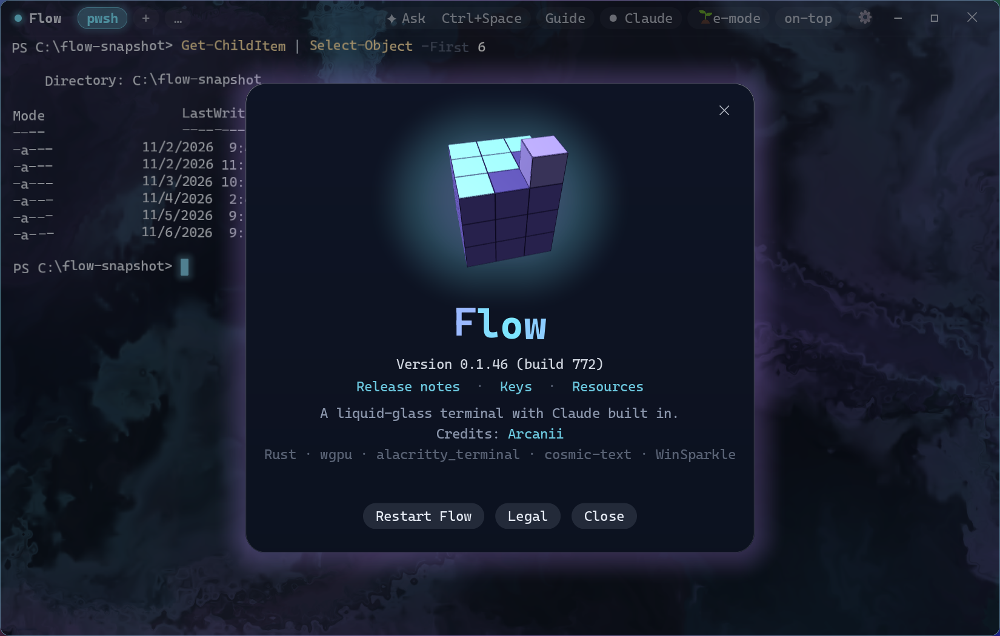

[← Flow's manual](../../README.md#documentation)

# Version and updates

The About dialog shows Flow's cube rolling out its F, after
`flow-demo cube` (see [Demos](demos.md)): a glossy small cube drops, bouncing,
onto a purple floor and rolls across it, lighting the squares it lands on,
until the floor turns out to be the top of a big cube, which jumps as it
shows. Flow draws it as a 3D model each frame, with a glaze on it, from the
moment the dialog opens. Beside the version, **Release notes** opens its
release's page on GitHub, with what's new in it (each OS's: `v0.1.27-macos`,
`v0.1.27` for Windows, `v0.1.27-linux`); a Flow built from source, which
has no updater and may be of a version not out yet, opens the list of
releases. **Resources**, beside it, shows what each tab uses, as the card
under a tab does (below). Under the tagline, the credits' **Arcanii** opens
the GitHub page of Arcanii, who make Flow (`github.com/arcanii`). On Linux the version's line ends with the window
system the window is on, **Wayland** or **X11**, its logo before its name
(Wayland's yellow disc, or the X in the text's color), glowing so it shows
on the glass: Flow takes Wayland where
the desktop has it, and started with `WAYLAND_DISPLAY` unset it's on X11
(XWayland, under a Wayland desktop). It shows the version as `0.1.0 (build N)`:

- `0.1.0` is the marketing version, `version` under `[workspace.package]` in
  the root `Cargo.toml`. A patch release adds a fourth number, `patch` under
  `[workspace.metadata.flow]` (`0.1.0.1`), which goes back to 0 when the
  version goes up. Only people see it: the updaters still compare `0.1.0` and
  the build number.
- A build of work toward a version not out yet says so: `0.1.40.DEV (build
  N)`. The version goes up to the next as soon as one is released, with
  `dev = true` under `[workspace.metadata.flow]`, and releasing sets it to
  false. Programs asking Flow its version (`TERM_PROGRAM_VERSION`,
  XTVERSION) and flowapp's catalog get `0.1.40` alone, and About's
  **Release notes** opens the list of releases.
- The build number is the git commit count plus a fixed offset
  (`build_offset` in `Cargo.toml`), so it rises with every commit and is the
  same for anyone who builds that commit.
  - `core/build.rs` stamps both into the app.
  - The root `build.rs` stamps them into the exe's file version (`0.1.0.N`),
    which WinSparkle compares against the update feed.
  - Flow.app carries them as `CFBundleShortVersionString` (`0.1.0`) and
    `CFBundleVersion` (`N`), and Sparkle compares `N` against the macOS feed.
    `flow --version` prints both.

Releases and the signed update feeds are published apart from the source,
in [arcanii/Flow-releases](https://github.com/arcanii/Flow-releases), which
every installed Flow reads its updates from.

Only Flow's own releases update themselves. A Flow you build from source
(`cargo build --release`), a fork's among them, has no updater, so it
never offers Flow's release in place of what you built: About and the
menus show no update check. The release scripts build with updates
(`FLOW_UPDATES=1`) only with Flow's update key at hand, the key every
update is signed with: on the Mac the login Keychain's, on Windows the key
file, and on Linux, whose tarballs are signed on the Mac, when told
`--updates`. A release made without it stops, unless it's told
`--no-updates` (`-NoUpdates` on Windows) for one that never updates
itself. `FLOW_SAY_UPDATES=1 flow --version` says which a build is, on a
second line, `updates: on` or `updates: off`.
[windows/RELEASING.md](../../windows/RELEASING.md) covers a Windows release: the
installer, Flow's update key (used to sign on Windows or the Mac), and the
appcast. [macos/RELEASING.md](../../macos/RELEASING.md) covers a macOS one: Flow.app,
signing and notarizing, the DMG, and its appcast. [linux/RELEASING.md](../../linux/RELEASING.md)
covers a Linux one: the tarballs, signing them on the Mac, and an appcast for
each architecture, which Flow's own updater reads (there's no Sparkle on
Linux).
